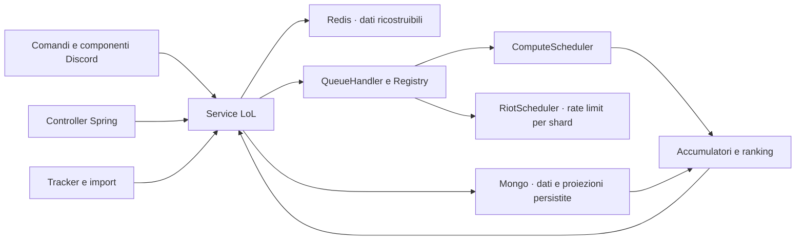

# Revisione del core League of Legends

Branch `the-dashboard` a `94f8d16d`, confrontato con `main` a `bf0f9d77`.

Il refactor più utile per LoL è dare a Discord, HTTP e tracker un percorso condiviso verso lo stesso dato: stessa identità, un proprietario della scrittura, proiezioni ricostruibili e un solo lavoro in corso per risultato. Il problema più urgente è che alcuni flussi scrivono più rappresentazioni dello stesso fatto e, se si interrompono, il retry può scambiare la prima rappresentazione per un'operazione conclusa. Subito dopo viene il lavoro ripetuto nelle letture, anche con Redis caldo.

Il branch ha migliorato i confini dei package, la traduzione degli errori HTTP e il riuso delle conversioni. La maggior parte dei cambiamenti nei servizi LoL è costituita da import, nomi e pulizia locale. La coda e i principali percorsi di aggregazione sono in larga parte ereditati. Riconoscendo i rename, `MongoDB.java` passa da 4.430 a 4.349 righe con similarità Git del 98%. La regressione di processo è concreta: il diff dei test contiene **84 file rimossi e 20 aggiunti**. Tra i rimossi ci sono **51 sotto `src/test/java/com/safjnest/lol`**, oltre a test Mongo, Redis e HTTP LoL. I 207 test del checkout attuale passano su Java 25 e coprono soprattutto il lavoro Beebot. I file di partenza per i contratti LoL sono ancora recuperabili da `main`. [Piano Beebot](repository-review.md) · [Contratti LoL](README.md)

## Cosa trasferire da GuildCache

| Regola di Beebot | Applicazione a LoL |
|---|---|
| Un ingresso condiviso per bot e dashboard | Stesso service e scheduler per un miss. Discord può attendere lo stesso future per comporre l'embed. HTTP può continuare a rispondere `202` o parziale. |
| Un'identità stabile per operazione | PUUID, match ID completo o scope champion risolto una volta. Derivare da lì identità Mongo, cache Redis e deduplicazione. |
| Singolo e bulk seguono lo stesso contratto | Mantenere il batch delle statistiche già in `ProfileService`, riusare il batch dei rank in inserimento match, aggiungere batch mirati per live game solo dove mancano davvero. |
| Pubblica dopo il salvataggio riuscito | Per timeline, facets, rank e proiezioni definire anche cosa accade quando la seconda scrittura fallisce o il processo si ferma. |
| Snapshot personale o derivato separato dalla mutazione | `SummonerView`, `MatchPage` e `ChampionView` restano le rappresentazioni canoniche. Rendere le proiezioni ripetibili e tenere separato il lavoro mutabile degli accumulatori. |
| Il lock ha vita e granularità note | Per LoL riusare `Registry` per i job e un coordinamento breve per i miss di sola lettura. A cache locale servono soprattutto piccoli cataloghi condivisi. Una cache di `Match` o `Summoner` mutabili allargherebbe il problema di coerenza tra Redis, Mongo e worker. |



Il riuso più riuscito è già nella repo. Lo scheduler separa I/O Riot, orchestrazione e calcolo pesante. Mongo ha cursori chiusi in try-with-resources e join in batch per timeline. `ProfileAnalyzer.ProfileRefreshAccumulator` alimenta statistiche, attività e matchup con la stessa visita. I record canonici, il dettaglio match separato dalla lista, l'accesso ordinato a `competitive` e la pubblicazione Redis tramite chiave temporanea hanno responsabilità riconoscibili. Terrei queste basi. [Scheduler](adr/0014-global-job-scheduler.md) · [Accumulatori e build](adr/0012-profile-and-champion-analysis-facades.md) · [Ranking](adr/0015-contextual-ranking.md)

## Prima fase — correttezza e possibilità di ripetere un'operazione

### 1. Match, timeline e facets possono divergere

`MongoDB.insertMatch` scrive il match con `$setOnInsert`, quindi scrive timeline e facets. Una caduta dopo la prima operazione lascia il canonico visibile. Il successivo `insertMatch` si ferma perché l'ID esiste. `MatchService.fetchAndInsert` può ritornare prima ancora di riprovare l'inserimento, perché trova quel match. Nel percorso di tracking, `upsertMatch` ha un ordine diverso, match più facets e poi timeline. Anche i summoner dei partecipanti sono aggiornati separatamente. È un difetto del percorso di ripresa. La frequenza effettiva richiede i dati Mongo. [MongoDB.insertMatch](../../src/main/java/com/safjnest/database/nosql/MongoDB.java#L2589) · [MatchService.fetchAndInsert](../../src/main/java/com/safjnest/lol/service/MatchService.java#L501) · [Tracker](../../src/main/java/com/safjnest/lol/tracker/Tracker.java#L186) · [Proiezione facets](../mongo/15-match-facets-projection.md)

**Proposta.** In `MongoDB` dare alla scrittura canonica e alle sue proiezioni un esito persistito per ID. Con transazioni supportate dal deployment, valutare una sola transazione per match, timeline e facets. Altrimenti marcare la proiezione da completare e rendere ripetibili gli upsert delle componenti. Distinguere timeline disponibile, assenza confermata e lookup da ripetere. Se il match è già tracciato, la riparazione deve preservare la versione canonica del rank e la timeline già salvata. Tenere l'arricchimento dei summoner come lavoro ripetibile con un esito proprio.

Esempio del percorso da centralizzare in `MatchService`. I metodi di persistenza sono proposte e vanno implementati con le garanzie sopra.

```java
private static Match persistImportedMatch(Match match) {
    MongoDB.MatchWrite write = MongoDB.storeOrResumeMatch(match);

    if (write.projectionsChanged())
        invalidate(write.match().gameId, write.match().leagueShard);

    return write.match();
}
```

`storeOrResumeMatch` sostituisce l'early return «ID esistente» nel percorso di ripresa. Prova richiesta: interrompere dopo ognuna delle tre scritture, ripetere lo stesso ID e confrontare dettaglio HTTP, match list, total facets e stato del tracker. Due inserimenti paralleli devono convergere. Una timeline realmente assente deve arrivare a esito terminale.

### 2. Le statistiche incrementali si perdono partite importate in ritardo

`ProfileService.generateStatistics` usa `statistics.timeEnd + 1` come watermark. Mongo lo applica a **`timeStart` della partita**. Esempio: partita A salvata e aggregata fino a 2.000, partita B importata più tardi con inizio a 1.500. L'incrementale costruisce `timeStart >= 2001` e non vede mai B. Lo stesso problema può toccare la correzione di campi su una partita già aggregata. La data della partita controlla l'inclusione nel filtro, mentre l'ordine di acquisizione controlla ciò che il calcolo ha già letto. Sono due informazioni diverse. [ProfileService.generateStatistics](../../src/main/java/com/safjnest/lol/service/ProfileService.java#L184) · [MongoDB.buildMatchFilter](../../src/main/java/com/safjnest/database/nosql/MongoDB.java#L3780) · [Owner delle statistiche](profile-statistics-source-of-truth.md)

**Proposta.** Prima correzione verificabile: rebuild per i profili interessati da backfill o correzioni; usare `generateStatistics(..., true)` attraverso il compute esistente. Per una soluzione permanente far registrare al match writer le revisioni delle sorgenti che obbligano a un rebuild. Una revisione deve coprire anche le modifiche che spostano il match fra scope. La generazione fissa una revisione di input e la salva insieme al risultato. Un import concorrente lascia il profilo nuovamente da aggiornare. L'incrementale richiede una sorgente monotona di nuovi inserimenti e una gestione esplicita di correzioni e deduplica; l'orario del match rimane il filtro temporale.

```java
boolean rebuild = requestedRebuild || sourceRevision.requiresRebuildSince(savedRevision);
ProfileStatistics statistics = rebuild
    ? new ProfileStatistics(filter.timeStart())
    : savedStatistics;
```

`sourceRevision` e `savedRevision` rappresentano il contratto proposto. Verifica confrontando un rebuild completo con ingressi in ordine, fuori ordine, ripetuti e con cambio di lane/rank. Testare anche import storico mentre due refresh dello stesso scope sono in volo.

### 3. Refresh indipendenti aggiornano le stesse proiezioni

`ComputeScheduler` deduplica `profile-refresh:<puuid>` separatamente da statistiche, attività, matchup e record. Può quindi esserci più di un writer per la stessa identità persistita. Anche `rebuild` e aggiornamento incrementale delle statistiche condividono la chiave attiva, mentre il body cattura il valore iniziale di `rebuild`. La promozione di priorità non cambia il body del job già registrato. `ProfileService.refreshProfile` scrive statistiche, attività, matchup e record separatamente e aggiorna Redis solo se tutti riportano successo. In caso di errore intermedio Mongo può aver già aggiornato singoli componenti e Redis continuare a servire la versione precedente. [ComputeScheduler](../../src/main/java/com/safjnest/lol/queue/scheduler/ComputeScheduler.java#L248) · [ProfileService.refreshProfile](../../src/main/java/com/safjnest/lol/service/ProfileService.java#L242)

**Proposta.** Coordinare gli aggiornamenti per identità della proiezione. Il refresh composto deve condividere quella regola con quello singolo. Preservare le richieste di rebuild arrivate su un job incrementale già avviato, ad esempio rendendole un secondo passaggio. Un risultato più vecchio non deve sovrascrivere quello appena pubblicato. Se il contratto rimane per componente, pubblicare e invalidare ciascuna proiezione dopo il relativo commit. Se si vuole esporre un insieme atomico serve un'unica generazione pubblicata, con una decisione di contratto esplicita. Testare refresh composto in concorrenza con GET, errore dopo ogni scrittura e richieste duplicate con priorità diversa.

### 4. Rank, mastery e leaderboard hanno più stadi di pubblicazione

`RankService` distingue correttamente un aggiornamento per coda da uno snapshot Riot completo. Mantenerlo. Oggi, però, aggiorna il rank canonico, pubblica Redis e aggiorna `competitive` in operazioni separate. Un errore in `CompetitiveService` può lasciare il rank già visibile e leaderboard o overview indietro. `MasteryService.save` persiste masteries e aggiorna anche il record mastery, con invalidazione del profilo che dipende dal chiamante. `SummonerService.hydrate` poi usa i setter operativi per comporre l'oggetto restituito e riscrive la cache identità, anche se rank e mastery sono `@JsonIgnore` su `Summoner`. La factory `Summoner.hydrated` mostra già come costruire la rappresentazione in memoria senza modifiche pendenti. [RankService.publishRanks](../../src/main/java/com/safjnest/lol/service/RankService.java#L190) · [MasteryService.save](../../src/main/java/com/safjnest/lol/service/MasteryService.java#L164) · [SummonerService.hydrate](../../src/main/java/com/safjnest/lol/service/SummonerService.java#L574) · [Summoner](../../src/main/java/com/safjnest/lol/model/summoner/Summoner.java#L54)

Esempio di composizione pura. I getter e la factory esistono. Prima di sostituire `hydrate`, verificare i chiamanti che usano i campi di un `Summoner` già caricato e le precedenze in caso di errore Riot.

```java
private static Summoner withComponents(
    Summoner identity, Map<GameQueueType, Rank> ranks, List<Mastery> masteries
) {
    return Summoner.hydrated(
        identity.puuid(), identity.riotId(), identity.region(),
        identity.level(), identity.icon(), identity.userId(), identity.tracking(),
        ranks, masteries
    );
}
```

Conservare il write canonico in `RankService` e `MasteryService`. Rendere recuperabili per PUUID le proiezioni competitive e record dopo un fallimento e invalidare le viste dipendenti dal componente salvato. Testare anche «Riot ha confermato una lista vuota» e «Riot non ha risposto». I due esiti devono rimanere distinguibili.

## Seconda fase — togliere lavoro dal percorso di lettura

### 5. Profilo Redis caldo con lavoro da profilo freddo

Su cache hit di `SUMMONER_OVERVIEW`, il codice riprende l'identità e qualche fallback, poi rilegge stats, rank e mastery, risolve posizioni e ricompone il profilo. `isStale` chiede `lastSeen` a Mongo anche per un aggregato appena calcolato. Nella stessa richiesta il controllo può essere invocato due volte. `ProfileStatistics.hasLeafStatistics` esegue anche `finish()`, che ricalcola totali e liste. `SummonerOverview.from` lo rifà e usa `putIfAbsent(championId, champion(championId))`: Java valuta il secondo argomento anche quando la chiave esiste. L'overview Redis conserva una pagina sotto PUUID senza filtro, pur ricevendo viste che possono dipendere dal filtro. Il codice rilegge le statistiche filtrate, ma riusa anche il dizionario dei champion della vista precedente. [ProfileService](../../src/main/java/com/safjnest/lol/service/ProfileService.java#L314) · [ProfileStatistics](../../src/main/java/com/safjnest/lol/model/statistics/ProfileStatistics.java#L43) · [SummonerOverview](../../src/main/java/com/safjnest/lol/model/summoner/SummonerOverview.java#L24)

Esempio di modifica piccola applicabile al codice attuale. I risultati freschi sotto la soglia minima di 30 giorni ottengono lo stesso esito senza I/O per `lastSeen`.

```java
static boolean isStale(String puuid, long lastUpdate) {
    if (puuid == null || puuid.isBlank())
        return true;

    long now = System.currentTimeMillis();
    if (lastUpdate > 0 && now - lastUpdate < STALE_BASE_MILLIS)
        return false;

    return isStale(puuid, lastUpdate, MongoDB.findSummonerLastSeen(puuid), now);
}
```

Per il dizionario, preservando completamento lazy ed eventuale fallback:

```java
for (Integer championId : championStats.keySet())
    championMap.computeIfAbsent(championId, SummonerOverview::champion);
```

Poi calcolare freschezza una volta per richiesta e passare l'esito alla composizione. Scegliere cosa rappresenta `SUMMONER_OVERVIEW`: pagina completa con identità comprensiva del filtro e invalidazione coerente, oppure componenti/cache più piccole e composizione esplicita. In quest'ultimo caso può bastare il Redis delle componenti esistenti. Tenere le posizioni contestuali dinamiche come da contratto. Obiettivo verificabile: un profilo fresco e caldo non legge Mongo per stabilire se è fresco. Verificare anche che due filtri con lo stesso PUUID restituiscano lo stesso JSON dei rispettivi percorsi a cache fredda.

### 6. Live game e import match fanno lookup per partecipante

`SummonerService.profileOverviews` legge identità, rank, mastery e stats per ogni partecipante. `MatchService.localRanking` fa un accesso Mongo per partecipante; esiste già `findRanksByPuuid`, che raggruppa gli ID e recupera la coda selezionata. Anche l'inserimento dei summoner durante un import opera per partecipante. Prima di aggiungere cache, riusare i batch che esistono e misurare i round trip. In live game l'arricchimento può leggere gli snapshot in bulk e accodare solo le statistiche mancanti con la politica corrente. [Live game](../../src/main/java/com/safjnest/lol/service/SummonerService.java#L521) · [Rank del match](../../src/main/java/com/safjnest/lol/service/MatchService.java#L478) · [Lookup rank bulk](../../src/main/java/com/safjnest/database/nosql/MongoDB.java#L1215)

```java
List<String> puuids = new ArrayList<>();
for (Participant participant : match.participants) {
    if (participant != null && participant.puuid != null && !participant.puuid.isBlank())
        puuids.add(participant.puuid);
}

Map<String, Rank> ranks = MongoDB.findRanksByPuuid(puuids, match.leagueShard, queue);
```

Il corpo di `localRanking` userebbe `ranks.get(participant.puuid)`. Prima del merge, allineare la semantica di «documento senza ranks», «rank presente senza questa coda», record storici senza regione e coda senza rank canonico tra lettura singola e bulk. Riusare `ProfileService.getStatistics(List, …)` e `MongoDB.findSummonersByPuuids` per il live dopo avere verificato i filtri per shard. Verifica: stessa media e stessi rankProgress, insieme a query Mongo confrontate con 10 o 16 partecipanti.

### 7. Champion caldo legge l'intero documento statistiche

`ChampionService.get` legge e deserializza il documento di scope di **tutti i champion** per ricavarne `updatedAt` prima di consultare `CHAMPION_PAGE`. Esegue anche il lookup del timestamp build e ricalcola il ranking dei matchup su hit. Su miss `compose` può rileggere lo stesso scope. Il ramo build standard converte inoltre qualunque `RuntimeException` Mongo in lista vuota quando `allowCompute=false`, indirizzando la richiesta verso riscaldamento/job anche quando il dato è indisponibile per errore. [ChampionService.get](../../src/main/java/com/safjnest/lol/service/ChampionService.java#L90) · [MongoDB.findChampionStatsDocument](../../src/main/java/com/safjnest/database/nosql/MongoDB.java#L3100) · [ChampionBuildEngine.loadBuilds](../../src/main/java/com/safjnest/lol/service/ChampionBuildEngine.java#L51)

**Prima modifica.** Risolvere freschezza da una proiezione Mongo con `updatedAt` e `ready`, oppure riusare il documento già letto su miss. **Seconda modifica.** In `ChampionService` conservare timestamp distinti per statistiche e build della pagina Redis, in un record annidato di cache. La risposta resta `ChampionView`. Quando il ranking è indipendente dalla richiesta, comporlo una volta per revisione. I costruttori di pagine possono usare una combinazione di timestamp al posto di scansioni o invalidazioni per ogni chiave di pagina. Prima di adottare un hit senza Mongo, verificare tutti i writer di scope e build, compresi import, refresh matrice e Arena.

```java
private record CachedChampionPage(
    ChampionView page, long statsLastUpdate, long buildLastUpdate
) {}

private ApiResult<ChampionView> response(CachedChampionPage cached, Filter filter) {
    boolean statsStale = isStale(cached.statsLastUpdate());
    boolean buildStale = isStale(cached.buildLastUpdate());
    if (statsStale || buildStale)
        ComputeScheduler.startChampionData(filter, statsStale, buildStale);

    ResponseMetadata metadata = ResponseMetadata.of(
        oldest(cached.statsLastUpdate(), cached.buildLastUpdate()),
        statsStale || buildStale, filter);
    ChampionView page = new ChampionView(
        cached.page().champion(), cached.page().stats(), cached.page().build(), metadata);

    return ApiResult.ready(page, metadata);
}
```

Esempio di risposta da snapshot proposto, successivo alla validazione della revisione o finestra di freschezza. Mantenere lo status e i metadata reali su vecchi payload, risultati vuoti, errore Mongo e aggiornamento indipendente Arena/standard. Validare anche tier list quando cambia uno dei suoi scope sorgente.

### 8. Chiavi, filtri e serializzazione devono avere confini espliciti

`Filter` è mutabile, il costruttore pubblico incorpora patch e split correnti e coesistono chiavi di stato, pagina, build e profilo. Hanno già semantiche diverse. Il codice si difende con `Filter.fromStateKey(filter.toStateKey())` prima di mettere i job in coda. Copiare un oggetto per serializzarlo e rileggerlo introduce allocazioni e fa dipendere uno snapshot Java dal formato Discord. Conservare i formati esistenti e portare la copia diretta in `Filter`; migrare a un valore immutabile solo dopo aver coperto tutte le factory e il binding JSON. In particolare, due periodi producono la stessa chiave build ma chiavi profilo e pagina distinte. Aggiungere un campo al filtro richiede una decisione su quali insiemi di dati quel campo cambia. [Filter](../../src/main/java/com/safjnest/lol/model/Filter.java#L258) · [ComputeScheduler](../../src/main/java/com/safjnest/lol/queue/scheduler/ComputeScheduler.java#L257)

```java
public Filter snapshot() {
    return new Filter(false)
        .setChampion(champion)
        .setLane(lane)
        .setQueue(queue)
        .setRank(rank)
        .setRankBehavior(rankBehavior)
        .setPatch(patch)
        .setRegion(region)
        .setOpponent(opponent)
        .setDuo(duo)
        .setPeriod(timeStart, timeEnd);
}
```

Dentro `Filter`, il body usa membri e metodi esistenti. Come passo successivo, Mongo può avere mapper privati per proiezioni specifiche. Oggi BSON, strutture generiche e `QueryRecord` attraversano alcuni confini di analisi, specialmente nelle build standard e negli aggregati. Un record di input annidato nel proprietario del calcolo è giustificato quando ha i campi minimi e sostituisce un passaggio reale. Eviterei un secondo `Match`, `Rank`, `Mastery` o un DTO Spring speculare. Il mixin Arena in `LolApiConfig` governa la forma HTTP e merita prove JSON, insieme ai documenti Mongo storici. L'estensione di `AbstractEntity` in `Summoner` e `Match` va trattata per comportamento: prima separare composizione da scrittura e misurare quanto viene allocato. [Provider champion](../../src/main/java/com/safjnest/lol/champion/ChampionStatsProvider.java) · [Serializzazione HTTP](../../src/main/java/com/safjnest/spring/config/LolApiConfig.java) · [AbstractEntity](../../src/main/java/com/safjnest/database/nosql/AbstractEntity.java#L10)

### 9. Redis ha intenzioni diverse sotto la stessa regola dei 60 secondi

`RedisKey` offre un solo posto dove leggere la policy, cosa da conservare. Il valore effettivo è però 60 secondi per quasi tutte le chiavi positive, comprese le facets dichiarate a 10 secondi e le cache dichiarate a ore. Le chiavi permanenti e i tre casi speciali hanno un comportamento diverso. L'ADR parla di namespace `ls` e assenza di versioni; il sorgente usa `los` e ha `rank-history:v2`. È drift documentale verificabile, preesistente al branch per questi pattern. La scelta del TTL dipende dal tipo di dato e la modifica delle chiavi ha costo operativo. [RedisKey](../../src/main/java/com/safjnest/database/redis/RedisKey.java#L30) · [ADR cache](adr/0008-endpoint-cache-and-async-lookups.md)

Separare nel contratto effettivo TTL di dato ricostruibile, cooldown operativo, lock e durata dei segmenti. Misurare hit, dimensione serializzata e chiavi per famiglia. Fare un cambio alla volta, con lettura di dati storici e invalidazione dopo commit. Evitare di aumentare il TTL di un risultato che oggi è coerente solo perché scade presto. `CacheInvalidationService.clearRedis` è quasi un alias di `RedisClient.delete`; tenere nello strato LoL solo l'invalidazione che conosce le dipendenze, per esempio match, history, profilo o scope champion. Riassorbire `clearMatchHistory` nel proprietario `MatchService` solo dopo che sono stati migrati tracker e comandi, conservando esattamente count, indice, coda e tipo nella chiave.

## Terza fase — raggruppamento, analisi e build

### 10. Discord e API champion avviano lo stesso calcolo da due ingressi

L'endpoint chiama `ChampionService.compose`, legge gli aggregati e mette i miss in `ComputeScheduler`. Il comando Discord chiama separatamente `getStatistics(filter)` e `getBuild(filter)`; le overload con `allowCompute=true` possono calcolare sul chiamante, inclusa la build standard con persistenza diretta e Arena via il suo percorso di refresh. L'impatto di una richiesta fredda è quindi diverso. Il dispatch esistente ha già la possibilità di accorpare build con matrice in coda e deduplicare per scope. [Comando Champion](../../src/main/java/com/safjnest/bot/commands/lol/Champion.java#L86) · [ChampionService.compose](../../src/main/java/com/safjnest/lol/service/ChampionService.java#L504) · [ComputeScheduler](../../src/main/java/com/safjnest/lol/queue/scheduler/ComputeScheduler.java#L138)

Esempio per il comando, mantenendo il suo `Filter` completo e lo stesso metodo di rendering. Il metodo proposto ritorna il future del lavoro già registrato da `ComputeScheduler` e poi rilegge le componenti persistite. L'HTTP conserva risposta immediata e stato attuale.

```java
CHAMPION_SERVICE.getOrQueue(filter).whenComplete((page, failure) -> {
    if (failure != null) {
        replyWithExistingError(event, failure);
        return;
    }

    renderExistingEmbed(event, page);
});
```

`getOrQueue`, `replyWithExistingError` e `renderExistingEmbed` indicano il nuovo collegamento e l'estrazione della presentazione esistente. Il filtro Discord conserva opponent e duo. Togliere la variante che calcola inline solo dopo aver migrato anche refresh manuali e consumatori indiretti. Prova: GET e comando simultanei con stessa build fredda producono una sola elaborazione fisica, stesso contenuto e stessi esiti previsti. Le opzioni dei due ingressi non sono perfettamente sovrapponibili e vanno normalizzate solo dove selezionano gli stessi dati.

### 11. La scansione champion è condivisa, il lavoro per match si moltiplica

`ChampionAnalyzer.recomputeMatrixCoalesced` fa bene a leggere una volta per patch e coda e riusare la matrice per gli scope. Dentro quella visita, però, prova tutte le build standard richieste a ogni documento e tutte le build Arena quando presenti. Per le standard ripassa da `MongoDB.championBuildRecords` per ciascun accumulatore. Lo scope potrebbe avere molti accumulatori, e ognuno trattiene contatori di firme e combinazioni distinte fino alla fine. I batch Mongo limitano gli input in memoria, mentre la cardinalità reale degli accumulatori rimane indipendente dalla dimensione del batch. [ChampionAnalyzer](../../src/main/java/com/safjnest/lol/service/ChampionAnalyzer.java#L238) · [ChampionBuildEngine](../../src/main/java/com/safjnest/lol/service/ChampionBuildEngine.java#L150) · [Lettore Mongo](../../src/main/java/com/safjnest/database/nosql/MongoDB.java#L1915)

**Proposta.** Indicizzare prima gli accumulatori per champion. Decodificare metadati e partecipanti una volta per match. Per ciascun champion presente passare solo ai suoi scope candidati. Conservare il filtro di eligibility per build e le regole dei conteggi statistiche. In Arena tenere la distinzione fra rank, regione, patch esatta e major. Pseudocodice tipizzato del dispatch, da applicare dentro la matrice esistente:

```java
for (BuildInput participant : projectedParticipants) {
    List<BuildAccumulator> candidates = buildsByChampion.get(participant.champion());
    if (candidates == null)
        continue;

    for (BuildAccumulator candidate : candidates) {
        if (accepts(candidate.filter(), matchMetadata, participant))
            ChampionBuildEngine.accept(candidate, participant.game());
    }
}
```

I nomi di lookup e della proiezione sono illustrativi. `BuildInput` rappresenta metadati del partecipante e il `ChampionBuildData.Game` esistente. Quest’ultimo non contiene champion né lane. Prima di estrarlo verificare quali parti della firma dipendono ancora dal filtro e mantenere quelle parti nello scope dell’accumulatore. Un match normale alimenta solo gli accumulatori dei champion giocati. Il guadagno dipende dal numero di filtri effettivamente accorpati. Confrontare build complete, games/wins, ordine, tie-break e dimensione BSON su fixture con remake, ruoli, timeline assente e più scope. Ricontrollare con JFR le allocazioni per match.

### 12. Calcolo, persistenza e mapping nella stessa classe

- **`ChampionAnalyzer`** miscela lettura, raggruppamento, proiezione, trend, mapping e scrittura. Lasciare in `ChampionAnalyzer` accumulo e proiezione di uno scope, con un risultato tipizzato. `ChampionService` invoca la sorgente Mongo, pubblica uno scope alla volta, gestisce invalidazione e progressi. Una callback per scope evita di trattenere tutti i documenti finiti insieme. Il proprietario delle query resta `MongoDB`. [ChampionAnalyzer](../../src/main/java/com/safjnest/lol/service/ChampionAnalyzer.java#L291)
- **`ChampionBuildEngine`** ha già `newAccumulator → accept → finish`, che è il pezzo da preservare. Spostare lettura, scrittura e decisione del miss verso `ChampionService`. Confrontare i due percorsi `recomputeAll` e `loadBuilds` perché fanno compute e salvataggio con chiamate diverse. Un errore Mongo non deve passare come build realmente vuota. [ChampionBuildEngine](../../src/main/java/com/safjnest/lol/service/ChampionBuildEngine.java#L35)
- **`ArenaChampionAnalyzer`** deve rimanere specializzato. La build Arena è boots più primo Prismatic, con attributi e fallback propri. Riutilizzare il contenitore puro e il ciclo di pubblicazione, mantenendo separati gruppi, campioni, denominatori, placement e distinzione tra timeline mancante e core mancante. [Contratto Arena](../arena-build/contracts.md)
- **`ProfileAnalyzer`, `ProfileStatistics`, `ProfileActivity`, `ProfileMatchups`** condividono già la visita nel refresh. Lo stesso refresh poi passa da `ProfileRecordService.generate` per un'altra scansione. Integrare i record nell'accumulo condiviso soltanto se i campi minimi, finestre, regole di inclusione e disponibilità degli eventi corrispondono. Per richieste singole di attività o record, tenere proiezioni leggere. Spostare fuori da `hasLeafStatistics` il calcolo di `finish` e definire quando viene invocato nel flusso. [ProfileAnalyzer](../../src/main/java/com/safjnest/lol/service/ProfileAnalyzer.java#L63) · [Refresh profilo](../../src/main/java/com/safjnest/lol/service/ProfileService.java#L242) · [Record](../../src/main/java/com/safjnest/lol/service/ProfileRecordService.java#L76)
- **`MatchupRankingAnalyzer` e `ChampionTierAnalyzer`** hanno motivi diversi per esistere. Il primo produce ranking su relazioni a partire da campioni e metriche; il secondo interpola i risultati dei ruoli e degli scope. Non unificherei gli algoritmi. Una revisione di calcolo dovrebbe fissare esempi con soglie e denominatori, match piccoli, pareggi e metriche assenti, poi verificare che una riorganizzazione mantenga valori e ordine. Le funzioni pure sono un buon punto per riattivare le fixture di `main`. [Ranking matchup](../../src/main/java/com/safjnest/lol/service/MatchupRankingAnalyzer.java) · [Tier list](../../src/main/java/com/safjnest/lol/service/ChampionTierAnalyzer.java)
- **`ProfileRecordAnalyzer` e `ProfileRecordService`** hanno già separazione accumulo/lettura sensata. L'overview globale fa una query per metrica. Il profilo con zero record può riaccodarsi a ogni lettura dopo il completamento del job, perché «zero righe» coincide con il miss. Il modello delle build champion ha già il precedente di `ready-empty`. Riutilizzare il principio con un esito di generazione per PUUID e filtro, preservando l'API di risposta. Per il top 5 per metrica confrontare il costo di letture indicizzate separate con una proiezione già pronta, prima di aggregarle tutte in una query. [ProfileRecordService](../../src/main/java/com/safjnest/lol/service/ProfileRecordService.java#L30) · [Persistenza record](../../src/main/java/com/safjnest/database/nosql/MongoDB.java#L2954)

Esempio di proprietà del flusso, partendo dagli accumulatori esistenti:

```java
private boolean rebuildStandardBuild(Filter filter) {
    ChampionBuildEngine.BuildAccumulator accumulator = ChampionBuildEngine.newAccumulator(filter);

    try {
        ChampionBuildProvider.forEachBatch(filter, batch -> {
            try {
                for (QueryRecord record : batch)
                    ChampionBuildEngine.accept(accumulator, record);
            } finally {
                MatchMemoryUtils.release(batch);
            }
        });

        List<Build> builds = ChampionBuildEngine.finish(accumulator);
        if (builds.isEmpty())
            builds = ChampionBuildEngine.emptyResult(filter);

        if (!MongoDB.upsertChampionBuilds(builds))
            return false;

        invalidate(filter);
        return true;
    } finally {
        accumulator.clear();
    }
}
```

L'esempio sposta il flusso standard nel service e conserva il rilascio del batch già applicato dal consumer. Prima di usarlo va verificato che l'invalidazione raggiunga tutte le pagine che dipendono dalla stessa build. Il reader e l'accumulatore Arena hanno un percorso proprio.

### 13. Il ranking rifà le medie dell'intero gruppo per ogni riga

`MatchupRankingAnalyzer` ripete lo stesso schema su matchup champion, sinergie per lane e matchup profilo. Per ogni riga e metrica ricalcola la media su tutte le righe del gruppo. Il helper ricostruisce anche il vettore delle metriche per ogni campione. Il costo del passaggio cresce come il quadrato delle righe del gruppo, a numero fisso di metriche, e produce array e liste temporanei. Il risultato oggi viene ricalcolato anche sulle pagine champion in cache. Qui c'è un intervento di calcolo piccolo e indipendente dalla cache. [MatchupRankingAnalyzer.rankChampionMatchups](../../src/main/java/com/safjnest/lol/service/MatchupRankingAnalyzer.java#L53) · [Ranking sinergie](../../src/main/java/com/safjnest/lol/service/MatchupRankingAnalyzer.java#L103) · [Medie](../../src/main/java/com/safjnest/lol/service/MatchupRankingAnalyzer.java#L267)

Esempio per il ramo champion. Estrae il vettore una volta per riga, calcola i momenti grezzi una volta per gruppo e riusa la media di ogni metrica. I momenti per lo score si calcolano ancora sulle metriche dopo lo shrink.

```java
List<double[]> adjusted = new ArrayList<>(values.size());
for (ChampionStatistics.Matchup value : values)
    adjusted.add(championMetrics(value));

Moments[] rawMoments = moments(adjusted);
for (int index = 0; index < values.size(); index++) {
    ChampionStatistics.Matchup value = values.get(index);
    double[] metrics = adjusted.get(index);
    int[] samples = championSamples(value);

    metrics[WINRATE] = TierMathUtils.shrinkRate(value.wins(), value.matches(), baseline, prior);
    for (int metric = 1; metric < METRIC_COUNT; metric++)
        metrics[metric] = shrink(metrics[metric], samples[metric], rawMoments[metric].mean(), prior);
}

Moments[] moments = moments(adjusted);
```

Il passaggio quadratico diventa lineare in righe × metriche. Il sort finale e la mediana restano, con la loro complessità. Conservare la stessa gestione di non-finiti, minGames, denominatori e pesi. Confrontare score e ordinamento prima/dopo su gruppi a una riga, molte righe, campioni mancanti e valori identici. `ProfileMatchups.withMinGames` crea le foglie che il ranking modifica. Proteggere quella precedenza prima di riusare snapshot in memoria.

### 14. Leaderboard, paginazione e ranking contestuale

Il bulk delle statistiche per shard di `buildPage`, il batch delle posizioni Redis e l'ordinamento deterministico Mongo sono buoni esempi di riuso. Il sorted set viene costruito per batch e promosso con rename. Rimane una finestra da coprire: un rank cambia mentre la temporanea si costruisce e il segmento finale ancora non esiste. `changeSegment` aggiorna la proiezione Redis solo se trova il segmento pubblicato. Il rename è atomico per il lettore, ma non riconcilia ciò che è cambiato durante la scansione. Verificare la race in un test con due connessioni. Una generazione di segmento può catturare un checkpoint e applicare rilettura o delta prima di pubblicare. `CompetitiveService` resta la fonte di ricostruzione. [LeaderboardService](../../src/main/java/com/safjnest/lol/service/LeaderboardService.java#L485) · [Pubblicazione Redis](../../src/main/java/com/safjnest/database/redis/RedisClient.java#L444) · [ADR ranking](adr/0015-contextual-ranking.md)

Gli snapshot scalari e hash sono già condivisi tramite `AggregateService`. Il servizio tuttavia conserva gli ID in `UNPUBLISHED` finché Redis non accetta pubblicazione o cancellazione. Dopo un guasto gli scope mai più letti possono restare nel set statico. È un secondo caso di retention condizionata, di sole stringhe. L'eviction alla cieca rischierebbe di servire un valore vecchio. Prima definire una riconciliazione sulla sorgente Mongo e la policy per gli scope invalidati. I 64 lock sono in numero fisso, ma `read` li tiene anche durante Redis, Mongo ed eventuale calcolo; due scope diversi possono collidere sullo stesso lock. Separare letture calde e deduplica dei miss conservando l'ordine write/invalidate. Verificare anche l'incremento concorrente a un rebuild dello snapshot. [AggregateService](../../src/main/java/com/safjnest/lol/service/AggregateService.java#L120) · [Persistenza aggregati](../mongo/16-aggregates.md)

Le pagine senza statistiche possono avviare un job per riga quando fredde. Su page cache hit la risoluzione delle posizioni rimane voluta dal contratto. Misurare il fan-out sui miss per scope prima di aggiungere altra concorrenza. La timeline di rank viene assemblata da sorgenti per stagione e ordinata in memoria. I profili con molte stagioni e pagine profonde sono i dataset da usare per confrontare byte, latenza e compatibilità. In match list impostare un tie-break di ordinamento su `_id` a parità di `timeStart` dopo aver controllato l'indice. Un cursore è una possibile estensione contrattuale futura; usare lo stesso ordinamento e mantenere offset finché il client lo richiede. [LeaderboardService.buildPage](../../src/main/java/com/safjnest/lol/service/LeaderboardService.java#L296) · [Rank history](../../src/main/java/com/safjnest/lol/service/MatchService.java#L308) · [Mongo match page](../../src/main/java/com/safjnest/database/nosql/MongoDB.java#L1313)

## Quarta fase — memoria, concorrenza e carico

### 15. Una cache locale trattiene cataloghi per tutta la vita del processo

`StaticDataService.PATCH_ITEMS` è una mappa statica che aggiunge il catalogo per ogni stringa di patch caricata con successo. Non ha un limite e non rimuove voci. Quei cataloghi sono raggiungibili dalla mappa per tutta la vita del classloader. Il GC non può liberarli. La cardinalità pratica dipende dalle patch effettivamente richieste e accettate, quindi da qui non segue un esaurimento della RAM in produzione. Inoltre `ItemUtils` tiene un riferimento ai current items e può memorizzare una mappa vuota se il primo caricamento fallisce. `PatchUtils` carica le versioni in un campo statico una sola volta. Una prova locale ha mostrato che `Filter.summoner(...)` può persino innescare Redis/Data Dragon tramite il costruttore di default prima di scartare la patch ottenuta. [StaticDataService](../../src/main/java/com/safjnest/lol/service/StaticDataService.java#L24) · [ItemUtils](../../src/main/java/com/safjnest/lol/utils/ItemUtils.java#L15) · [PatchUtils](../../src/main/java/com/safjnest/lol/utils/PatchUtils.java#L20) · [Filter](../../src/main/java/com/safjnest/lol/model/Filter.java#L55)

**Proposta.** Un proprietario dello snapshot del catalogo in `StaticDataService`. Caffeine è già nel progetto. Tenere una cache locale limitata per versione effettiva e scadenza, e scegliere il limite in base a peso e frequenza d'uso misurati. Risolvere l'alias major prima della cache locale solo dopo aver validato il comportamento del catalogo esatto e del fallback. `ItemUtils` e `ChampionUtils` continuano a possedere le rispettive operazioni sugli elementi; per il dato delegano alla sorgente condivisa. Separare la factory di un filtro esplicito dai default dipendenti dal tempo.

```java
private static final Cache<String, Map<Integer, Item>> PATCH_ITEMS = Caffeine.newBuilder()
    .maximumSize(MAX_CACHED_PATCHES)
    .expireAfterAccess(PATCH_CATALOG_IDLE)
    .build();

public static Map<Integer, Item> getItems(String patch) {
    if (patch == null)
        return getItems();

    String version = resolveRequestedVersion(patch);

    return PATCH_ITEMS.get(version, StaticDataService::loadExactItems);
}
```

`resolveRequestedVersion` e `loadExactItems` estraggono la risoluzione e il caricamento già in `getItems(String)`. Prima di cambiare la chiave Redis esistente, verificare hit per major ed exact patch. Una prova con due alias, una sostituzione di patch corrente e un errore al primo caricamento distingue correttezza da semplice eviction.

### 16. Il completamento dei job chiama i consumatori mentre tiene il lock globale

`Registry.completeBody` passa da `terminal` mentre è dentro il monitor. `terminal` completa il future lì dentro e contemporaneamente propaga l'esito ai genitori. Una continuazione sincrona può eseguire sullo stesso thread sotto quel lock. Il chiamante oggi concatena anche passaggi con I/O: `getSummonerAsync` può rileggere il profilo dopo un future Riot e `ProfileService.loadProfile` fa richieste successive. Un accesso lento in una continuazione può allungare il tempo in cui submit, promozioni e completamenti contendono lo stesso monitor. La prova locale con `Thread.holdsLock(registry)` ha confermato che una callback `thenApply` parte sotto il monitor. [Registry](../../src/main/java/com/safjnest/lol/queue/Registry.java#L246) · [SummonerService.getSummonerAsync](../../src/main/java/com/safjnest/lol/service/SummonerService.java#L79) · [ProfileService.loadProfile](../../src/main/java/com/safjnest/lol/service/ProfileService.java#L335)

**Proposta.** Sotto lock aggiornare stato, dedup, parent/follower e produrre una lista di notifiche. Rilasciare il lock prima di chiamare `CompletableFuture.complete`. Applicare lo stesso principio a successo, errore, cancel e worker release. Va preservata la garanzia dell'ADR: nessun future padre si completa prima che siano terminali tutti i discendenti. Una prova con callback deliberatamente bloccata deve lasciare l'inserimento di un job indipendente libero di avanzare. Aggiungere test su follower, promozione, callback conservate e shutdown prima di modificare il registry. [Contratto del registry](adr/0014-global-job-scheduler.md)

### 17. I virtual thread sono già usati. Il rischio è il volume in volo

`SyncScheduler`, le letture parallele della match list e i worker fisici usano già virtual thread. Il tracker può creare un Sync per account, con molte istanze, future e job Riot in attesa. `JobQueue` usa deque senza limite di capacità. La deduplica riduce i body ripetuti, ma ennesime sottoscrizioni a un job attivo possono creare follower nel registry. Il registry rimuove le entry quando terminali e rilasciate. C'è un percorso normale di pulizia. Un backlog crescente tiene invece quei riferimenti legittimamente vivi fino alla fine del lavoro. Il limite del JSON di status non limita il lavoro in memoria. [Tracker.retrieveSummoners](../../src/main/java/com/safjnest/lol/tracker/Tracker.java#L65) · [SyncScheduler](../../src/main/java/com/safjnest/lol/queue/scheduler/SyncScheduler.java#L32) · [JobQueue](../../src/main/java/com/safjnest/lol/queue/worker/JobQueue.java#L13) · [Registry](../../src/main/java/com/safjnest/lol/queue/Registry.java#L276)

Partire dal produttore più pesante. Nel tracker, paginare gli account per shard e mantenere una finestra limitata di job figli, conservando tracking indipendente per regione e il significato del job padre. I job che richiedono I/O Mongo o Riot hanno limiti distinti. Evitare un unico semaforo su tutta Sync: se parent e child usassero gli stessi permessi mentre il parent attende, si potrebbe bloccare il flusso. Un limite sul contratto generale Sync richiederebbe di rivedere l'ADR 0014. Nel calcolo CPU di matchups, tier list e build, introdurre più thread solo dopo aver misurato CPU, tempo di coda e heap. Più accumulatori contemporanei alzano il picco di memoria. [ADR scheduler](adr/0014-global-job-scheduler.md)

Nel percorso HTTP match, mantenere i due rami paralleli e rendere la query una sola identità tipizzata di normalizzazione. Aggiungere prima un coordinamento dei miss per chiave facets. Quando Redis scade, le richieste concorrenti a `/matches` e `/facets` possono entrambe avviare la stessa aggregazione. Per quella lettura basta condividere il future in corso e rimuoverlo su successo o errore. Il risultato continua nel Redis esistente. La proposta separa attesa del chiamante e vita della query condivisa.

```java
CompletableFuture<MatchFacets> loaded = new CompletableFuture<>();
CompletableFuture<MatchFacets> active = inFlight.putIfAbsent(key, loaded);
if (active != null)
    return active.copy();

try {
    executor.execute(() -> {
        try {
            loaded.complete(loadSavedOrCompute(puuid, query));
        } catch (RuntimeException | Error failure) {
            loaded.completeExceptionally(failure);
        } finally {
            inFlight.remove(key, loaded);
        }
    });
} catch (RuntimeException failure) {
    inFlight.remove(key, loaded);
    loaded.completeExceptionally(failure);
}
return loaded.copy();
```

Il frammento va in `FacetsService` come parte di una lettura asincrona con un executor di lettura scelto esplicitamente. `loadSavedOrCompute` è il flusso read-through attuale dopo normalizzazione. Il limite di ammissione per chiavi distinte, i timeout dell'I/O e la durata del future condiviso restano da definire insieme. Un timeout del singolo chiamante deve lasciare gli altri chiamanti indipendenti. Prima di riusare questo meccanismo altrove misurare l'aggregazione duplicata effettiva.

### 18. Picchi di memoria e allocazioni misurabili

| Sorgente | Cosa succede oggi | Prima misura |
|---|---|---|
| Matrice champion e build | I batch Mongo sono limitati e i contatori distinti restano vivi fino alla proiezione. Le firme possono crescere con le combinazioni osservate. | Heap dopo GC, allocazioni per match, numero di bucket e firme per patch, durata, dimensione BSON di output. |
| `MatchMemoryUtils.release` | Visita e svuota grafi mutabili. Può anticipare il distacco di riferimenti e ha un costo proprio. Se una vista conserva una parte del grafo, può alterarla. | JFR durante una matrice e fixture su ownership degli oggetti prima di sostituirlo con semplici confini di vita. |
| `findSeasonSummonerPuuids` e indexables | Il primo raccoglie tutti i PUUID di stagione prima del refresh. Gli indexables materializzano l'intera lista prima del JSON. | Cardinalità, byte di risposta e memoria con richieste concorrenti. Valutare iterazione per batch per job e cache snapshot o streaming per API a payload invariato. |
| Export training | Il cursor è chiuso e il JSON è streaming. Il batch è 10.000 documenti e ogni sample passa da una stringa JSON e da un flush. Un client lento tiene occupata la lettura più a lungo. | Byte per batch, durata del cursore, allocazioni e tempo con un consumer lento. Riutilizzare Jackson per scrittura incrementale e raggruppare i flush, mantenendo lo stesso oggetto JSON. |
| Redis | Timeline raw, detail, viste e componenti possono sovrapporsi. Alcuni contatori e segmenti sono persistenti. Sono consumo Redis, che si misura a parte dall'heap Java. | Memoria e TTL per famiglia, distribuzione della dimensione delle chiavi, hit/miss. |
| Mongo | Facets, record e statistiche sono proiezioni. Le statistiche per combinazione di filtro sono persistite. La famiglia di filtri ad alta cardinalità può aumentare i documenti. | Cardinalità per PUUID/filtro, occupazione e piano `explain`, separando spazio storage e cache WiredTiger. |

Per dire «leak JVM» servono crescita del live heap dopo GC a carico comparabile e un grafo di retention che indichi il proprietario del riferimento. I profili da confrontare sono idle, traffico API caldo, import, tracker e build matrix. Per le code misurare numero massimo di non terminali, età del più vecchio e ritorno a livello di base quando il carico finisce. Terrei il GC attuale durante la prova. Cambiarlo prima renderebbe difficile attribuire l'effetto del refactor. [MatchMemoryUtils](../../src/main/java/com/safjnest/lol/utils/MatchMemoryUtils.java#L20) · [Rebuild stagionale](../../src/main/java/com/safjnest/database/nosql/MongoDB.java#L1550) · [Export](../../src/main/java/com/safjnest/spring/controller/lol/AiTrainingController.java#L23)

## Tutte le rotte LoL censite

I path sono relativi a `/api/lol`. Il prefisso `/{shard}` si applica solo dove compare. Per ogni gruppo il controllo riguarda il comportamento al confine e il proprietario dei dati. [Contratti HTTP](../api/lol-api.md)

| Rotta | Proprietario e verifica del refactor |
|---|---|
| GET `/{shard}/profile/{puuid}` | `ProfileService`. Hit senza letture evitabili, filtro completo, componenti mancanti e freschezza. |
| GET `/{shard}/profile-by-name/{gameName}/{tagLine}` | Risoluzione `SummonerService`, poi stesso profilo; il cold miss deve continuare il lavoro quando si risolve il Riot ID. |
| POST `/{shard}/profile/{puuid}/refresh` | Oggi il controller attende `SummonerService.refresh().join()`, poi tocca lastSeen e accoda history. Ricondurre il comando a un use case in `ProfileService`; decidere se preservare l'attesa del contratto o aggiornare il contratto esplicitamente. |
| POST `/{shard}/profile/{puuid}/history` | `MatchService.queueMatchHistory`. Mantenere la differenza tra finestra recente e storico completo. Correggere ripresa e rescan delle proiezioni aggiornate. |
| GET `/{shard}/profile/{puuid}/matches` | `MatchService` e `FacetsService`. Una normalizzazione per pagina e total, offset e tie-break coerenti. Match canonici completi privi di eventi. |
| GET `/{shard}/profile/{puuid}/facets` | `FacetsService`. Preservare filtri disgiuntivi, multi-selezione e conteggio della pagina. Condividere i miss equivalenti. |
| GET `/{shard}/profile/{puuid}/rank-history` | `MatchService` e `RankProgressUtils`. Testare fonte per stagione, patch, confini temporali, ordinamento e progressioni ripristinate. |
| GET `/{shard}/profile/{puuid}/activity` | `ProfileService` e accumulatore attività. Evitare la riscrittura Redis al solo hit se la policy desiderata è expire-after-write. Conservare esito pronto/parziale. |
| GET `/{shard}/profile/{puuid}/matchups` | `ProfileService` e `MatchupRankingAnalyzer`. Conservare `minGames` come filtro di visualizzazione quando fuori dallo scope dell'aggregato. |
| GET `/{shard}/profile/{puuid}/records` | `ProfileRecordService`. Riconoscere risultato vuoto calcolato e separare record mastery da record partita. |
| GET `/{shard}/livegame/{puuid}` | `SummonerService`. Bulk di componenti dei partecipanti, percorso spectator e assenza live confermata. |
| GET `/{shard}/livegame-by-name/{gameName}/{tagLine}` | Stessa lettura live dopo risoluzione del Riot ID. Testare equivalenza dopo risoluzione. |
| GET `/{shard}/match/{gameId}` | `MatchService`. Match e timeline, errore vs miss asincrono, ripresa delle proiezioni. |
| GET `/profile/indexables` | `ProfileService` e proiezione Mongo. Preservare shape e ordine mentre si riduce la materializzazione ripetuta. |
| GET `/search` | `SummonerService`. Ricerca con rank già proiettato, nessun N+1 nel flusso attuale. Affiancare l'autocomplete Discord per confrontare normalizzazione e ordinamento prima di riusare un cache payload comune. |
| GET `/champion/{champion}` | `ChampionService`. Doppio timestamp stats/build, cold miss unico, ranking e JSON Arena. |
| GET `/champion/indexables` | `ChampionService` e proiezione per patch. Confrontare quanti dati si rileggono e come si riconcilia un cambio patch. |
| GET `/champions/tier-list` | `ChampionService` e `ChampionTierAnalyzer`. Verificare che l'invalidazione copra tutti gli scope sorgente delle liste e testare soglie e tie-break. |
| GET `/leaderboard` | `LeaderboardService`, `CompetitiveService`, `ProfileService`. Paginazione ordinaria e intorno al summoner, regione/ruolo/OTP, rank a parità di MMR e refresh delle posizioni. |
| GET `/leaderboard/rank-distribution` | `AggregateService` via `LeaderboardService`. Contatori ricostruibili e fallback durante rigenerazione, preservare coda e scope globale. |
| GET `/leaderboard/top-regions` | Stessi proprietari degli snapshot, aggregazione e ordinamento regionali propri. |
| GET `/records` | `ProfileRecordService`. Top 5 per metrica, identità dei giocatori in bulk e conteggi stabili. |
| GET `/records/{metric}` | Stesso proprietario, page + count allineati per filtro, metrica e regione. |
| GET `/records/HIGHEST_MASTERY/{champion}` | Stesso percorso paginato e scope champion. Testare che le scritture da partite non tocchino i record mastery. |
| GET `/ai/training` | Controller di streaming → Mongo. Preservare record e struttura JSON mentre si riducono flush per sample e memoria di batch. |

Anche `GET /api/status` usa modelli e contatori LoL. Può misurare i cambiamenti al registry e al backlog. Il lavoro sulla presentazione e sulla gestione generale di BotStatus è fuori da questo refactor. [StatusController](../../src/main/java/com/safjnest/spring/controller/StatusController.java) · [Perimetro del refactor](repository-review.md#perimetro-attivo)

### Ingressi Discord, operazioni periodiche e metodi interni

| Famiglia | Cosa riusare o approfondire |
|---|---|
| Comandi profilo, overview, champion del summoner, componenti di `LeagueMessage` | Convergere su letture e cache di `ProfileService`, preservando i filtri e la presentazione. Verificare i punti che aggiungono fallback e letture prima della composizione. |
| Champion, live game, OP.GG | Champion deve condividere il compute. Live game deve condividere il bulk. Per OP.GG tenere il percorso Sync immediato richiesto dall'ADR e seguire le eccezioni in cui il match è ancora in import. |
| Link, unlink e tracking | Identità canonica e aggiornamento dello stato in Mongo. Conservare l'accesso al profilo quando il giocatore esiste e cambia il link Discord. Separare tracking, membership Discord e lettura profilo. |
| Tracker, rank scan e import owner | Verificare ripresa per ID, checkpoint per regione, rate limit, cleanup timeline e input storico. Una finestra di lavoro per account nel tracker è un intervento distinto dalle code Riot. |
| Cataloghi, patch, item, rune, spell, champion | Un proprietario del caricamento delle versioni ed eviction dove serve. Preservare le classi di lookup e i calcoli puri. Separare i cataloghi esatti di Arena dal catalogo corrente. |
| Match, participant, rank progress, build/signature | Usare i modelli canonici. Verificare le proprietà della timeline e il round trip dei documenti legacy. Mantenere differenze intenzionali tra firma build, firma rune e gruppi Arena. |
| `AggregateService`, contatori status, record e leaderboard | Il riuso è nel salvataggio e lettura degli snapshot scalari/hash. Verificare concorrenza tra rigenerazione e incremento, invalidazione per scope e comportamento durante indisponibilità Redis. |
| `MongoDB`, `RedisClient`, `JsonCodec` | Mantenere semantiche I/O e gestione delle risorse. Ridurre i ritorni generici solo dove un consumatore può assorbire la rappresentazione e il round trip è coperto. I ~4.300 LOC di Mongo indicano più responsabilità, ma per questa fase è sufficiente mettere a fuoco i metodi dei singoli flussi. |

Per i componenti Discord, `Bot` registra sia `EventButtonHandler` sia `LeagueEventHandler`. Quest'ultimo estende il primo e sovrascrive `onButtonInteraction` con un ritorno immediato, mentre gestisce LoL tramite `onGenericComponentInteractionCreate`. La doppia registrazione da sola non dimostra che lo stesso body venga eseguito due volte. Un test di dispatch per prefisso e tipo di evento è il criterio per togliere l'ereditarietà se i due listener risultano indipendenti. [Registrazione](../../src/main/java/com/safjnest/bot/Bot.java#L227) · [LeagueEventHandler](../../src/main/java/com/safjnest/lol/message/LeagueEventHandler.java#L37)

## Sequenza di interventi

1. **Contratti.** Ripristinare da `main` un primo gruppo mirato. JSON e status del match e del profilo, filtri, Arena, build standard, queue promotion. Adattare package/import e validare il comportamento odierno prima di modificare le responsabilità. Testare con fixture sintetiche e Mongo/Redis di prova.
2. **Ripresa.** Sistemare la scrittura match con interruzioni riproducibili. Sistemare watermark/backfill del profilo e pubblicazione dopo persistenza. I cambi di schema, se necessari, vengono disegnati dopo aver verificato la topologia Mongo e i documenti storici.
3. **Sorgente di calcolo condivisa.** Portare Discord champion allo scheduler esistente. Eliminare le varianti inline quando i chiamanti sono migrati. Rendere il refresh composto e quello singolo coordinati.
4. **Hot path.** Cortocircuito freschezza profilo, proiezione di metadata champion, riuso di batch rank e live. Contare operazioni Mongo/Redis e allocazioni per richiesta prima e dopo.
5. **Concorrenza e capacità.** Provare il completamento del registry fuori lock e le finestre di lavoro al producer. Limitare cache statiche e misurare il heap dopo GC con lo stesso lavoro.
6. **Matrix e build.** Raggruppare per champion e separare query, calcolo e pubblicazione. Confrontare fixture e output integrali prima di cambiare denominatori, firma o algoritmo.

## Copertura e verifiche

Sono state censite tutte le **25 rotte LoL** e la rotta di status collegata, le 20 classi di `lol.service` e i 155 file Java sotto `lol`. L'inventario strutturale CodeGraph include 2.009 simboli metodo tra LoL, i suoi controller e i tre file centrali Mongo/Redis; il conteggio comprende overload e metodi interni. La revisione ha seguito i percorsi sopra e ha letto i metodi decisivi per ciascun rilievo. Il singolo getter, utility, comando e metodo Mongo fuori da quei percorsi è stato censito e richiede una revisione individuale se entra in una fase attuativa. Il totale dell'indice non è un conteggio di metodi revisionati.

- `mvn -o clean test` su Java 25. **207 test, zero errori e zero fallimenti**.
- Prova Java locale di `buildMatchFilter`. Il caso incrementale ha prodotto `timeStart >= 2001` e `timeEnd <= 4000`. Controllate anche le diverse semantiche delle chiavi di due periodi e l'accettazione di statistiche profilate vuote.
- Prova Java locale del registry. La callback sincrona ha osservato il lock preso. Dopo fine e rilascio il job è sparito dal registry.
- Restano da misurare latenza e picchi su Mongo, Redis, Riot e sulla JVM del bot. Le implicazioni su RAM indicano percorsi o riferimenti osservati nel codice. I valori effettivi richiedono carico rappresentativo e misure.
- La consegna è una proposta con esempi di codice, senza modifica al runtime. Gli esempi con firme nuove sono contratti proposti. L'API pubblica, la presentazione e i documenti di contratto restano invariati in questa revisione.
