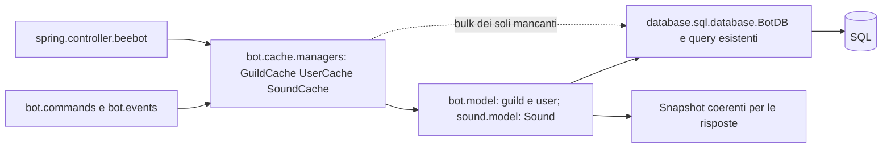

# Beebot: piano concordato di riordino e unificazione

Revisione aggiornata al 17 novembre 2026. L'analisi funzionale iniziale descrive la baseline `48c43d58`; gli spostamenti eseguiti dal proprietario sono nel commit `e9bf1585`. Il proprietario ha confermato come definitiva la struttura attuale: `bot`, `database`, `discord`, `lol`, `sound`, `spring`, `status` e `utils` sotto `com.safjnest`. Questa decisione sostituisce le precedenti destinazioni, compresa `spring.auth`. Il passaggio 1 è nel commit `96d4197a`; il passaggio 2 (guild e alert) è implementato nel working tree con il modello `deferEdit()` concordato. Restano i passaggi 3–6.

I rilievi funzionali, i numeri di riga delle fonti iniziali e l'inventario descrivono la baseline prima degli spostamenti; i collegamenti ai sorgenti seguono le posizioni attuali. La sezione «Struttura finale concordata dei package» registra i movimenti già eseguiti, i file nuovi da creare e quelli da assorbire soltanto dopo. Ogni ulteriore decisione concordata va aggiornata qui, mantenendo una sola versione del piano.

## Perimetro attivo

L'obiettivo principale è che bot e API usino le stesse cache, gli stessi oggetti e le stesse operazioni persistenti. `GuildData`, `AlertData` e `Sound` mantengono il modello esistente: una modifica tramite l'oggetto salva sul DB e aggiorna la memoria dopo il successo.

| Decisione | Applicazione al piano |
|---|---|
| MongoDB resta com'è | È ora in `database.nosql`; nessuna scomposizione del repository, ottimizzazione delle query o migrazione dei tipi `QueryRecord`/BSON |
| Struttura SQL conservata | È ora in `database.sql`; nessun refactoring generale di `AbstractDB`/`BotDB`; solo allineamento delle query nuove e assorbimento delle operazioni che oggi creano percorsi paralleli guild/sound |
| App e nomi storici conservati | Nessuna ridenominazione di `App.java`, `distruzione_demoniaca` o altre parti per motivi estetici |
| BotStatus e metriche rimandati | Struttura `status` attuale confermata, incluso `status.log`; nessun refactoring funzionale |
| Comandi e component handler conservati | Spostamenti in `bot.commands` e `bot.events` eseguiti, senza nuove gerarchie o riscritture; solo adeguamenti delle chiamate indispensabili al percorso comune |
| Chronos secondario | `bot.Chronos` conserva nome e comportamento; rimozione o sostituzione rimandata. Una future rappresenta un risultato e non sostituisce la pianificazione periodica |
| Priorità | Cache/oggetti e coerenza bot/API; errori e Spring/auth; trasporto HTTP e parsing comune con LoL |
| Stile Java | Tipi espliciti nelle variabili locali; `var` soltanto eventualmente nelle lambda; singleton `instance` minuscolo. Conservare spaziatura, raggruppamenti e banner ASCII esistenti. Separare per responsabilità anche campi e inizializzazioni dei costruttori, applicando lo stesso criterio ai blocchi nuovi. Mettere il corpo di `if`/`for`/`while` sulla riga successiva. Operazioni delimitate con lambda come `withGuild`, senza comprimere i metodi |
| SoundAnalytics rimandato | Nessuna riscrittura di `sound()`, `guild()` o delle classi `SoundAnalytics` in questo passaggio |

Le esclusioni non impediscono di leggere un chiamante per capire un contratto. Impediscono di trasformare ogni dipendenza osservata in un ulteriore refactoring.

## Problemi individuati nella baseline

Questi rilievi descrivono il punto di partenza. Il passaggio 1 ha risolto la base comune, i caricamenti coordinati e la durata delle operazioni sulle cache; il passaggio 2 unifica mutazioni e snapshot di guild/alert. User e sound restano nel passaggio 3.

### 1. Le modifiche guild e sound hanno ancora percorsi paralleli

**Guild:** `GuildData.setPrefix`, `setExpSystem`, `setLeagueShard` e `setVoice` sono già sincronizzati e aggiornano la memoria dopo il risultato SQL. `AlertData.setMessage`, `setPrivateMessage`, `setAlertChannel` e `setEnabled` fanno già query prima di aggiornare il campo. La dashboard usa invece `GuildService` → `GuildSettingsDB`, poi invalida `GuildCache`. Un riferimento già ottenuto dal bot non viene aggiornato dall'invalidazione.

**Suoni:** `Sound.setName`, `setPublic`, `setTags`, `like` e `dislike` sono già operazioni persistenti, diverse delle quali sincronizzate. La dashboard usa anche mutazioni in `SoundCache.patch/vote/settings` e `SoundDB`. `BotDB.updateSoundMetadata` chiama a sua volta `SoundDB` e invalida `SoundCache`: la catena esiste già, non è soltanto un rischio futuro.

**User:** `UserData.setGreet/unsetGreet` salva e modifica il proprio stato, mentre l'API aggiorna il greet da `SoundCache.settings` e invalida `UserCache`.

**Proposta prioritaria:** le operazioni tornano agli oggetti esistenti e i due ingressi li ottengono dalla stessa cache. La cache carica e coordina l'identità; non interpreta il JSON HTTP. Eliminare i percorsi paralleli senza introdurre `GuildRepository`, `GuildMutationService`, `UserRepository` o `SoundService` sostitutivi.

Fonti: [GuildData](../../src/main/java/com/safjnest/bot/model/guild/GuildData.java):136, [AlertData](../../src/main/java/com/safjnest/bot/model/guild/alert/AlertData.java):120, [Sound](../../src/main/java/com/safjnest/sound/model/Sound.java):158, [UserData](../../src/main/java/com/safjnest/bot/model/UserData.java):160, [SoundCache](../../src/main/java/com/safjnest/bot/cache/managers/SoundCache.java):413 e :497, [BotDB](../../src/main/java/com/safjnest/database/sql/database/BotDB.java):215.

### 2. Il lock sul singolo oggetto non garantisce da solo coerenza

`GuildCache.getGuild` e `UserCache.getUser` separano controllo, caricamento e pubblicazione: due richieste possono costruire istanze diverse. Scadenza e rimozione possono creare lo stesso problema se un chiamante conserva un riferimento precedente. Anche una `ConcurrentHashMap` protegge le operazioni sulla mappa, non l'intera sequenza né lo stato dei valori.

Gli alert espongono altri punti concreti: `GuildData.getAlerts` assegna la mappa prima di completarne il caricamento e la restituisce modificabile; `deleteAlert` rimuove prima dell'esito SQL. `AlertData.setRoles` elimina e ricrea ruoli con chiamate separate. Il lock della guild e un eventuale `synchronized` sul figlio sono due lock diversi: lettori e scrittori devono partecipare allo stesso coordinamento.

**Decisione proposta:** mutazioni negli oggetti, ciclo di vita nella cache. Usare un'operazione delimitata della cache per ottenere e mantenere l'istanza corrente durante il lavoro; sincronizzare nello stesso proprietario le modifiche, le letture coerenti e i relativi snapshot. Il dettaglio del contratto è descritto sotto. Non dichiarare la garanzia finché tutti gli scrittori, inclusi gli handler esistenti, non usano il percorso concordato.

Fonti: [GuildCache](../../src/main/java/com/safjnest/bot/cache/managers/GuildCache.java):40, [UserCache](../../src/main/java/com/safjnest/bot/cache/managers/UserCache.java):27, [GuildData](../../src/main/java/com/safjnest/bot/model/guild/GuildData.java):309 e :419, [AlertData](../../src/main/java/com/safjnest/bot/model/guild/alert/AlertData.java):176.

### 3. La base delle cache è condivisa, ma Sound la aggira

`AbstractCache` contiene un backing statico e bookkeeping separato in mappe non concorrenti. `CacheAdapter` costruisce il namespace dal tipo della chiave. `SoundCache` eredita queste classi ma sostituisce gran parte delle operazioni con una Caffeine tipizzata propria.

**Proposta:** assorbire la base utile in un solo `CacheAdapter<K,V>`, con istanze distinte per tipo di oggetto, caricamento singolo/bulk e coordinamento comune. Eliminare `AbstractCache` quando tutti i consumatori sono migrati. Non costruire una sola mappa globale indicizzata soltanto per ID, né trasferire automaticamente a questa base le politiche di sicurezza delle sessioni.

### 4. Gli errori applicativi sono accoppiati a Spring

`AuthException` deriva da `ResponseStatusException` ed è usata anche da guild, sound e query sound. Le risposte vengono assemblate dal filtro e da più advice. `LolApiExceptionHandler` è globale anche se il nome suggerisce un perimetro LoL; `AuthRequestExceptionHandler` elenca controller specifici. Nel filtro il mapping attuale perde l'eventuale `retryAfter` che l'advice sa rappresentare.

**Proposta:** una sola eccezione applicativa riusabile, senza import Spring, e un mapping HTTP comune anche al filtro. Non occorre una classe `SoundNotFoundException`, una `GuildNotFoundException` e così via.

### 5. Trasporto e parsing hanno opportunità precise di riuso

**HTTP:** `PatchUtils.fetchPatches` e `LeagueHandler.loadRunes` usano già `HttpUtils.readUrl`. Il punto separato è `DiscordApi`: client, request builder, invio e form OAuth propri. Conviene estendere il proprietario esistente `HttpUtils` e far convergere Discord su di esso.

**Parsing:** `lol.utils.NumberUtils` è priva di dipendenze LoL. `BuildUtils.parseAnyInt` ripete sostanzialmente il suo parsing tollerante di un `Object`. Altre conversioni apparentemente simili hanno regole diverse: `ArenaGameParser.integer` verifica integrità/range, `ChampionStatsProvider.number` accetta soltanto `Number`, `LolApiParameters.page` segnala un parametro HTTP errato. Sostituirle indiscriminatamente con un fallback a zero cambierebbe il comportamento.

Fonti: [HttpUtils](../../src/main/java/com/safjnest/utils/HttpUtils.java), [DiscordApi](../../src/main/java/com/safjnest/discord/auth/DiscordApi.java):35 e :67, [PatchUtils](../../src/main/java/com/safjnest/lol/utils/PatchUtils.java):85, [LeagueHandler](../../src/main/java/com/safjnest/lol/LeagueHandler.java):177, [NumberUtils](../../src/main/java/com/safjnest/lol/utils/NumberUtils.java), [BuildUtils](../../src/main/java/com/safjnest/lol/utils/BuildUtils.java):43, [ArenaGameParser](../../src/main/java/com/safjnest/lol/arena/ArenaGameParser.java):155.

## Percorso unico proposto



L'arco bulk indica soltanto il caricamento: le scritture restano nelle operazioni dei medesimi oggetti. Il controller adatta input/output HTTP e verifica il contesto autorizzato; non crea un'altra copia operativa né scrive prima nel DB per invalidare dopo.

### Responsabilità degli oggetti

| Proprietario | Cosa mantiene o assorbe |
|---|---|
| `GuildData` | Impostazioni della guild, proprietà dei figli e operazioni di modifica dei blocchi; crea/rimuove alert e canali senza esporre mappe come ingresso di scrittura |
| `AlertData`, `RewardData`, `TwitchData`, `ChannelData`, `BlacklistData` | Setter persistenti e aggiornamenti composti coerenti con la guild; nessuna conoscenza di `JsonNode`, servlet o status HTTP |
| `UserData` | Alias e greet globali/per guild, con aggiornamento dell'istanza corrente dopo il commit; associazioni LoL sul percorso esistente |
| `MemberData` | XP, livello e contatori del membro identificato da guild+user; operazioni composte come acquisizione XP, non soltanto setter isolati |
| `Sound` | Nome, pubblicazione, tag, voti e contatori attraverso il percorso persistente esistente, unificato con la dashboard |
| Cache tipizzate | Identità, caricamenti, bulk e durata delle operazioni; nessuna seconda implementazione delle mutazioni |

`MemberData` non è `UserData`: spostare XP globale dentro la cache user confonderebbe utenti uguali in guild diverse. Anche il controllo del cooldown, la lettura dell'XP, il calcolo del livello e il salvataggio devono essere una singola operazione coordinata sul membro; sincronizzare solo `setExpData` non protegge il calcolo precedente.

### Trasferimento delle operazioni, non soltanto dei file

I nomi nella colonna di destra sono interfacce proposte, da adattare allo stile dei metodi esistenti durante l'implementazione.

| Operazione attuale | Proprietario proposto |
|---|---|
| `GuildService.getGuild` | `GuildCache` ottiene l'istanza; `GuildData.snapshot` copia i setting; `GuildController` completa informazioni, canali e ruoli Discord |
| `GuildService.parseBlock/parseAlert` | Il controller decodifica JSON e presenza/tipo dei campi; `GuildData`/`AlertData` validano e applicano le regole dell'oggetto. Nessun `JsonNode` negli oggetti |
| `GuildService.updateBlock/updateAlert` | Metodi composti di `GuildData` e figli; query necessarie assorbite in `BotDB` con una connessione/transazione per blocco |
| Creazione/inserimento/rimozione alert via mappe | Metodi di `GuildData` che coordinano il figlio e pubblicano il cambiamento dopo il salvataggio |
| `GuildSettingsDB.saveAlert`, sostituzione ruoli | Operazione SQL comune in `BotDB`, riusata sia dai setter singoli sia da aggiornamenti composti; preservare la possibilità di salvare alert ancora non validi |
| `SoundCache.patch/vote/delete` | `Sound` possiede modifica e risultato; cache coordina l'istanza e invalida soltanto le selezioni derivate. Controlli di proprietà/visibilità sotto lock SQL conservati |
| `SoundCache.settings` | `UserData` applica i greet con le stesse operazioni del bot e restituisce risultati per elemento; nessuna invalidazione dell'oggetto corrente dopo una modifica propria |
| `SoundCache.greets` e `/me` | `UserCache` ottiene l'utente; `UserData` carica i greet necessari; i Sound sono risolti in bulk da `SoundCache` |
| `MemberData.canReceiveExperience` più calcolo e `setExpData` in chiamanti separati | Un'operazione composta del membro riusa `ExperienceSystem` e aggiorna cooldown, contatori, XP/livello nello stesso coordinamento |

Il caricamento dei greet richiede un indicatore esplicito di completezza: oggi `UserData.getGreets()` può rappresentare soltanto gli scope caricati finora. Non usarla come se contenesse tutta la tabella per la risposta `/me`. I caricamenti singoli e completi devono arricchire la stessa istanza, conservando fallback globale e override di guild.

### Contratto minimo di concorrenza

La proposta usa l'infrastruttura della cache già esistente, senza un nuovo lock service o repository:

1. **Caricamento unico per chiave.** Una richiesta singola e una bulk per lo stesso ID condividono lo stesso caricamento e la stessa istanza. Il risultato in corso può essere rappresentato internamente da una `CompletableFuture` nell'entry della cache.
2. **Operazione delimitata.** Un metodo della cache, per esempio `GuildCache.withGuild(id, operation)`, acquisisce l'entry e ne impedisce la sostituzione finché l'operazione termina. Lo stesso meccanismo serve a user e sound. Gli oggetti modificabili non devono essere conservati per una scrittura successiva fuori da questo intervallo; all'esterno si conservano ID o snapshot.
3. **Lock del proprietario.** Le operazioni di `GuildData` e dei figli di configurazione condividono il coordinamento della guild. `MemberData` può avere coordinamento per guild+user per evitare di serializzare tutto l'XP della guild; user e sound hanno le proprie identità. Nessun lock globale tenuto durante SQL, Discord o download.
4. **Letture consistenti.** Le risposte copiano lo stato sotto lo stesso coordinamento e serializzano lo snapshot dopo. Non si itera una mappa modificabile mentre un altro ingresso la cambia.
5. **Transazione prima della pubblicazione.** Un aggiornamento di più campi o una sostituzione ruoli usa una transazione SQL per il blocco, poi pubblica in memoria. I setter singoli conservano il loro salvataggio immediato. `synchronized` non trasforma una serie di query con commit separati in una transazione.
6. **Fallimenti e scadenza.** Un caricamento fallito non diventa un oggetto vuoto o un'assenza; le entry in corso vengono completate con errore e possono essere ritentate. Una entry occupata non viene eliminata e ricreata con un'altra istanza. Nessun lock/future/generation viene rimosso mentre protegge ancora un'operazione.
7. **Niente accessi laterali.** Bot e API devono entrambi passare qui, incluse le scritture dei figli. Gli handler mantengono struttura e presentazione, ma le chiamate dirette come `guild.getAlerts().put(...)` devono diventare operazioni del proprietario se si vuole la garanzia completa.

Il passaggio 1 implementa le entry private, i caricamenti coordinati e il mantenimento dell’identità durante `with`/`withAll`. Le operazioni singole sincronizzano sul valore; quelle bulk mantengono tutte le entry, ma richiedono il coordinamento del singolo proprietario per modificarle. I vecchi chiamanti che trattengono oggetti da getter o scrivono nelle mappe non acquisiscono automaticamente queste garanzie: il passaggio 2 migra impostazioni guild, canali, blacklist e alert. User, sound e XP rimangono nel passaggio 3. È coordinamento locale al processo; non dimostra coerenza tra due bot o scrittori esterni sullo stesso DB.

### Bulk: 10 presenti, 20 richiesti

Interfacce indicative: `GuildCache.getGuilds(ids)`, `UserCache.getUsers(ids)`, `SoundCache.getSounds(ids)`. Devono usare lo stesso nucleo dei caricamenti singoli, non implementare un secondo ciclo di vita.

`SoundCache.load` già riusa gli oggetti presenti e carica insieme i mancanti: è una base concreta da conservare. Il lavoro è rendere questo comportamento coerente e concorrente anche per guild e user, senza ricrearlo indipendentemente per ogni API.

1. Normalizzare e deduplicare gli ID, mantenendo l'ordine concordato della risposta.
2. Riutilizzare le 10 entry già presenti; per quelle in corso attendere il caricamento esistente.
3. Prenotare i soli 10 ID mancanti che questa richiesta deve caricare. Un'altra richiesta non avvia un secondo fetch sugli stessi ID.
4. Caricare questi ID con le query bulk necessarie, suddivise in gruppi se richiesto dai limiti. Nessun fetch dei 10 hit.
5. Idratare gli oggetti con i dati già ottenuti, pubblicarli nelle entry prenotate e comporre il risultato con i riferimenti mantenuti dall'operazione.

Il risultato completo HTTP attende soltanto i dati mancanti; gli hit sono già disponibili internamente. Non cambia il contratto dell'endpoint per introdurre risposte parziali non richieste.

**Idratazione nei passaggi 1–2:** le cache usano `GuildData.fromRows` e `UserData.fromRows`, che ricevono canali/azioni/alias già caricati. I costruttori pubblici precedenti restano compatibili; il bulk non li usa per avviare query per ogni oggetto. Il loader SQL restituisce assenza per una guild non salvata; `withGuild` può conservarne un contenitore predefinito solo in memoria. Una GET non crea righe: la prima modifica valida salva il blocco e crea la guild nella stessa transazione. `getGuildOrPut`/`withGuildOrPut` mantengono la richiesta esplicita di creazione sul DB. `GuildData.getMemberData` può ancora creare membri: i percorsi XP e le letture di sola consultazione richiedono il passaggio 3. I profili LoL mantengono il caricamento lazy esistente, senza modifiche a Mongo.

Le viste autorizzate e i campi personali di Sound non vanno memorizzati sugli oggetti globali condivisi. I dati dell'utente che guarda la risposta restano su copie di risposta, come previsto dal contratto attuale.

## Errori: una classe applicativa e un adattatore HTTP

Nome concordato nel piano: `com.safjnest.exception.BeebotException`, invece di chiamarla semplicemente `Exception`, che confonderebbe il tipo Java standard.

Contenuto minimo: categoria, codice stabile, messaggio passato dal chiamante, causa originale ed eventuale `retryAfter`. La categoria può essere un enum annidato nello stesso file. Nessun `HttpStatus`, `ResponseEntity`, dipendenza da Spring o sottoclasse per ogni dominio.

| Esempio richiesto | Categoria condivisa | Dato specifico conservato |
|---|---|---|
| Elemento non trovato | `NOT_FOUND` | `sound_not_found`, `guild_not_found` o altro codice esistente; messaggio del chiamante |
| Chiave errata | `UNAUTHENTICATED` | `invalid_api_key`; distinto da un utente autenticato ma senza permessi |
| Body errato | `INVALID_REQUEST` | `invalid_request`, campo/messaggio sanitizzato dove previsto |
| Permesso insufficiente | `FORBIDDEN` | `guild_forbidden`, `sound_forbidden` |
| Dipendenza indisponibile | `UNAVAILABLE` | `auth_unavailable`, `discord_unavailable`, `sound_storage_unavailable` |
| Risposta upstream malformata | `INVALID_UPSTREAM_RESPONSE` | Mantiene la distinzione attuale fra 502 e 503 |
| Rate limit esterno | `RATE_LIMITED` | Codice, durata e mapping specifico già promesso al client |

Il codice specifico resta importante: il frontend deve distinguere chiave errata, sessione scaduta e Discord indisponibile anche se la classe Java è unica. I messaggi delle eccezioni impreviste non vengono copiati automaticamente al client.

In Spring, `ApiErrors` compone body/header/status e può scrivere anche la risposta del filtro; `ApiExceptionHandler` intercetta gli errori applicativi e di binding/framework. I record di risposta possono essere annidati in `ApiErrors`, mantenendo le forme Beebot e LoL esistenti, inclusi `metadata` e `Retry-After`. `LolApiResponses` continua a mappare `ApiResult` secondo ADR-0007: dati pronti, parziali o in preparazione non diventano eccezioni.

## HTTP e parsing: unificazione circoscritta

### HTTP

`utils.HttpUtils` resta il punto comune e assorbe costruzione della request, invio, encoding dei form dove utile e trattamento dell'interruzione. `DiscordApi` conserva URL, payload, autenticazione Discord e significato di 401/403/429 o risposta malformata; passa la richiesta al trasporto comune. La seam `Transport` già usata dalla suite precedente può essere annidata nel proprietario HTTP comune; i test precedenti non sono più presenti nel checkout attuale.

Conservare i valori attuali: HttpUtils ha connessione 5 s/richiesta 10 s; Discord usa 15 s. Una factory comune può mantenere client configurati diversamente senza duplicare il codice del builder. Non serve imporre un solo timeout o lo stesso parser JSON. Il trasporto deve restituire anche status/header/body per la politica Discord; non trasformare ogni risposta non 2xx in un errore indistinto prima che venga interpretata.

### Parsing

`lol.utils.NumberUtils` resta nella posizione attuale al termine degli spostamenti. Nel passaggio 5, i meccanismi effettivamente condivisi con altri consumatori potranno essere estratti in `utils.ParseUtils`: è un consolidamento del codice, non una rinomina preliminare obbligatoria. Esporre soltanto le varianti realmente necessarie, distinguendo rigoroso/fallback/null. Mantenere in `FilterCodec` il significato LoL di `*` e la codifica delle chiavi.

| Punto attuale | Intervento proposto | Compatibilità da verificare |
|---|---|---|
| `BuildUtils.parseAnyInt` | Delegare alla conversione comune e rimuovere il duplicato dopo gli aggiornamenti dei chiamanti | `Number`, stringhe con trim, null/errore → 0 |
| `NumberUtils` e chiamanti `Filter`, `BuildSignature`, `RuneSignature`, `Match`, `FilterCodec` | Aggiornare import e riusare il proprietario comune | Fallback, tipo di ritorno e significato delle chiavi immutati |
| `PatchUtils.patchPart` | Riusare la parte numerica solo preservando la politica sui segmenti | Oggi non fa trim: non cambiare silenziosamente gli input accettati |
| `LolApiParameters.page/profileSeason/parseEnum` | Riusare la conversione di base, mantenere vincoli e messaggi HTTP qui | Input invalido resta errore, non zero/null interpretati come dato valido |
| `ChampionStatsProvider.number`, `ProfileRecordAnalyzer.number` | Valutare una variante comune per soli `Number`, non la conversione che accetta anche stringhe | Stesso insieme di valori accettati |
| `ArenaGameParser.integer/time` | Conservare i controlli integrità/range/non negatività; estrarre solo se ci sono altri consumatori effettivi | Nessuna conversione frazionaria o fuori range tramite semplice `intValue` |
| `QueryRecord.getAsInt/getAsLong/getAsDouble` | Restano dove sono; i consumatori di righe riusano questi metodi | Nessun refactoring del framework SQL/BSON |

La ricerca non ha individuato un tipo canonico `QueryResult`: il pattern esistente è `List<QueryRecord>`. Per auth, `findClient` e `findSession` possono riusare il parser delle righe e factory dei modelli, mantenendo prepared statement, controllo delle righe modificate e transazioni. Non devono passare da fallback che nascondono un DB indisponibile come credenziale semplicemente assente.

## Struttura finale concordata dei package

Il 17 novembre 2026 il proprietario ha confermato la struttura già realizzata nel commit `e9bf1585`. Non sono più richiesti gli spostamenti verso `beebot`, `spring.auth`, una `cache` alla radice o i vecchi package database alla radice. Anche i nomi `LolApiConfig` e `DiscordAuthController` rimangono quelli attuali.

La radice resta `com.safjnest`. Le responsabilità sono:

- `bot`: avvio del bot, comandi, eventi, audio/chat, modelli guild/user/configurazione e infrastruttura delle cache;
- `database`: SQL, MongoDB e Redis nei rispettivi sottopackage;
- `discord.auth`: credenziali, flussi di autenticazione e client Discord; `discord.guild`: cache autorizzativa e, temporaneamente, i servizi guild da assorbire;
- `lol`: dominio, modelli, servizi, analisi, tracker, code e presentazione LoL; i comandi Discord LoL sono in `bot.commands.lol`;
- `sound`: operazioni e helper sound, con i modelli in `sound.model`;
- `spring`: ingressi HTTP, filtro/configurazione e rappresentazione degli errori;
- `status`: metriche e logging; `utils`: utility esistenti e meccanismi comuni verificati.

La base resta `bot.cache.CacheAdapter`, con `GenericCache`, `GuildCache`, `UserCache` e `SoundCache` in `bot.cache.managers`. I controller Spring useranno queste stesse cache: il loro package non introduce un percorso separato. Le politiche di sicurezza di `discord.guild.DiscordGuildCache` rimangono distinte dalle cache degli oggetti operativi.

L'albero seguente descrive i file attuali rilevanti per il piano, aggiornati dopo il passaggio 1; `...` conserva tutti gli altri file e sottopackage esistenti. I file da assorbire sono presenti finché non è completata la migrazione delle loro funzionalità. Le aggiunte future sono elencate separatamente.

```text
com/safjnest/
├── App.java
├── bot/
│   ├── Bot.java
│   ├── Chronos.java
│   ├── commands/                         ... inclusi i comandi LoL
│   ├── events/                           ... handler esistenti
│   ├── audio/                            ... sottopackage esistenti
│   ├── chat/                             ... classi esistenti
│   ├── cache/
│   │   ├── CacheAdapter.java
│   │   └── managers/
│   │       ├── GenericCache.java
│   │       ├── GuildCache.java
│   │       ├── UserCache.java
│   │       └── SoundCache.java
│   └── model/
│       ├── AliasData.java
│       ├── UserData.java
│       ├── BotSettings/                  ... configurazioni esistenti
│       ├── customemoji/                  ... modelli esistenti
│       └── guild/                        ... inclusi GuildData, MemberData e alert/
├── database/
│   ├── sql/
│   │   ├── AbstractDB.java
│   │   ├── DatabaseHandler.java
│   │   ├── QueryRecord.java
│   │   ├── QueryRecordParser.java
│   │   └── database/                     ... AuthDB, BotDB e altri DB esistenti
│   ├── nosql/                            ... implementazione conservata
│   └── redis/                            ... implementazione conservata
├── discord/
│   ├── auth/
│   │   ├── ApiKey.java
│   │   ├── AuthException.java            da assorbire
│   │   ├── DiscordApi.java
│   │   └── DiscordAuthService.java
│   └── guild/
│       ├── DiscordGuildCache.java
│       └── DiscordGuildService.java      da assorbire
├── lol/                                  ... dominio esistente conservato
├── sound/
│   ├── SoundAccess.java                  da assorbire
│   ├── SoundAnalytics.java
│   ├── SoundPeriod.java
│   ├── SoundQueryCache.java              da assorbire
│   ├── SoundValues.java                  da assorbire
│   └── model/
│       ├── Sound.java
│       └── Tag.java
├── spring/
│   ├── SpringServer.java
│   ├── config/
│   │   ├── AuthFilter.java
│   │   └── LolApiConfig.java
│   ├── controller/
│   │   ├── StatusController.java
│   │   ├── beebot/                       ... DiscordAuthController, GuildController, SoundController
│   │   └── lol/                          ... controller e helper HTTP esistenti
│   ├── dto/                              ... LolApiError da assorbire
│   └── exception/                        ... handler da unificare qui
├── status/
│   ├── log/                              ... BotLogger, converter e LoggerIDpair
│   └── ... metriche esistenti
└── utils/                                ... utility e sottopackage esistenti
```

`ExperienceSystem` e `AlertMessage` restano in `utils`. `bot.audio.SoundAnalytics` e `sound.SoundAnalytics` sono classi differenti e non vengono unite sulla sola base del nome. `App.java`, `distruzione_demoniaca`, comandi, component handler e presentazione mantengono il comportamento previsto dal perimetro.

### Spostamenti eseguiti dal proprietario

Le colonne sono relative a `src/main/java/com/safjnest/`. Questa tabella registra i movimenti dalla baseline iniziale al checkout confermato; non è una nuova lista di spostamenti da eseguire.

| Posizione nella baseline | Posizione attuale confermata |
|---|---|
| `core/Bot.java`, `core/Chronos.java` | `bot/Bot.java`, `bot/Chronos.java` |
| `commands/**` | `bot/commands/**` |
| `core/events/**` | `bot/events/**` |
| `core/audio/**` | `bot/audio/**` |
| `core/chat/**` | `bot/chat/**` |
| `core/cache/**` | `bot/cache/**`, conservando `managers` |
| `model/**`, escluso `model/sound/**` | `bot/model/**`, comprese configurazioni, emoji e `GuildSettings` |
| `model/sound/**` | `sound/model/**` |
| `auth/**` | `discord/auth/**` |
| `guild/**` | `discord/guild/**` |
| `sql/**` | `database/sql/**` |
| `nosql/**` | `database/nosql/**` |
| `redis/**` | `database/redis/**` |
| `utils/log/**` | `status/log/**` |

`NumberUtils`, `LolApiConfig`, `DiscordAuthController`, `AuthFilter` e gli helper già in `sound` conservano posizione e nome attuali. Nessun ulteriore movimento dei file esistenti è un prerequisito del prossimo passaggio. Le estrazioni e rimozioni funzionali descritte sotto restano successive alla migrazione dei chiamanti.

### File nuovi a cura dell'assistente

| File da creare | Responsabilità |
|---|---|
| `exception/BeebotException.java` | Eccezione applicativa comune senza Spring, con categoria annidata, codice, messaggio, causa ed eventuale retry |
| `spring/exception/ApiErrors.java` | Mapping e record HTTP annidati, riusati dal filtro, dall'advice e da `LolApiResponses` |
| `spring/exception/ApiExceptionHandler.java` | Gestione unificata degli errori applicativi, di binding e del framework |
| `spring/controller/beebot/MeController.java` | Profilo e impostazioni utente; delega al percorso comune degli oggetti |
| `utils/ParseUtils.java` | Nel passaggio 5, solo i meccanismi di conversione effettivamente condivisi estratti dai proprietari esistenti |

L'albero non richiede una nuova classe per ogni errore o un nuovo service/repository per ogni cache. I tipi di sola rappresentazione restano nei proprietari appropriati, annidati quando semplice e utile.

### File da mantenere temporaneamente e assorbire dopo

Questi file non vanno cancellati durante i soli spostamenti. L'assistente li rimuoverà soltanto dopo aver trasferito le funzionalità necessarie e aggiornato chiamanti, registrazioni, contratti e test.

| File attuale da mantenere temporaneamente | Assorbimento previsto |
|---|---|
| `discord/auth/AuthException.java` | Sostituito dall'errore comune `exception.BeebotException`, con mapping HTTP in `spring.exception` |
| `discord/guild/DiscordGuildService.java` | Operazioni di lista autorizzata, decrittazione e controllo amministrativo in `discord.auth.DiscordAuthService`, con la stessa cache autorizzativa |
| `discord/guild/GuildService.java` — rimosso nel passaggio 2 | Mutazioni e regole in `bot.model.guild.GuildData`/figli; adattamento input/output nel controller. Nessun trasferimento indiscriminato di tutta la classe in un unico altro file |
| `database/sql/database/GuildSettingsDB.java` — rimosso nel passaggio 2 | Query necessarie in `BotDB`, mantenendo transazioni per blocco, ruoli vuoti, campi omessi, null e creazione di alert ancora non validi |
| `bot/model/guild/GuildSettings.java` — rimosso nel passaggio 2 | Record di vista/risultato annidati nel proprietario `bot.model.guild.GuildData`, con forma HTTP e validità attuali |
| `sound/SoundAccess.java` | Lookup/proiezione Discord in `discord.auth.DiscordApi`, con politiche distinte per membership ordinaria e amministrazione |
| `database/sql/database/SoundDB.java` | Query nuove necessarie in `BotDB`, preservando statement preparati, lock SQL, streaming/batch e sessione di lettura; eliminazione della catena `BotDB → SoundDB` |
| `sound/SoundQueryCache.java` | Dettaglio di selezione Redis di soli ID dentro `bot.cache.managers.SoundCache` |
| `sound/SoundValues.java` | Errori all'eccezione comune, validazione al confine/proprietario e rappresentazioni nei tipi appropriati; nessun nuovo generico `MapUtils` |
| `spring/exception/AuthExceptionHandler.java` | Gestione applicativa in `spring.exception.ApiExceptionHandler`; record di errore in `ApiErrors` |
| `spring/exception/AuthRequestExceptionHandler.java` | Binding e body errati nel medesimo handler HTTP |
| `spring/exception/LolApiExceptionHandler.java` | Gestione HTTP LoL/framework nel medesimo handler, mantenendo il contratto esistente |
| `spring/dto/LolApiError.java` | Record annidato in `spring.exception.ApiErrors`, conservando `status`, `code`, `message` e `metadata` |

### Modifiche ai file conservati

| Proprietario nella struttura finale | Modifica prevista |
|---|---|
| `bot.model.guild.GuildData` e figli | Setter persistenti preservati; operazioni composte, proprietà delle mappe e snapshot coerenti |
| `bot.model.UserData` | Greet/alias sullo stesso percorso di bot e API; completezza esplicita dei caricamenti e supporto all'idratazione bulk |
| `bot.model.guild.MemberData` | Operazione XP coordinata per guild+user, comprendente cooldown, calcolo e salvataggio |
| `sound.model.Sound` | Assorbire mutazioni API oggi in `SoundCache`, mantenendo controlli atomici di visibilità/proprietà e setter dei comandi |
| `bot.cache.managers.GuildCache/UserCache/SoundCache` | Loader e policy tipizzate sulla base comune; richieste singole/bulk coordinate, senza nuovi service/repository intermedi |
| `bot.cache.CacheAdapter` | Backing per istanza, identità, durata delle operazioni e caricamenti coordinati; `GenericCache` riusa la medesima base |
| `utils.HttpUtils` | Builder/invio comuni anche a Discord, trasporto testabile e timeout compatibili |
| `discord.auth.DiscordApi` | URL, payload e politica Discord; trasporto sul helper HTTP comune. L'URL OAuth è un dato semplice che il servizio auth avvolge nel proprio risultato |
| `discord.auth.DiscordAuthService` | Un unico flusso credenziali/sessioni; assorbire la lista amministrativa senza confonderla con la membership sound |
| `discord.guild.DiscordGuildCache` | Preservare identità utente/applicazione/sessione, revoca, Redis/fallback, lease e fencing |
| `spring.config.AuthFilter` | Controllo credenziali/contesto e uso del mapper errori comune; nessun package `spring.security` separato |
| `spring.config.LolApiConfig` | Configurazione HTTP comune e personalizzazioni LoL; la scansione continua a includere controller/auth/error HTTP |
| `spring.controller.beebot.DiscordAuthController` | Solo authorize, session e logout |
| `spring.controller.beebot.MeController` | `/me` e `/me/settings`, usando gli oggetti ottenuti dalla cache comune |
| `spring.controller.beebot.GuildController` | Aggiungere `/guilds` e l'alias `/servers`, oggi nel controller auth; impostazioni sui medesimi oggetti del bot |
| `spring.controller.beebot.SoundController` | Endpoint sound sul percorso comune; `/me/settings` passa al controller Me |
| `spring.controller.lol.LolApiParameters/LolApiResponses` | Riuso dei meccanismi comuni senza perdere vincoli HTTP, stati `ApiResult`, metadati o regole LoL |
| `database.sql.database.AuthDB` | Allineare le letture nuove al parser/record esistente, mantenendo query parametrizzate, revoca autorevole e transazioni |

Dopo gli assorbimenti si rimuovono soltanto i file le cui funzionalità sono state migrate e le cartelle effettivamente vuote. `discord.auth`, `discord.guild`, `sound`, `bot.cache.managers` e `spring.exception` restano destinazioni confermate; non vanno eliminati per conformarsi al vecchio albero.

### Confine Spring e sincronizzazione delle regole

La struttura confermata conserva Spring per controller, filtro/configurazione e mapping HTTP degli errori. L'autenticazione resta in `discord.auth`, la cache autorizzativa in `discord.guild`; non è più previsto l'ampliamento verso `spring.auth` descritto nella versione precedente del piano. I modelli di successo LoL restano in `lol.model` e le decisioni accettate non vengono modificate.

L'autenticazione non viene duplicata per controller LoL o credenziali personali. `discord.auth.DiscordApi` serve anche ai suoni; `exception.BeebotException` è applicativa; `AuthDB` resta in `database.sql.database`. L'handler e il mapper comuni nuovi saranno in `spring.exception`, riusando il package esistente.

### Suoni e futuro R2

I metadati e le modifiche restano in `sound.model.Sound` e la cache locale ne coordina l'istanza. In futuro `bot.audio.SoundFiles` sarà l'unico proprietario del recupero R2 e della copia temporanea sulla VPS, riusato da player, download e greet. Non una catena `SoundRepository → CachedSoundRepository → R2Repository`.

Download concorrenti, file incompleti, durata della copia locale e cleanup durante la riproduzione andranno verificati quando si implementa R2. La conservazione per alcune ore e la pulizia periodica rimangono requisiti del futuro lavoro; non sono implementate da questo piano. `SoundFiles` non va creato durante i soli spostamenti dei file attuali.


## Sequenza di implementazione proposta

Gli spostamenti del proprietario sono conclusi e la struttura attuale è confermata. Il passaggio 1 è nel commit `96d4197a`, insieme alla correzione dei due XML di logging. Il passaggio 2 è implementato nel working tree. Il prossimo intervento è il passaggio 3: user, XP e sound sul percorso comune. I package attuali restano confermati; prima di ogni modifica vanno riletti simboli e impatto CodeGraph, sincronizzando un indice stale. Gli assorbimenti non si anticipano cancellando i file ancora usati.

| Passaggio | Risultato concreto | Verifiche necessarie |
|---|---|---|
| 1 — Cache e identità, implementato | Una base per istanza; singolo/bulk coordinati; viste della cache e operazioni delimitate. Snapshot di dominio nei passaggi 2–3 | 10 hit+10 miss; richiesta singola sovrapposta; scadenza durante mutazione; errore loader; stessa istanza durante l'operazione |
| 2 — Guild e alert, implementato | API sugli oggetti della cache; eliminazione `GuildService`/`GuildSettingsDB` dopo la migrazione delle funzionalità | Bot→API e API→bot immediati; ruoli vuoti; rollback per blocco; letture durante modifiche; Twitch dopo il commit e fuori dal lock |
| 3 — User e sound | Greet e mutazioni sullo stesso percorso dei comandi; eliminazione dei passaggi paralleli | XP concorrente per guild+user; metadata/voti e privacy sound; cache query invalidata dopo commit senza sostituire oggetti ancora in uso |
| 4 — Errori e Spring/auth | Eccezione comune, mapper unico e raggruppamento dei controller | Contratti Beebot/LoL, filtro e advice, token scaduti, retry, body errato e rotta non trovata |
| 5 — HTTP e parsing | Helper già esistenti estesi e riusati; niente cambi a Mongo o al framework SQL | Timeout/status/header Discord e Data Dragon; input numerici limite e fallback; filtri e chiavi invariati |
| 6 — Allineamento query auth/API | Record/parser per le letture nuove e rimozione dei doppioni residui | Query parametrizzate, righe modificate, consumo OAuth una sola volta, revoca autorevole anche con cache piena |

È utile realizzare presto la piccola parte condivisa degli errori se serve ai passaggi precedenti; la sequenza non impone di far transitare tutto il riordino da una grande riscrittura preventiva.

Le eliminazioni avvengono soltanto quando chiamanti, registrazioni e test sono migrati. Il progetto deve compilare tra gruppi coerenti; in fase di implementazione si rileggerà l'impatto CodeGraph e la documentazione API per ogni gruppo. Le API guild hanno transazioni indipendenti per blocco/elemento, non una nuova transazione unica dell'intero body.

## Passaggio 1 implementato

- `CacheAdapter` sostituisce `AbstractCache`: backing Caffeine per istanza, senza prefissi costruiti dal tipo della chiave, reflection sui generics o mappe statiche di bookkeeping. `GenericCache` conserva il costruttore pubblico esistente e riusa la stessa base.
- Guild e user mantengono rispettivamente limite 60/2000 e scadenza dopo 12 ore di inattività; sound mantiene limite 100 e 60 secondi dalla scrittura. Le entry occupate possono superare temporaneamente la capacità trattenuta dalla cache: restano attive finché termina l'operazione.
- Singolo, bulk e dati già precaricati riservano le stesse entry. Si caricano soltanto i mancanti, con future condivise; gli ID duplicati non generano altri fetch e l'ordine della risposta è conservato. Le assenze non vengono memorizzate come cache negativa.
- `withGuild`, `withUser`, `withSound` e le varianti plurali delimitano l'uso. Una scadenza o eviction non sostituisce l'istanza occupata. La variante singola usa il monitor dell'oggetto; la plurale mantiene le entry e consente di acquisire il singolo proprietario durante le modifiche.
- Invalidazione e `clear` impediscono che un vecchio caricamento ripubblichi dati in cache. I partecipanti già sull'entry possono terminare; la rimozione definitiva avviene all'ultimo rilascio. Un `put` sostitutivo viene applicato al rilascio, rispettando successive invalidazioni. Gli errori completano le attese e permettono il retry.
- Guild precarica impostazioni, canali e azioni con query preparate in gruppi di massimo 500 ID; user precarica gli alias. Le factory dai record evitano query e dipendenze Discord durante l'idratazione. Il caricamento completo iniziale delle guild seleziona anche voce, lingua e shard, richiesti dal modello.
- Sound riusa la stessa base sia dal player sia dalle risposte API già precaricate; conserva controlli di visibilità, dati freschi per richiesta e copie con dati personali. Le mutazioni API restano ancora nella facade, da migrare nel passaggio 3. Le liste e mappe esposte dalla cache sono viste copiate, non accessi modificabili al backing.
- I riferimenti di converter e logger nei due XML sono stati aggiornati a `com.safjnest.status.log`.

Sono stati riesaminati `GuildController`, `SoundController` e i loro percorsi: endpoint, payload, autorizzazione e presentazione restano invariati. Questa era la verifica del passaggio 1: il percorso guild separato è stato successivamente migrato nel passaggio 2 descritto sotto. Nessuna modifica a modelli/servizi/API LoL, Mongo, Redis LoL, metriche, `SoundAnalytics` o nomi storici. Framework SQL e schema conservati; le sole query nuove servono al bulk delle cache.

## Passaggio 2 implementato: copie di modifica e salvataggi espliciti

La direzione concordata con il proprietario è questa:

```java
boolean saved = GuildCache.withGuild(guildId, guild -> {
    AlertData edit = guild.getAlert(AlertType.LEAVE).deferEdit();

    edit.setMessage(message);
    edit.setPrivateMessage(privateMessage);

    return edit.update();
});
```

- `deferEdit()` crea una copia privata, compresi i ruoli e i campi Twitch/reward. I setter sulla copia non eseguono query; i setter sull'oggetto originale continuano a salvare immediatamente.
- `update()` salva tutti i campi del solo blocco interessato tramite query preparate esplicite in `BotDB`. Non ci sono mappe campo→colonna, aggiornamenti SQL dinamici o transazioni dell'intero JSON. Ruoli e sottotipo dell'alert partecipano alla stessa transazione.
- Il commit precede la copia dei valori nell'istanza originale. Errore SQL, cancellazione o revisione superata restituiscono `false`, lasciando intatta la memoria. Una copia già salvata va sostituita con una nuova `deferEdit()` per un'altra modifica.
- `GuildData.deferEdit()` riguarda i campi generali. Blacklist, canali e alert si modificano sulle rispettive copie, ciascuna con il proprio `update()`; non è una copia dell'intera guild da salvare in blocco.
- `AlertData` non conserva un riferimento a `GuildData`: conserva l'ID della guild e il proprio stato. `GuildData` coordina creazione e rimozione; il monitor della cache mantiene l'istanza durante l'operazione. Un controllo di revisione per oggetto impedisce a due copie obsolete di sovrascriversi.
- `GuildController` mantiene parsing JSON, verifica dei riferimenti Discord, autorizzazione e adattamento HTTP. Ottiene dalla stessa `GuildCache` gli oggetti usati da comandi ed eventi; non invalida la guild dopo una modifica propria. Gli snapshot copiano lo stato e la serializzazione avviene fuori dal lock.
- Ogni chiave di blocco e ogni elemento di `channels`/`twitch`/`reward` produce il proprio risultato. L'elaborazione resta sequenziale per guild: le modifiche allo stesso oggetto sono comunque serializzate, senza introdurre future aggiuntive. Twitch viene registrato dopo il commit e fuori dal lock.
- Le mappe restituite da `getAlerts()` e `getChannels()` sono copie: l'inserimento passa da `createAlert` oppure da `newAlert` → `update` → `addAlert`, la rimozione dai metodi di `GuildData`. Gli ID SQL indicizzano internamente gli alert, così modificare il livello reward non richiede un riferimento al padre.
- `GuildService`, `GuildSettingsDB` e il file di soli record `GuildSettings` sono rimossi dopo la migrazione. I record di risposta rimangono annidati in `GuildData`; endpoint, campi HTTP, validazione e presentazione Discord sono conservati.

La garanzia riguarda il processo che condivide queste entry della cache. Non è un protocollo di sincronizzazione con scrittori esterni o altre istanze del bot. XP, membri, user e sound rimangono nel passaggio 3; auth, errori comuni, HTTP/parsing e R2 mantengono la sequenza concordata.

## Stato delle verifiche

L'inventario iniziale descriveva 448 Java `com.safjnest`, 10 Java incorporati e 101 file di test. [Il registro](review/inventory.tsv) distingue lettura completa, parziale e soli metadati della baseline: non è un audit esaustivo di ogni metodo.

Nel controllo degli spostamenti del 17 novembre 2026 sul commit `e9bf1585`:

- CodeGraph risulta aggiornato a 484 file; restano 448 sorgenti applicativi e 10 incorporati;
- dichiarazioni package, cartelle e import risultano coerenti;
- `mvn -o -DskipTests clean compile` ha compilato da zero tutti i 458 file Java con `BUILD SUCCESS`;
- i 101 file di test precedenti sono stati rimossi dal proprietario; quella suite non è stata eseguita e servono verifiche mirate durante l'implementazione dei passaggi funzionali;
- una prova isolata di Logback ha riprodotto due errori nella configurazione caricata da `BotLogger`: `rsc/logback.xml` e `src/main/resources/logback-spring.xml` conservano riferimenti a `com.safjnest.utils.log`, mentre le classi sono in `com.safjnest.status.log`; il logger attuale eredita inoltre `INFO` invece del `TRACE` configurato per il vecchio nome. La correzione è stata applicata nel passaggio 1;
- i file degli agenti/skill sono stati rimossi dal versionamento e le cartelle ignorate; il piano resta nel documento versionato, mentre la skill locale non è più condivisa dalla repo.

Le prove precedenti non verificano il funzionamento live di bot/API, la concorrenza, le integrazioni o le prestazioni. I passaggi 1–2 sono implementati; gli accorpamenti dei passaggi 3–6 restano da implementare. Le esclusioni su Mongo, framework SQL, BotStatus, nomi storici e grandi refactoring degli handler rimangono valide.

Il passaggio 1 modifica la base delle cache, i loader, le factory di idratazione, le sole query bulk necessarie e i riferimenti del logging. I nuovi test locali coprono concorrenza, bulk, scadenza/eviction, invalidazione, errori, creazione, SQL preparato con H2 e isolamento delle risposte sound. La suite precedente di 101 file non è stata ripristinata. Il codice resta compatibile con il target Java 25 configurato; le lambda non richiedono un cambio di versione. Contratti API, presentazione e ADR accettati rimangono invariati.

Verifica finale del passaggio 1 sul working tree del 17 novembre 2026:

- `mvn -o clean test`: compilazione pulita di 457 sorgenti principali, 4 file di test e 29 test superati, zero errori/fallimenti/skipped;
- prova isolata del logging con classpath aggiornato: zero errori di configurazione e livello effettivo `TRACE` per `BotLogger`;
- `git diff --check` senza errori; nessuna modifica a `SoundAnalytics`, sorgenti LoL, Mongo, `AbstractDB` o `QueryRecord`;
- le prove SQL usano H2 locale e quelle sound sorgenti finte: nessun avvio live di bot/API o verifica con MariaDB, Redis, Discord o R2.

Rifinitura dello stile richiesta dal proprietario: spaziatura applicata ai metodi introdotti/riscritti nello step 1, con gruppi logici separati e controlli su più righe. Verificata l’identità dei token Java rispetto allo stato precedente alla formattazione: logica, API, persistenza e presentazione invariati. I metodi legacy esclusi, inclusi quelli di `SoundAnalytics`, restano fuori dal giro.

Verifica finale del passaggio 2 sul working tree del 17 novembre 2026:

- `mvn -o clean test`: compilazione pulita di 454 sorgenti principali e 5 file di test; 51 test superati, zero errori/fallimenti/skipped. I 22 nuovi casi di `GuildEditingTest` verificano copie private, identità condivisa, setter immediati, revisioni obsolete, rollback SQL e ruoli, creazione/cancellazione, risultati indipendenti, bot/API concorrenti, snapshot e compatibilità HTTP, autorizzazione, indisponibilità SQL e Twitch dopo commit fuori dal lock.
- `git diff --check` senza errori; CodeGraph aggiornato e impatto di modelli/chiamanti riesaminato. Nessuna scrittura residua tramite `getAlerts().put` o `getChannels().put`; nessun riferimento operativo ai tre file assorbiti.
- Controllati i consumatori di guild nelle parti bot e LoL. Il comando `Region` cambia soltanto la chiamata alla cache; modelli, servizi, controller e contratti API LoL non richiedono aggiornamenti. Nessuna modifica a Mongo, `SoundAnalytics`, status, `AbstractDB`, schema o presentazione Discord. Documentazione guild/API, handbook e piano sincronizzati.
- SQL verificato con H2 in modalità MariaDB, HTTP con MockMvc, Discord/Twitch tramite sostituti locali. Nessun avvio live del bot o controllo su MariaDB, Redis, Discord, Twitch o R2 reali; nessuna misura di prestazioni.


Rifinitura dello stile del passaggio 2, richiesta dal proprietario il 17 novembre 2026: riesaminati i 20 file Java presenti nel diff, incluso il nuovo file di test. Sistemati 13 file con raggruppamenti di campi, inizializzazioni e fasi dei metodi; ripristinati i sei banner ASCII di `GuildData`, il separatore preesistente del controller e le attribuzioni delle classi riscritte. Il confronto lessicale con lo stato immediatamente precedente conferma la stessa sequenza di token Java in tutti i 20 file, ignorando solo spaziatura e commenti. Nessuna modifica funzionale, al contratto API, alla persistenza o alla presentazione; la documentazione funzionale rimane valida. `git diff --check` e `mvn -o -DskipTests clean compile` completati con successo; compilazione pulita dei 454 sorgenti principali. Non sono stati aggiunti o rieseguiti test per la sola formattazione.
