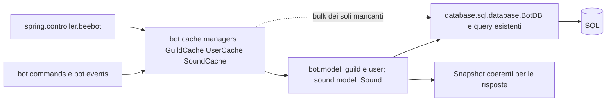

# Beebot: piano concordato di riordino e unificazione

Revisione aggiornata al 18 novembre 2026. L'analisi funzionale iniziale descrive la baseline `48c43d58`. Gli spostamenti eseguiti dal proprietario sono nel commit `e9bf1585`. Il proprietario ha confermato come definitiva la struttura attuale di `com.safjnest`, con `bot`, `database`, `discord`, `lol`, `sound`, `spring`, `status` e `utils`. Questa decisione sostituisce le precedenti destinazioni, compresa `spring.auth`. Il passaggio 1 è nel commit `96d4197a` e il passaggio 2 (guild e alert) è nel commit `21b62a32` con il modello `deferEdit()` concordato. Il passaggio 3 (user, XP e sound), il riordino analytics e la chiusura Sound/Tag sono nel commit `e7daa3f2`. Il passaggio 4 (errori e Spring/auth) è nel commit `f43fc0b8` e il passaggio 5 (HTTP e parsing) in `f4a2d014`. Il passaggio 6 (query auth/API) è nel commit `cb644f3a`. La pulizia finale Sound è nel commit `645f746e`.

Il proprietario ha confermato la chiusura di tutte e sei le fasi. Logging, `Chronos` e la possibile rimozione di `Sound.isOpus()` o del costruttore vuoto sono fuori dal perimetro della chiusura. I criteri di lavoro riutilizzabili sono nella [guida al refactor](refactor-workflow.md).

I rilievi funzionali, i numeri di riga delle fonti iniziali e l'inventario descrivono la baseline prima degli spostamenti; i collegamenti ai sorgenti seguono le posizioni attuali. La sezione «Struttura finale concordata dei package» registra i movimenti già eseguiti, i file nuovi da creare e quelli da assorbire soltanto dopo. Ogni ulteriore decisione concordata va aggiornata qui, mantenendo una sola versione del piano.

## Perimetro attivo

L'obiettivo principale è che bot e API usino le stesse cache, gli stessi oggetti e le stesse operazioni persistenti. `GuildData`, `AlertData` e `Sound` mantengono il modello esistente: una modifica tramite l'oggetto salva sul DB e aggiorna la memoria dopo il successo.

| Decisione | Applicazione al piano |
|---|---|
| MongoDB resta com'è | È ora in `database.nosql`; nessuna scomposizione del repository, ottimizzazione delle query o migrazione dei tipi `QueryRecord`/BSON |
| Struttura SQL conservata | È ora in `database.sql`; nessun refactoring generale di `AbstractDB`/`BotDB`; solo allineamento delle query nuove e assorbimento delle operazioni che oggi creano percorsi paralleli guild/sound |
| App e nomi storici conservati | Nessuna ridenominazione di `App.java`, `distruzione_demoniaca` o altre parti per motivi estetici |
| BotStatus e metriche rimandati | Struttura `status` attuale confermata, incluso `status.log`; nessun refactoring funzionale |
| Comandi e component handler conservati | Spostamenti in `bot.commands` e `bot.events` eseguiti, senza nuove gerarchie o riscritture; solo adeguamenti delle chiamate indispensabili al percorso comune |
| Chronos secondario | `bot.Chronos` conserva nome e comportamento; rimozione o sostituzione rimandata. Una future rappresenta un risultato e non sostituisce la pianificazione periodica |
| Priorità | Cache/oggetti e coerenza bot/API; errori e Spring/auth; trasporto HTTP e parsing comune con LoL |
| Stile Java | Tipi espliciti nelle variabili locali; `var` soltanto eventualmente nelle lambda; singleton `instance` minuscolo. Conservare spaziatura, raggruppamenti e banner ASCII esistenti. Separare per responsabilità anche campi e inizializzazioni dei costruttori, applicando lo stesso criterio ai blocchi nuovi. Mettere il corpo di `if`/`for`/`while` sulla riga successiva. Operazioni delimitate con lambda come `withGuild`, senza comprimere i metodi |
| SoundAnalytics | Riordino di `com.safjnest.sound.SoundAnalytics` riaperto e autorizzato dal proprietario dopo il passaggio 3; `bot.audio.SoundAnalytics` resta escluso |

Le esclusioni non impediscono di leggere un chiamante per capire un contratto. Impediscono di trasformare ogni dipendenza osservata in un ulteriore refactoring.

## Problemi individuati nella baseline

Questi rilievi descrivono il punto di partenza. Il passaggio 1 ha risolto la base comune, i caricamenti coordinati e la durata delle operazioni sulle cache; il passaggio 2 unifica mutazioni e snapshot di guild/alert. Il passaggio 3 unifica ora user, XP e sound; i rilievi sotto conservano la baseline originaria.

### 1. Le modifiche guild e sound hanno ancora percorsi paralleli

**Guild:** `GuildData.setPrefix`, `setExpSystem`, `setLeagueShard` e `setVoice` sono già sincronizzati e aggiornano la memoria dopo il risultato SQL. `AlertData.setMessage`, `setPrivateMessage`, `setAlertChannel` e `setEnabled` fanno già query prima di aggiornare il campo. La dashboard usa invece `GuildService` → `GuildSettingsDB`, poi invalida `GuildCache`. Un riferimento già ottenuto dal bot non viene aggiornato dall'invalidazione.

**Suoni:** `Sound.setName`, `setPublic`, `setTags`, `like` e `dislike` sono già operazioni persistenti, diverse delle quali sincronizzate. La dashboard usa anche mutazioni in `SoundCache.patch/vote/settings` e `SoundDB`. `BotDB.updateSoundMetadata` chiama a sua volta `SoundDB` e invalida `SoundCache`: la catena esiste già, non è soltanto un rischio futuro.

**User:** `UserData.setGreet/unsetGreet` salva e modifica il proprio stato, mentre l'API aggiorna il greet da `SoundCache.settings` e invalida `UserCache`.

**Proposta prioritaria:** le operazioni tornano agli oggetti esistenti e i due ingressi li ottengono dalla stessa cache. La cache carica e coordina l'identità; non interpreta il JSON HTTP. Eliminare i percorsi paralleli senza introdurre `GuildRepository`, `GuildMutationService`, `UserRepository` o `SoundService` sostitutivi.

Fonti: [GuildData](../../src/main/java/com/safjnest/bot/model/guild/GuildData.java):136, [AlertData](../../src/main/java/com/safjnest/bot/model/guild/alert/AlertData.java):120, [Sound](../../src/main/java/com/safjnest/sound/model/Sound.java):158, [UserData](../../src/main/java/com/safjnest/bot/model/UserData.java):160, [SoundCache](../../src/main/java/com/safjnest/bot/cache/managers/SoundCache.java):413 e :497, [BotDB](../../src/main/java/com/safjnest/database/sql/database/BotDB.java):215.

### 2. Il lock sul singolo oggetto non garantisce da solo coerenza

`GuildCache.getGuild` e `UserCache.getUser` separano controllo, caricamento e pubblicazione: due richieste possono costruire istanze diverse. Scadenza e rimozione possono creare lo stesso problema se un chiamante conserva un riferimento precedente. Anche una `ConcurrentHashMap` protegge le operazioni sulla mappa, non l'intera sequenza né lo stato dei valori.

Gli alert espongono altri punti concreti: `GuildData.getAlerts` assegna la mappa prima di completarne il caricamento e la restituisce modificabile; `deleteAlert` rimuove prima dell'esito SQL. `AlertData.setRoles` elimina e ricrea ruoli con chiamate separate. Il lock della guild e un eventuale `synchronized` sul figlio sono due lock diversi: lettori e scrittori devono partecipare allo stesso coordinamento.

**Decisione proposta:** mutazioni negli oggetti, ciclo di vita nella cache. Usare un'operazione delimitata della cache per ottenere e mantenere l'istanza corrente durante il lavoro; sincronizzare nello stesso proprietario le modifiche, le letture coerenti e i relativi snapshot. Il dettaglio del contratto è descritto sotto. Non dichiarare la garanzia finché tutti gli scrittori, inclusi gli handler esistenti, non usano il percorso concordato.

Fonti: [GuildCache](../../src/main/java/com/safjnest/bot/cache/managers/GuildCache.java):40, [UserCache](../../src/main/java/com/safjnest/bot/cache/managers/UserCache.java):27, [GuildData](../../src/main/java/com/safjnest/bot/model/guild/GuildData.java):309 e :419, [AlertData](../../src/main/java/com/safjnest/bot/model/guild/alert/AlertData.java):176.

### 3. La base delle cache è condivisa, ma Sound la aggira

`AbstractCache` contiene un backing statico e bookkeeping separato in mappe non concorrenti. `CacheAdapter` costruisce il namespace dal tipo della chiave. `SoundCache` eredita queste classi ma sostituisce gran parte delle operazioni con una Caffeine tipizzata propria.

**Proposta:** assorbire la base utile in un solo `CacheAdapter<K,V>`, con istanze distinte per tipo di oggetto, caricamento singolo/bulk e coordinamento comune. Eliminare `AbstractCache` quando tutti i consumatori sono migrati. Non costruire una sola mappa globale indicizzata soltanto per ID, né trasferire automaticamente a questa base le politiche di sicurezza delle sessioni.

### 4. Gli errori applicativi sono accoppiati a Spring

`AuthException` deriva da `ResponseStatusException` ed è usata anche da guild, sound e query sound. Le risposte vengono assemblate dal filtro e da più advice. `LolApiExceptionHandler` è globale anche se il nome suggerisce un perimetro LoL; `AuthRequestExceptionHandler` elenca controller specifici. Nel filtro il mapping attuale perde l'eventuale `retryAfter` che l'advice sa rappresentare.

**Proposta:** una sola eccezione applicativa riusabile, senza import Spring, e un mapping HTTP comune anche al filtro. Non occorre una classe `SoundNotFoundException`, una `GuildNotFoundException` e così via.

### 5. Trasporto e parsing hanno opportunità precise di riuso

**HTTP:** `PatchUtils.fetchPatches` e `LeagueHandler.loadRunes` usano già `HttpUtils.readUrl`. Il punto separato è `DiscordApi`: client, request builder, invio e form OAuth propri. Conviene estendere il proprietario esistente `HttpUtils` e far convergere Discord su di esso.

**Parsing:** `lol.utils.NumberUtils` è priva di dipendenze LoL. `BuildUtils.parseAnyInt` ripete sostanzialmente il suo parsing tollerante di un `Object`. Altre conversioni apparentemente simili hanno regole diverse: `ArenaGameParser.integer` verifica integrità/range, `ChampionStatsProvider.number` accetta soltanto `Number`, `LolApiParameters.page` segnala un parametro HTTP errato. Sostituirle indiscriminatamente con un fallback a zero cambierebbe il comportamento.

Fonti: [HttpUtils](../../src/main/java/com/safjnest/utils/HttpUtils.java), [DiscordApi](../../src/main/java/com/safjnest/discord/auth/DiscordApi.java):35 e :67, [PatchUtils](../../src/main/java/com/safjnest/lol/utils/PatchUtils.java):85, [LeagueHandler](../../src/main/java/com/safjnest/lol/LeagueHandler.java):177, [ParseUtils, che ha assorbito NumberUtils](../../src/main/java/com/safjnest/utils/ParseUtils.java), [BuildUtils](../../src/main/java/com/safjnest/lol/utils/BuildUtils.java):43, [ArenaGameParser](../../src/main/java/com/safjnest/lol/arena/ArenaGameParser.java):155.

## Percorso unico proposto



L'arco bulk indica soltanto il caricamento: le scritture restano nelle operazioni dei medesimi oggetti. Il controller adatta input/output HTTP e verifica il contesto autorizzato; non crea un'altra copia operativa né scrive prima nel DB per invalidare dopo.

### Responsabilità degli oggetti

| Proprietario | Cosa mantiene o assorbe |
|---|---|
| `GuildData` | Impostazioni della guild, proprietà dei figli e operazioni di modifica dei blocchi; crea/rimuove alert e canali senza esporre mappe come ingresso di scrittura |
| `AlertData`, `RewardData`, `TwitchData`, `ChannelData`, `BlacklistData` | Setter persistenti e aggiornamenti composti coerenti con la guild; nessuna conoscenza di `JsonNode`, servlet o status HTTP |
| `UserData` | Alias e greet globali/per guild, con aggiornamento dell'istanza corrente dopo il commit; associazioni LoL sul percorso esistente |
| `MemberData` | XP, livello e contatori del membro identificato da guild+user; operazioni composte come acquisizione XP, non soltanto setter isolati |
| `Sound` | Nome, pubblicazione, tag, voti e contatori attraverso il percorso persistente esistente, unificato con la dashboard |
| Cache tipizzate | Identità, caricamenti, bulk e durata delle operazioni; nessuna seconda implementazione delle mutazioni |

`MemberData` non è `UserData`: spostare XP globale dentro la cache user confonderebbe utenti uguali in guild diverse. Anche il controllo del cooldown, la lettura dell'XP, il calcolo del livello e il salvataggio devono essere una singola operazione coordinata sul membro; sincronizzare solo `setExpData` non protegge il calcolo precedente.

### Trasferimento delle operazioni, non soltanto dei file

I nomi nella colonna di destra sono interfacce proposte, da adattare allo stile dei metodi esistenti durante l'implementazione.

| Operazione attuale | Proprietario proposto |
|---|---|
| `GuildService.getGuild` | `GuildCache` ottiene l'istanza; `GuildData.snapshot` copia i setting; `GuildController` completa informazioni, canali e ruoli Discord |
| `GuildService.parseBlock/parseAlert` | Il controller decodifica JSON e presenza/tipo dei campi; `GuildData`/`AlertData` validano e applicano le regole dell'oggetto. Nessun `JsonNode` negli oggetti |
| `GuildService.updateBlock/updateAlert` | Metodi composti di `GuildData` e figli; query necessarie assorbite in `BotDB` con una connessione/transazione per blocco |
| Creazione/inserimento/rimozione alert via mappe | Metodi di `GuildData` che coordinano il figlio e pubblicano il cambiamento dopo il salvataggio |
| `GuildSettingsDB.saveAlert`, sostituzione ruoli | Operazione SQL comune in `BotDB`, riusata sia dai setter singoli sia da aggiornamenti composti; preservare la possibilità di salvare alert ancora non validi |
| `SoundCache.patch/vote/delete` | `Sound` possiede modifica e risultato; cache coordina l'istanza e invalida soltanto le selezioni derivate. Controlli di proprietà/visibilità sotto lock SQL conservati |
| `SoundCache.settings` | `UserData` applica i greet con le stesse operazioni del bot e restituisce risultati per elemento; nessuna invalidazione dell'oggetto corrente dopo una modifica propria |
| `SoundCache.greets` e `/me` | `UserCache` ottiene l'utente; `UserData` carica i greet necessari; i Sound sono risolti in bulk da `SoundCache` |
| `MemberData.canReceiveExperience` più calcolo e `setExpData` in chiamanti separati | Un'operazione composta del membro riusa `ExperienceSystem` e aggiorna cooldown, contatori, XP/livello nello stesso coordinamento |

Il caricamento dei greet richiede un indicatore esplicito di completezza: oggi `UserData.getGreets()` può rappresentare soltanto gli scope caricati finora. Non usarla come se contenesse tutta la tabella per la risposta `/me`. I caricamenti singoli e completi devono arricchire la stessa istanza, conservando fallback globale e override di guild.

### Contratto minimo di concorrenza

La proposta usa l'infrastruttura della cache già esistente, senza un nuovo lock service o repository:

1. **Caricamento unico per chiave.** Una richiesta singola e una bulk per lo stesso ID condividono lo stesso caricamento e la stessa istanza. Il risultato in corso può essere rappresentato internamente da una `CompletableFuture` nell'entry della cache.
2. **Operazione delimitata.** Un metodo della cache, per esempio `GuildCache.withGuild(id, operation)`, acquisisce l'entry e ne impedisce la sostituzione finché l'operazione termina. Lo stesso meccanismo serve a user e sound. Gli oggetti modificabili non devono essere conservati per una scrittura successiva fuori da questo intervallo; all'esterno si conservano ID o snapshot.
3. **Lock del proprietario.** Le operazioni di `GuildData` e dei figli di configurazione condividono il coordinamento della guild. `MemberData` può avere coordinamento per guild+user per evitare di serializzare tutto l'XP della guild; user e sound hanno le proprie identità. Nessun lock globale tenuto durante SQL, Discord o download.
4. **Letture consistenti.** Le risposte copiano lo stato sotto lo stesso coordinamento e serializzano lo snapshot dopo. Non si itera una mappa modificabile mentre un altro ingresso la cambia.
5. **Transazione prima della pubblicazione.** Un aggiornamento di più campi o una sostituzione ruoli usa una transazione SQL per il blocco, poi pubblica in memoria. I setter singoli conservano il loro salvataggio immediato. `synchronized` non trasforma una serie di query con commit separati in una transazione.
6. **Fallimenti e scadenza.** Un caricamento fallito non diventa un oggetto vuoto o un'assenza; le entry in corso vengono completate con errore e possono essere ritentate. Una entry occupata non viene eliminata e ricreata con un'altra istanza. Nessun lock/future/generation viene rimosso mentre protegge ancora un'operazione.
7. **Niente accessi laterali.** Bot e API devono entrambi passare qui, incluse le scritture dei figli. Gli handler mantengono struttura e presentazione, ma le chiamate dirette come `guild.getAlerts().put(...)` devono diventare operazioni del proprietario se si vuole la garanzia completa.

Il passaggio 1 implementa le entry private, i caricamenti coordinati e il mantenimento dell’identità durante `with`/`withAll`. Le operazioni singole sincronizzano sul valore; quelle bulk mantengono tutte le entry, ma richiedono il coordinamento del singolo proprietario per modificarle. I vecchi chiamanti che trattengono oggetti da getter o scrivono nelle mappe non acquisiscono automaticamente queste garanzie: il passaggio 2 migra impostazioni guild, canali, blacklist e alert. User, sound e XP sono migrati nel passaggio 3 descritto in fondo al documento. È coordinamento locale al processo; non dimostra coerenza tra due bot o scrittori esterni sullo stesso DB.

### Bulk: 10 presenti, 20 richiesti

Interfacce indicative: `GuildCache.getGuilds(ids)`, `UserCache.getUsers(ids)`, `SoundCache.getSounds(ids)`. Devono usare lo stesso nucleo dei caricamenti singoli, non implementare un secondo ciclo di vita.

`SoundCache.load` già riusa gli oggetti presenti e carica insieme i mancanti: è una base concreta da conservare. Il lavoro è rendere questo comportamento coerente e concorrente anche per guild e user, senza ricrearlo indipendentemente per ogni API.

1. Normalizzare e deduplicare gli ID, mantenendo l'ordine concordato della risposta.
2. Riutilizzare le 10 entry già presenti; per quelle in corso attendere il caricamento esistente.
3. Prenotare i soli 10 ID mancanti che questa richiesta deve caricare. Un'altra richiesta non avvia un secondo fetch sugli stessi ID.
4. Caricare questi ID con le query bulk necessarie, suddivise in gruppi se richiesto dai limiti. Nessun fetch dei 10 hit.
5. Idratare gli oggetti con i dati già ottenuti, pubblicarli nelle entry prenotate e comporre il risultato con i riferimenti mantenuti dall'operazione.

Il risultato completo HTTP attende soltanto i dati mancanti; gli hit sono già disponibili internamente. Non cambia il contratto dell'endpoint per introdurre risposte parziali non richieste.

**Idratazione nei passaggi 1–2:** le cache usano `GuildData.fromRows` e `UserData.fromRows`, che ricevono canali/azioni/alias già caricati. I costruttori pubblici precedenti restano compatibili; il bulk non li usa per avviare query per ogni oggetto. Il loader SQL restituisce assenza per una guild non salvata; `withGuild` può conservarne un contenitore predefinito solo in memoria. Una GET non crea righe: la prima modifica valida salva il blocco e crea la guild nella stessa transazione. `getGuildOrPut`/`withGuildOrPut` mantengono la richiesta esplicita di creazione sul DB. `GuildData.getMemberData` costruisce un membro solo in memoria quando assente; il passaggio 3 salva il membro insieme al primo aggiornamento valido. I profili LoL mantengono il caricamento lazy esistente, senza modifiche a Mongo.

Le viste autorizzate e i campi personali di Sound non vanno memorizzati sugli oggetti globali condivisi. I dati dell'utente che guarda la risposta restano su copie di risposta, come previsto dal contratto attuale.

## Errori: una classe applicativa e un adattatore HTTP

Nome richiesto dal proprietario: `com.safjnest.exception.Exception`. È una `RuntimeException` applicativa; nei file che la importano le catch e le firme riferite al tipo Java standard usano esplicitamente `java.lang.Exception`.

Contenuto minimo: categoria, codice stabile, messaggio passato dal chiamante, causa originale ed eventuale `retryAfter`. La categoria può essere un enum annidato nello stesso file. Nessun `HttpStatus`, `ResponseEntity`, dipendenza da Spring o sottoclasse per ogni dominio.

| Esempio richiesto | Categoria condivisa | Dato specifico conservato |
|---|---|---|
| Elemento non trovato | `NOT_FOUND` | `sound_not_found`, `guild_not_found` o altro codice esistente; messaggio del chiamante |
| Chiave errata | `UNAUTHENTICATED` | `invalid_api_key`; distinto da un utente autenticato ma senza permessi |
| Body errato | `INVALID_REQUEST` | `invalid_request`, campo/messaggio sanitizzato dove previsto |
| Permesso insufficiente | `FORBIDDEN` | `guild_forbidden`, `sound_forbidden` |
| Dipendenza indisponibile | `UNAVAILABLE` | `auth_unavailable`, `discord_unavailable`, `sound_storage_unavailable` |
| Risposta upstream malformata | `INVALID_UPSTREAM_RESPONSE` | Mantiene la distinzione attuale fra 502 e 503 |
| Rate limit esterno | `RATE_LIMITED` | Codice, durata e mapping specifico già promesso al client |

Il codice specifico resta importante: il frontend deve distinguere chiave errata, sessione scaduta e Discord indisponibile anche se la classe Java è unica. I messaggi delle eccezioni impreviste non vengono copiati automaticamente al client.

In Spring, `ApiErrors` compone body/header/status e può scrivere anche la risposta del filtro; `ApiExceptionHandler` intercetta gli errori applicativi e di binding/framework. I record di risposta possono essere annidati in `ApiErrors`, mantenendo le forme Beebot e LoL esistenti, inclusi `metadata` e `Retry-After`. `LolApiResponses` continua a mappare `ApiResult` secondo ADR-0007: dati pronti, parziali o in preparazione non diventano eccezioni.

## HTTP e parsing: unificazione circoscritta

### HTTP

`utils.HttpUtils` è il punto comune per costruzione della request, invio, encoding dei form e trattamento dell'interruzione. `DiscordApi` conserva URL, payload, autenticazione Discord e significato di 401/403/429 o risposta malformata; passa la richiesta al trasporto comune. Il trasporto testabile è ora `HttpUtils.Transport`, riusato dal client Discord e dalle facciate esistenti; non rimane una seconda interfaccia in `DiscordApi`.

I valori restano: HttpUtils ha connessione 5 s/richiesta 10 s; Discord usa 15 s. `createTransport` costruisce i client riusati con profili distinti, senza duplicare il builder. La decodifica ordinaria segue il charset HTTP; Discord mantiene UTF-8 esplicito. Non serve imporre un solo timeout o lo stesso parser JSON. Il trasporto deve restituire anche status/header/body per la politica Discord; non trasformare ogni risposta non 2xx in un errore indistinto prima che venga interpretata.

### Parsing

`utils.ParseUtils` possiede ora le conversioni condivise effettivamente usate. `lol.utils.NumberUtils` è rimosso dopo la migrazione dei chiamanti; le varianti senza consumatori non sono replicate. Restano distinti parsing esatto, trim, fallback e risultato nullable. `FilterCodec` conserva il significato LoL di `*`, delimitatori e codifica delle chiavi.

| Punto attuale | Intervento proposto | Compatibilità da verificare |
|---|---|---|
| `BuildUtils.parseAnyInt` | Delegare alla conversione comune e rimuovere il duplicato dopo gli aggiornamenti dei chiamanti | `Number`, stringhe con trim, null/errore → 0 |
| `NumberUtils` e chiamanti `Filter`, `BuildSignature`, `RuneSignature`, `Match`, `FilterCodec` | Aggiornare import e riusare il proprietario comune | Fallback, tipo di ritorno e significato delle chiavi immutati |
| `PatchUtils.patchPart` | Riusare la parte numerica solo preservando la politica sui segmenti | Oggi non fa trim: non cambiare silenziosamente gli input accettati |
| `LolApiParameters.page/profileSeason/parseEnum` | Riusare la conversione di base, mantenere vincoli e messaggi HTTP qui | Input invalido resta errore, non zero/null interpretati come dato valido |
| `ChampionStatsProvider.number`, `ProfileRecordAnalyzer.number` | Valutare una variante comune per soli `Number`, non la conversione che accetta anche stringhe | Stesso insieme di valori accettati |
| `ArenaGameParser.integer/time` | Conservare i controlli integrità/range/non negatività; estrarre solo se ci sono altri consumatori effettivi | Nessuna conversione frazionaria o fuori range tramite semplice `intValue` |
| `QueryRecord.getAsInt/getAsLong/getAsDouble` | Restano dove sono; i consumatori di righe riusano questi metodi | Nessun refactoring del framework SQL/BSON |

Il pattern esistente usa `QueryRecord` per una riga e `List<QueryRecord>` per più righe. `AuthDB.findClient` e `AuthDB.findSession` usano `QueryRecordParser.fromRow()` e costruiscono `ApiKey` e `Session` dalle colonne nominate. Un risultato assente e un errore SQL restano casi distinti.

## Struttura finale concordata dei package

Il 17 novembre 2026 il proprietario ha confermato la struttura già realizzata nel commit `e9bf1585`. Non sono più richiesti gli spostamenti verso `beebot`, `spring.auth`, una `cache` alla radice o i vecchi package database alla radice. Anche i nomi `LolApiConfig` e `DiscordAuthController` rimangono quelli attuali.

La radice resta `com.safjnest`. Le responsabilità sono:

- `bot`: avvio del bot, comandi, eventi, audio/chat, modelli guild/user/configurazione e infrastruttura delle cache;
- `database`: SQL, MongoDB e Redis nei rispettivi sottopackage;
- `discord.auth`: credenziali, flussi di autenticazione e client Discord; `discord.guild`: cache autorizzativa;
- `exception`: errore applicativo comune, senza dipendenze Spring;
- `lol`: dominio, modelli, servizi, analisi, tracker, code e presentazione LoL; i comandi Discord LoL sono in `bot.commands.lol`;
- `sound`: operazioni e helper sound, con i modelli in `sound.model`;
- `spring`: ingressi HTTP, filtro/configurazione e rappresentazione degli errori;
- `status`: metriche e logging; `utils`: utility esistenti e meccanismi comuni verificati.

La base resta `bot.cache.CacheAdapter`, con `GenericCache`, `GuildCache`, `UserCache` e `SoundCache` in `bot.cache.managers`. I controller Spring useranno queste stesse cache: il loro package non introduce un percorso separato. Le politiche di sicurezza di `discord.guild.DiscordGuildCache` rimangono distinte dalle cache degli oggetti operativi.

L'albero seguente descrive i file attuali rilevanti per il piano, aggiornati dopo il passaggio 5; `...` conserva tutti gli altri file e sottopackage esistenti. I file da assorbire sono presenti finché non è completata la migrazione delle loro funzionalità. Le aggiunte future sono elencate separatamente.

```text
com/safjnest/
├── App.java
├── bot/
│   ├── Bot.java
│   ├── Chronos.java
│   ├── commands/                         ... inclusi i comandi LoL
│   ├── events/                           ... handler esistenti
│   ├── audio/                            ... sottopackage esistenti
│   ├── chat/                             ... classi esistenti
│   ├── cache/
│   │   ├── CacheAdapter.java
│   │   └── managers/
│   │       ├── GenericCache.java
│   │       ├── GuildCache.java
│   │       ├── UserCache.java
│   │       └── SoundCache.java
│   └── model/
│       ├── AliasData.java
│       ├── UserData.java
│       ├── BotSettings/                  ... configurazioni esistenti
│       ├── customemoji/                  ... modelli esistenti
│       └── guild/                        ... inclusi GuildData, MemberData e alert/
├── database/
│   ├── sql/
│   │   ├── AbstractDB.java
│   │   ├── DatabaseHandler.java
│   │   ├── QueryRecord.java
│   │   ├── QueryRecordParser.java
│   │   └── database/                     ... AuthDB, BotDB e altri DB esistenti
│   ├── nosql/                            ... implementazione conservata
│   └── redis/                            ... implementazione conservata
├── discord/
│   ├── auth/
│   │   ├── ApiKey.java
│   │   ├── DiscordApi.java
│   │   └── DiscordAuthService.java
│   └── guild/
│       └── DiscordGuildCache.java
├── exception/
│   └── Exception.java
├── lol/                                  ... dominio esistente conservato
├── sound/
│   ├── SoundAnalytics.java
│   ├── SoundHistory.java                 accumulatore interno analytics
│   ├── SoundPeriod.java
│   └── model/
│       ├── Sound.java
│       └── Tag.java
├── spring/
│   ├── SpringServer.java
│   ├── config/
│   │   ├── AuthFilter.java
│   │   └── LolApiConfig.java
│   ├── controller/
│   │   ├── StatusController.java
│   │   ├── beebot/                       ... DiscordAuthController, MeController, GuildController, SoundController
│   │   └── lol/                          ... controller e helper HTTP esistenti
│   └── exception/
│       ├── ApiErrors.java
│       └── ApiExceptionHandler.java
├── status/
│   ├── log/                              ... BotLogger, converter e LoggerIDpair
│   └── ... metriche esistenti
└── utils/
    ├── HttpUtils.java
    ├── ParseUtils.java
    └── ...                               altre utility e sottopackage esistenti
```

`ExperienceSystem` e `AlertMessage` restano in `utils`. `bot.audio.SoundAnalytics` e `sound.SoundAnalytics` sono classi differenti e non vengono unite sulla sola base del nome. `App.java`, `distruzione_demoniaca`, comandi, component handler e presentazione mantengono il comportamento previsto dal perimetro.

### Spostamenti eseguiti dal proprietario

Le colonne sono relative a `src/main/java/com/safjnest/`. Questa tabella registra i movimenti dalla baseline iniziale al checkout confermato; non è una nuova lista di spostamenti da eseguire.

| Posizione nella baseline | Posizione attuale confermata |
|---|---|
| `core/Bot.java`, `core/Chronos.java` | `bot/Bot.java`, `bot/Chronos.java` |
| `commands/**` | `bot/commands/**` |
| `core/events/**` | `bot/events/**` |
| `core/audio/**` | `bot/audio/**` |
| `core/chat/**` | `bot/chat/**` |
| `core/cache/**` | `bot/cache/**`, conservando `managers` |
| `model/**`, escluso `model/sound/**` | `bot/model/**`, comprese configurazioni, emoji e `GuildSettings` |
| `model/sound/**` | `sound/model/**` |
| `auth/**` | `discord/auth/**` |
| `guild/**` | `discord/guild/**` |
| `sql/**` | `database/sql/**` |
| `nosql/**` | `database/nosql/**` |
| `redis/**` | `database/redis/**` |
| `utils/log/**` | `status/log/**` |

`LolApiConfig`, `DiscordAuthController`, `AuthFilter` e gli helper ancora in `sound` conservano posizione e nome attuali. `NumberUtils`, mantenuto durante gli spostamenti, è stato assorbito da `ParseUtils` nel passaggio 5. Nessun ulteriore movimento dei file esistenti è un prerequisito del prossimo passaggio. Le estrazioni e rimozioni funzionali descritte sotto restano successive alla migrazione dei chiamanti.

### File nuovi a cura dell'assistente

| File da creare | Responsabilità |
|---|---|
| `exception/Exception.java` — creato nel passaggio 4 | Eccezione applicativa comune senza Spring, con categoria annidata, codice, messaggio, causa ed eventuale retry |
| `spring/exception/ApiErrors.java` — creato nel passaggio 4 | Mapping e record HTTP annidati, riusati dal filtro, dall'advice e da `LolApiResponses` |
| `spring/exception/ApiExceptionHandler.java` — creato nel passaggio 4 | Gestione unificata degli errori applicativi, di binding e del framework |
| `spring/controller/beebot/MeController.java` — creato nel passaggio 3 | Profilo e impostazioni utente; delega al percorso comune degli oggetti |
| `utils/ParseUtils.java` — creato nel passaggio 5 | Conversioni effettivamente condivise, con regole esatte/trim, fallback e null distinti |

L'albero non richiede una nuova classe per ogni errore o un nuovo service/repository per ogni cache. I tipi di sola rappresentazione restano nei proprietari appropriati, annidati quando semplice e utile.

### File da mantenere temporaneamente e assorbire dopo

Questi file non vanno cancellati durante i soli spostamenti. L'assistente li rimuoverà soltanto dopo aver trasferito le funzionalità necessarie e aggiornato chiamanti, registrazioni, contratti e test.

| File attuale da mantenere temporaneamente | Assorbimento previsto |
|---|---|
| `discord/auth/AuthException.java` — rimosso nel passaggio 4 | Sostituito dall'errore comune `exception.Exception`, con mapping HTTP in `spring.exception` |
| `discord/guild/DiscordGuildService.java` — rimosso nel passaggio 4 | Operazioni di lista autorizzata, decrittazione e controllo amministrativo in `discord.auth.DiscordAuthService`, con la stessa cache autorizzativa |
| `discord/guild/GuildService.java` — rimosso nel passaggio 2 | Mutazioni e regole in `bot.model.guild.GuildData`/figli; adattamento input/output nel controller. Nessun trasferimento indiscriminato di tutta la classe in un unico altro file |
| `database/sql/database/GuildSettingsDB.java` — rimosso nel passaggio 2 | Query necessarie in `BotDB`, mantenendo transazioni per blocco, ruoli vuoti, campi omessi, null e creazione di alert ancora non validi |
| `bot/model/guild/GuildSettings.java` — rimosso nel passaggio 2 | Record di vista/risultato annidati nel proprietario `bot.model.guild.GuildData`, con forma HTTP e validità attuali |
| `sound/SoundAccess.java` — rimosso nel passaggio 4 | Lookup/proiezione Discord in `discord.auth.DiscordApi`, con politiche distinte per membership ordinaria e amministrazione |
| `database/sql/database/SoundDB.java` | Query nuove necessarie in `BotDB`, preservando statement preparati, lock SQL, streaming/batch e sessione di lettura; catena `BotDB → SoundDB` eliminata, file assorbito e rimosso nel passaggio 3 |
| `lol/utils/NumberUtils.java` — rimosso nel passaggio 5 | Funzioni effettivamente usate in `utils.ParseUtils`; wildcard e chiavi rimangono in `FilterCodec` |
| `sound/SoundQueryCache.java` | Rimosso. Le selezioni Redis di soli ID sono gestite da `bot.cache.managers.SoundCache`. |
| `sound/SoundValues.java` | Rimosso. I risultati tipizzati sono in `SoundCache` e `MeController`, la validazione in `ValidationUtils`, gli errori in `Exception`. |
| `spring/exception/AuthExceptionHandler.java` — rimosso nel passaggio 4 | Gestione applicativa in `spring.exception.ApiExceptionHandler`; record di errore in `ApiErrors` |
| `spring/exception/AuthRequestExceptionHandler.java` — rimosso nel passaggio 4 | Binding e body errati nel medesimo handler HTTP |
| `spring/exception/LolApiExceptionHandler.java` — rimosso nel passaggio 4 | Gestione HTTP LoL/framework nel medesimo handler, mantenendo il contratto esistente |
| `spring/dto/LolApiError.java` — rimosso nel passaggio 4 | Record `LolApiError` annidato in `spring.exception.ApiErrors`, conservando `status`, `code`, `message` e `metadata` |

### Modifiche concordate ai file conservati

| Proprietario nella struttura finale | Modifica prevista |
|---|---|
| `bot.model.guild.GuildData` e figli | Setter persistenti preservati; operazioni composte, proprietà delle mappe e snapshot coerenti |
| `bot.model.UserData` | Greet/alias sullo stesso percorso di bot e API; completezza esplicita dei caricamenti e supporto all'idratazione bulk |
| `bot.model.guild.MemberData` | Operazione XP coordinata per guild+user, comprendente cooldown, calcolo e salvataggio |
| `sound.model.Sound` | Assorbire mutazioni API oggi in `SoundCache`, mantenendo controlli atomici di visibilità/proprietà e setter dei comandi |
| `bot.cache.managers.GuildCache/UserCache/SoundCache` | Loader e policy tipizzate sulla base comune; richieste singole/bulk coordinate, senza nuovi service/repository intermedi |
| `bot.cache.CacheAdapter` | Backing per istanza, identità, durata delle operazioni e caricamenti coordinati; `GenericCache` riusa la medesima base |
| `utils.HttpUtils` | Builder/invio comuni anche a Discord, trasporto testabile e timeout compatibili |
| `discord.auth.DiscordApi` | URL, payload e politica Discord; trasporto sul helper HTTP comune. L'URL OAuth è un dato semplice che il servizio auth avvolge nel proprio risultato |
| `discord.auth.DiscordAuthService` | Un unico flusso credenziali/sessioni; assorbire la lista amministrativa senza confonderla con la membership sound |
| `discord.guild.DiscordGuildCache` | Preservare identità utente/applicazione/sessione, revoca, Redis/fallback, lease e fencing |
| `spring.config.AuthFilter` | Controllo credenziali/contesto e uso del mapper errori comune; nessun package `spring.security` separato |
| `spring.config.LolApiConfig` | Configurazione HTTP comune e personalizzazioni LoL; la scansione continua a includere controller/auth/error HTTP |
| `spring.controller.beebot.DiscordAuthController` | Solo authorize, session e logout |
| `spring.controller.beebot.MeController` | `/me` e `/me/settings`, usando gli oggetti ottenuti dalla cache comune |
| `spring.controller.beebot.GuildController` | Ora possiede anche `/guilds` e l'alias `/servers`, trasferiti dal controller auth; impostazioni sui medesimi oggetti del bot |
| `spring.controller.beebot.SoundController` | Endpoint sound sul percorso comune; `/me/settings` passa al controller Me |
| `spring.controller.lol.LolApiParameters/LolApiResponses` | Riuso dei meccanismi comuni senza perdere vincoli HTTP, stati `ApiResult`, metadati o regole LoL |
| `database.sql.database.AuthDB` | Mantiene tutto il SQL auth e usa il parser delle righe per le letture di chiavi e sessioni |

Dopo gli assorbimenti si rimuovono soltanto i file le cui funzionalità sono state migrate e le cartelle effettivamente vuote. `discord.auth`, `discord.guild`, `sound`, `bot.cache.managers` e `spring.exception` restano destinazioni confermate; non vanno eliminati per conformarsi al vecchio albero.

### Confine Spring e sincronizzazione delle regole

La struttura confermata conserva Spring per controller, filtro/configurazione e mapping HTTP degli errori. L'autenticazione resta in `discord.auth`, la cache autorizzativa in `discord.guild`; non è più previsto l'ampliamento verso `spring.auth` descritto nella versione precedente del piano. I modelli di successo LoL restano in `lol.model` e le decisioni accettate non vengono modificate.

L'autenticazione non viene duplicata per controller LoL o credenziali personali. `discord.auth.DiscordApi` serve anche ai suoni; `exception.Exception` è applicativa; `AuthDB` resta in `database.sql.database`. L'handler e il mapper comuni nuovi saranno in `spring.exception`, riusando il package esistente.

### Suoni e R2

`bot.audio.SoundFiles` coordina la copia locale sulla VPS per player, download e
greet. `database.R2` condivide URL CDN, download e upload S3.
`sound.model.Sound` conserva i metadati e `SoundCache` ne coordina l'istanza.

Le copie locali vengono mantenute e tutte le letture usano il CDN configurato.
I dettagli dell'upload e dei setting sono in [Asset storage on R2](../audio-storage-r2.md).
Le copertine delle soundboard usano lo stesso bucket. `SoundboardThumbnails`
carica le immagini, `BotDB` salva la chiave dopo l'upload e `SoundEmbed` usa
il CDN.
La durata dei suoni è calcolata prima dell'upload e letta da SQL da API ed
embed. R2 riceve i metadati della riga e dei tag durante upload e modifica.
Il lookup per nome o ID usa query preparate e una sola regola di visibilità
per i comandi, con il contesto della gilda corrente.


## Sequenza di implementazione proposta

I passaggi 1–6 sono nei commit riportati in apertura. La tabella riporta per ogni intervento il risultato e i criteri di verifica.

| Passaggio | Risultato concreto | Verifiche necessarie |
|---|---|---|
| 1 — Cache e identità, implementato | Una base per istanza; singolo/bulk coordinati; viste della cache e operazioni delimitate. Snapshot di dominio nei passaggi 2–3 | 10 hit+10 miss; richiesta singola sovrapposta; scadenza durante mutazione; errore loader; stessa istanza durante l'operazione |
| 2 — Guild e alert, implementato | API sugli oggetti della cache; eliminazione `GuildService`/`GuildSettingsDB` dopo la migrazione delle funzionalità | Bot→API e API→bot immediati; ruoli vuoti; rollback per blocco; letture durante modifiche; Twitch dopo il commit e fuori dal lock |
| 3 — User e sound, implementato | Greet e mutazioni sullo stesso percorso dei comandi; eliminazione dei passaggi paralleli | XP concorrente per guild+user; metadata/voti e privacy sound; cache query invalidata dopo commit senza sostituire oggetti ancora in uso |
| 4 — Errori e Spring/auth, implementato | Eccezione comune, mapper unico e raggruppamento dei controller | Contratti Beebot/LoL, filtro e advice, token scaduti, retry, body errato e rotta non trovata |
| 5 — HTTP e parsing, implementato | Helper già esistenti estesi e riusati; niente cambi a Mongo o al framework SQL | Timeout/status/header Discord e Data Dragon; input numerici limite e fallback; filtri e chiavi invariati |
| 6 — Allineamento query auth/API, implementato | Letture tramite `QueryRecord` e condizioni condivise per le sessioni in `AuthDB` | Query parametrizzate, consumo OAuth una sola volta, revoca autorevole anche con cache piena, 401 e 503 distinti |

È utile realizzare presto la piccola parte condivisa degli errori se serve ai passaggi precedenti; la sequenza non impone di far transitare tutto il riordino da una grande riscrittura preventiva.

Le eliminazioni avvengono soltanto quando chiamanti, registrazioni e test sono migrati. Il progetto deve compilare tra gruppi coerenti; in fase di implementazione si rileggerà l'impatto CodeGraph e la documentazione API per ogni gruppo. Le API guild hanno transazioni indipendenti per blocco/elemento, non una nuova transazione unica dell'intero body.

## Passaggio 1 implementato

- `CacheAdapter` sostituisce `AbstractCache`: backing Caffeine per istanza, senza prefissi costruiti dal tipo della chiave, reflection sui generics o mappe statiche di bookkeeping. `GenericCache` conserva il costruttore pubblico esistente e riusa la stessa base.
- Guild e user mantengono rispettivamente limite 60/2000 e scadenza dopo 12 ore di inattività; sound mantiene limite 100 e 60 secondi dalla scrittura. Le entry occupate possono superare temporaneamente la capacità trattenuta dalla cache: restano attive finché termina l'operazione.
- Singolo, bulk e dati già precaricati riservano le stesse entry. Si caricano soltanto i mancanti, con future condivise; gli ID duplicati non generano altri fetch e l'ordine della risposta è conservato. Le assenze non vengono memorizzate come cache negativa.
- `withGuild`, `withUser`, `withSound` e le varianti plurali delimitano l'uso. Una scadenza o eviction non sostituisce l'istanza occupata. La variante singola usa il monitor dell'oggetto; la plurale mantiene le entry e consente di acquisire il singolo proprietario durante le modifiche.
- Invalidazione e `clear` impediscono che un vecchio caricamento ripubblichi dati in cache. I partecipanti già sull'entry possono terminare; la rimozione definitiva avviene all'ultimo rilascio. Un `put` sostitutivo viene applicato al rilascio, rispettando successive invalidazioni. Gli errori completano le attese e permettono il retry.
- Guild precarica impostazioni, canali e azioni con query preparate in gruppi di massimo 500 ID; user precarica gli alias. Le factory dai record evitano query e dipendenze Discord durante l'idratazione. Il caricamento completo iniziale delle guild seleziona anche voce, lingua e shard, richiesti dal modello.
- Sound riusa la stessa base sia dal player sia dalle risposte API già precaricate; conserva controlli di visibilità, dati freschi per richiesta e copie con dati personali. Alla fine di quel passaggio le mutazioni API restavano nella facade; il passaggio 3 le migra agli oggetti. Le liste e mappe esposte dalla cache sono viste copiate, non accessi modificabili al backing.
- I riferimenti di converter e logger nei due XML sono stati aggiornati a `com.safjnest.status.log`.

Sono stati riesaminati `GuildController`, `SoundController` e i loro percorsi: endpoint, payload, autorizzazione e presentazione restano invariati. Questa era la verifica del passaggio 1: il percorso guild separato è stato successivamente migrato nel passaggio 2 descritto sotto. Nessuna modifica a modelli/servizi/API LoL, Mongo, Redis LoL, metriche, `SoundAnalytics` o nomi storici. Framework SQL e schema conservati; le sole query nuove servono al bulk delle cache.

## Passaggio 2 implementato: copie di modifica e salvataggi espliciti

La direzione concordata con il proprietario è questa:

```java
boolean saved = GuildCache.withGuild(guildId, guild -> {
    AlertData edit = guild.getAlert(AlertType.LEAVE).deferEdit();

    edit.setMessage(message);
    edit.setPrivateMessage(privateMessage);

    return edit.update();
});
```

- `deferEdit()` crea una copia privata, compresi i ruoli e i campi Twitch/reward. I setter sulla copia non eseguono query; i setter sull'oggetto originale continuano a salvare immediatamente.
- `update()` salva tutti i campi del solo blocco interessato tramite query preparate esplicite in `BotDB`. Non ci sono mappe campo→colonna, aggiornamenti SQL dinamici o transazioni dell'intero JSON. Ruoli e sottotipo dell'alert partecipano alla stessa transazione.
- Il commit precede la copia dei valori nell'istanza originale. Errore SQL, cancellazione o revisione superata restituiscono `false`, lasciando intatta la memoria. Una copia già salvata va sostituita con una nuova `deferEdit()` per un'altra modifica.
- `GuildData.deferEdit()` riguarda i campi generali. Blacklist, canali e alert si modificano sulle rispettive copie, ciascuna con il proprio `update()`; non è una copia dell'intera guild da salvare in blocco.
- `AlertData` non conserva un riferimento a `GuildData`: conserva l'ID della guild e il proprio stato. `GuildData` coordina creazione e rimozione; il monitor della cache mantiene l'istanza durante l'operazione. Un controllo di revisione per oggetto impedisce a due copie obsolete di sovrascriversi.
- `GuildController` mantiene parsing JSON, verifica dei riferimenti Discord, autorizzazione e adattamento HTTP. Ottiene dalla stessa `GuildCache` gli oggetti usati da comandi ed eventi; non invalida la guild dopo una modifica propria. Gli snapshot copiano lo stato e la serializzazione avviene fuori dal lock.
- Ogni chiave di blocco e ogni elemento di `channels`/`twitch`/`reward` produce il proprio risultato. L'elaborazione resta sequenziale per guild: le modifiche allo stesso oggetto sono comunque serializzate, senza introdurre future aggiuntive. Twitch viene registrato dopo il commit e fuori dal lock.
- Le mappe restituite da `getAlerts()` e `getChannels()` sono copie: l'inserimento passa da `createAlert` oppure da `newAlert` → `update` → `addAlert`, la rimozione dai metodi di `GuildData`. Gli ID SQL indicizzano internamente gli alert, così modificare il livello reward non richiede un riferimento al padre.
- `GuildService`, `GuildSettingsDB` e il file di soli record `GuildSettings` sono rimossi dopo la migrazione. I record di risposta rimangono annidati in `GuildData`; endpoint, campi HTTP, validazione e presentazione Discord sono conservati.

La garanzia riguarda il processo che condivide queste entry della cache. Non è un protocollo di sincronizzazione con scrittori esterni o altre istanze del bot. XP, membri, user e sound sono stati poi migrati nel passaggio 3; auth, errori comuni, HTTP/parsing e R2 mantengono la sequenza concordata.

## Stato delle verifiche

L'inventario iniziale descriveva 448 Java `com.safjnest`, 10 Java incorporati e 101 file di test. [Il registro](review/inventory.tsv) distingue lettura completa, parziale e soli metadati della baseline: non è un audit esaustivo di ogni metodo.

Nel controllo degli spostamenti del 17 novembre 2026 sul commit `e9bf1585`:

- CodeGraph risulta aggiornato a 484 file; restano 448 sorgenti applicativi e 10 incorporati;
- dichiarazioni package, cartelle e import risultano coerenti;
- `mvn -o -DskipTests clean compile` ha compilato da zero tutti i 458 file Java con `BUILD SUCCESS`;
- i 101 file di test precedenti sono stati rimossi dal proprietario; quella suite non è stata eseguita e servono verifiche mirate durante l'implementazione dei passaggi funzionali;
- una prova isolata di Logback ha riprodotto due errori nella configurazione caricata da `BotLogger`: `rsc/logback.xml` e `src/main/resources/logback-spring.xml` conservano riferimenti a `com.safjnest.utils.log`, mentre le classi sono in `com.safjnest.status.log`; il logger attuale eredita inoltre `INFO` invece del `TRACE` configurato per il vecchio nome. La correzione è stata applicata nel passaggio 1;
- i file degli agenti/skill sono stati rimossi dal versionamento e le cartelle ignorate; il piano resta nel documento versionato, mentre la skill locale non è più condivisa dalla repo.

Questi controlli risalgono alla verifica degli spostamenti e riguardano compilazione e coerenza dei package. Le verifiche funzionali dei passaggi successivi sono nelle rispettive sezioni.

Il passaggio 1 modifica la base delle cache, i loader, le factory di idratazione, le sole query bulk necessarie e i riferimenti del logging. I nuovi test locali coprono concorrenza, bulk, scadenza/eviction, invalidazione, errori, creazione, SQL preparato con H2 e isolamento delle risposte sound. La suite precedente di 101 file non è stata ripristinata. Il codice resta compatibile con il target Java 25 configurato; le lambda non richiedono un cambio di versione. Contratti API, presentazione e ADR accettati rimangono invariati.

Verifica finale del passaggio 1 sul working tree del 17 novembre 2026:

- `mvn -o clean test`: compilazione pulita di 457 sorgenti principali, 4 file di test e 29 test superati, zero errori/fallimenti/skipped;
- prova isolata del logging con classpath aggiornato: zero errori di configurazione e livello effettivo `TRACE` per `BotLogger`;
- `git diff --check` senza errori; nessuna modifica a `SoundAnalytics`, sorgenti LoL, Mongo, `AbstractDB` o `QueryRecord`;
- le prove SQL usano H2 locale e quelle sound sorgenti finte: nessun avvio live di bot/API o verifica con MariaDB, Redis, Discord o R2.

Rifinitura dello stile richiesta dal proprietario: spaziatura applicata ai metodi introdotti/riscritti nello step 1, con gruppi logici separati e controlli su più righe. Verificata l’identità dei token Java rispetto allo stato precedente alla formattazione: logica, API, persistenza e presentazione invariati. I metodi legacy esclusi, inclusi quelli di `SoundAnalytics`, restano fuori dal giro.

Verifica finale del passaggio 2 sul working tree del 17 novembre 2026:

- `mvn -o clean test`: compilazione pulita di 454 sorgenti principali e 5 file di test; 51 test superati, zero errori/fallimenti/skipped. I 22 nuovi casi di `GuildEditingTest` verificano copie private, identità condivisa, setter immediati, revisioni obsolete, rollback SQL e ruoli, creazione/cancellazione, risultati indipendenti, bot/API concorrenti, snapshot e compatibilità HTTP, autorizzazione, indisponibilità SQL e Twitch dopo commit fuori dal lock.
- `git diff --check` senza errori; CodeGraph aggiornato e impatto di modelli/chiamanti riesaminato. Nessuna scrittura residua tramite `getAlerts().put` o `getChannels().put`; nessun riferimento operativo ai tre file assorbiti.
- Controllati i consumatori di guild nelle parti bot e LoL. Il comando `Region` cambia soltanto la chiamata alla cache; modelli, servizi, controller e contratti API LoL non richiedono aggiornamenti. Nessuna modifica a Mongo, `SoundAnalytics`, status, `AbstractDB`, schema o presentazione Discord. Documentazione guild/API, handbook e piano sincronizzati.
- SQL verificato con H2 in modalità MariaDB, HTTP con MockMvc, Discord/Twitch tramite sostituti locali. Nessun avvio live del bot o controllo su MariaDB, Redis, Discord, Twitch o R2 reali; nessuna misura di prestazioni.


Rifinitura dello stile del passaggio 2, richiesta dal proprietario il 17 novembre 2026: riesaminati i 20 file Java presenti nel diff, incluso il nuovo file di test. Sistemati 13 file con raggruppamenti di campi, inizializzazioni e fasi dei metodi; ripristinati i sei banner ASCII di `GuildData`, il separatore preesistente del controller e le attribuzioni delle classi riscritte. Il confronto lessicale con lo stato immediatamente precedente conferma la stessa sequenza di token Java in tutti i 20 file, ignorando solo spaziatura e commenti. Nessuna modifica funzionale, al contratto API, alla persistenza o alla presentazione; la documentazione funzionale rimane valida. `git diff --check` e `mvn -o -DskipTests clean compile` completati con successo; compilazione pulita dei 454 sorgenti principali. Non sono stati aggiunti o rieseguiti test per la sola formattazione.

## Passaggio 3 implementato: user, XP e sound

Baseline del passaggio: `21b62a32`, working tree inizialmente pulito. Il modello
concordato continua a usare oggetti persistenti e cache condivise, senza nuovi
service/repository. Nessuna modifica di schema o migrazione.

- `UserData` possiede alias e greet: le query preparate sono in `BotDB`, la
  memoria cambia dopo il commit e le mappe esposte sono copie. La cancellazione
  di un alias usa il suo ID persistito e lo user proprietario. `UserCache`
  conserva il caricamento bulk dei soli alias mancanti e passa lo stesso DB
  agli oggetti idratati.
- Ogni greet è una singola associazione scope → sound e conserva una propria
  transazione e un proprio risultato; non serve una copia differita dell'intero
  user per modificare un solo valore. `getAllGreets()` completa il caricamento
  sulla stessa istanza, distingue lo stato completo dai lookup lazy e conserva
  override di guild e fallback globale. Una lettura fallita non viene pubblicata
  come assenza. Bot, API e playback passano da questo oggetto; i salvataggi API
  non invalidano più `UserCache`.
- `MeController` possiede `/me` e `/me/settings`, con gli stessi URL, campi e
  risultati precedenti. Il parsing HTTP e gli errori per scope escono da
  `SoundCache`; membership ordinaria e lista amministrativa restano distinte.
  L'advice dei body malformati comprende il nuovo controller. Le rotte
  `/guilds` e `/servers` rimangono nel controller attuale fino al passaggio 4.
- `MemberData.receiveExperience()` coordina cooldown, calcolo tramite
  `ExperienceSystem`, messaggi, XP/livello e salvataggio. ID, contatori e cooldown
  vengono pubblicati dopo il commit. `GuildCache.receiveExperience()` mantiene
  l'entry della guild durante il lavoro; normalmente rilascia il monitor della
  guild prima del salvataggio e coordina sul singolo membro. Per una guild
  inizialmente assente usa il percorso di creazione già esistente. Le scritture
  SQL continuano a usare il lock della riga guild. L'identità resta guild+user.
  `Functions` invia ricompense e level-up soltanto dopo un esito salvato.
- `Sound` possiede metadati, voti, conteggio delle riproduzioni e cancellazione.
  I setter restano persistenti; `deferEdit()`/`update()` raggruppano nome,
  pubblicazione e tag in una sola transazione, riscrivendo anche i campi non
  cambiati. I tag sono copiati e gli ID vengono restituiti dal salvataggio.
  Copie obsolete o oggetti cancellati non sovrascrivono lo stato. Contatori e
  voti hanno operazioni dedicate e non vengono riscritti da un edit dei metadati.
- `SoundController` valida il JSON e usa l'oggetto trattenuto dalla cache.
  Prima delle mutazioni API, la cache verifica visibilità e ricarica i metadati
  correnti sotto il monitor dell'oggetto: i campi omessi del PATCH conservano i
  valori riletti. Proprietà/visibilità vengono ricontrollate sotto lock SQL
  durante i salvataggi. I voti restituiscono `Sound.Vote` con gli stessi campi
  JSON, mantenendo idempotenza e la semantica di disabilitazione del solo voto
  richiesto. Le risposte personali restano copie separate dai Sound condivisi.
- `SoundDB` è assorbito in `BotDB` e rimosso dopo la migrazione dei consumatori.
  Sono conservati statement preparati, blocchi da 500 ID, streaming a 256 righe,
  sessione repeatable-read e impostazione/ripristino UTC. `SoundAnalytics` cambia
  soltanto il riferimento al DB, i nomi dei record e del metodo di lettura;
  calcoli, formati e metodi `sound()`/`guild()` restano invariati. Le API di
  compatibilità di `BotDB` delegano agli stessi oggetti della cache.
- Le modifiche proprie invalidano soltanto le selezioni derivate Redis, dopo il
  commit; non sostituiscono il Sound in uso. La cancellazione marca l'oggetto e
  rimuove l'entry. Comandi, pulsanti, modal e callback audio acquisiscono di nuovo
  l'istanza corrente prima di scrivere. Nomi, testi, embed e componenti Discord
  restano quelli esistenti.

I contratti pubblici, la presentazione e gli ADR accettati sono invariati.
Associazioni/profili LoL in `UserData`, Mongo, controller/API LoL, metriche,
status e algoritmi `SoundAnalytics` sono stati riesaminati come consumatori e
non richiedono cambi funzionali. `SoundAccess`, `SoundValues` e `SoundQueryCache`
restano disponibili per gli assorbimenti successivi; R2 e cleanup dei file
restano lavoro futuro. Il coordinamento descritto è locale al processo e non
introduce sincronizzazione della memoria tra bot diversi.

Verifiche del passaggio: suite locale precedente conservata e prove mirate
aggiunte per identità bot/API, edit differiti e obsoleti, rollback di metadati,
tag, voti, cronologia e greet; autorizzazione; risultati indipendenti per scope;
caricamenti completi/lazy; concorrenza XP e voti; streaming sulla stessa sessione;
contratti HTTP e JSON malformato. Le prove SQL usano H2 in modalità MariaDB e le
integrazioni Discord/Redis sono sostituite localmente: non sono verifiche live
MariaDB, Discord, Redis o R2.

Esito verifiche locali: `mvn -o clean test` riuscito, 454 sorgenti principali e
6 file di test compilati; 81 test passati (51 esistenti e 30 nuovi).
`git diff --check` senza errori. Nessun avvio live delle integrazioni.

## Revisione del package sound, 17 novembre 2026

Analisi richiesta dal proprietario dopo il passaggio 3. Questa sezione registra
rilievi e proposte: non introduce modifiche operative né approva una nuova
architettura. Riapre l'analisi di `com.safjnest.sound.SoundAnalytics`, prima
rimandata; `bot.audio.SoundAnalytics` resta fuori dal perimetro.

### Copertura e fonti

Letti integralmente i sette file del package `com.safjnest.sound`, compreso
`model`, e i tipi annidati. Verificati ingressi e consumatori pertinenti in
`SoundCache`, `SoundController`, `MeController`, `SoundEmbed`, comandi/eventi,
`BotDB`, `DiscordApi`, `RedisClient` e test correnti. CodeGraph aggiornato.
Questi consumatori sono stati esaminati per i flussi coinvolti, non revisionati
integralmente come sottosistemi autonomi. Nessun test o servizio è stato avviato
in questa analisi; gli 81 test citati sopra appartengono alla verifica precedente.

Le regole applicate sono quelle concordate: tipi espliciti nei metodi,
controlli e cicli su più righe, spazi tra passi logici, nomi comprensibili,
oggetti persistenti, stessa cache per bot/API, SQL in `BotDB`, riuso dei
proprietari esistenti e nessun nuovo service/repository di passaggio.
Conteggio statico dei token `var` nei sette sorgenti: 29 in `SoundAnalytics`,
2 in `SoundAccess`, 1 in `SoundPeriod`; le occorrenze sono fuori dalle lambda.

### Valutazione per classe

| Classe | Serve per | Intervento proposto | Esito sul file |
|---|---|---|---|
| `SoundAnalytics` | Statistiche per guild, sound, utente e riepiloghi; aggregazione streaming e cronologia personale limitata | Riordinare interamente metodi e tipi locali; separare caricamento, calcolo e costruzione delle risposte; riusare aggregati tipizzati invece dei passaggi mappa → `QueryRecord` sintetico → parsing; nomi espliciti al posto di `guild`, `sound`, `mine` | Conservare e ripulire |
| `SoundPeriod` | Intervallo temporale, timezone, intervallo precedente e cursore della cronologia | Conservare il record; dividere la factory in passi privati di parsing/validazione, eliminare `var`, import wildcard, dichiarazioni e controlli compressi; riusare l'errore applicativo comune quando implementato | Conservare e ripulire |
| `SoundAccess` | Membership ordinaria, permesso di cancellazione e identità Discord da mostrare | Assorbire lookup JDA, proiezioni e gestione errori in `discord.auth.DiscordApi`; mantenere distinte membership ordinaria, amministrazione e Manage Server | Eliminare dopo migrazione |
| `SoundQueryCache` | Cache Redis di liste ordinate di ID, TTL e generazione del catalogo | Assorbire come dettaglio interno di selezione di `SoundCache`, come già previsto dal piano; conservare la distinzione dalla cache locale degli oggetti, le chiavi e l'invalidazione dopo commit | Eliminare come file autonomo dopo migrazione |
| `SoundValues` | Costruzione di mappe, validazione ID ed errori HTTP | Distribuire le tre responsabilità ai proprietari: risultati tipizzati nel loro contesto, validazione al confine/proprietario, errori all'eccezione comune; nessun nuovo `MapUtils` generico | Eliminare dopo migrazione di tutti gli usi |
| `model.Sound` | Identità canonica, metadati persistenti, copie differite, voti, riproduzioni e copie di risposta personali | Conservare il modello concordato; togliere SQL letterale e dipendenze HTTP, chiarire refresh/revisioni, raggruppare operazioni e presentazione; uniformare i risultati delle letture composte | Conservare e correggere |
| `model.Tag` | Tag canonico, serializzazione dell'ID e slot vuoti della personalizzazione Discord | Rendere esplicita la distinzione tra tag vuoto e tag nuovo non salvato; rendere immutabile `name`; conservare ID stringa nel JSON e compatibilità dei pulsanti | Conservare, intervento piccolo |

### Rilievi da affrontare prima

I rilievi seguenti conservano la fotografia dell'audit. I punti 1–2 sono risolti
dal riordino analytics documentato sotto; i punti 3–5 dalla chiusura Sound/Tag
prima del passaggio 4. Il punto 6 è risolto dal passaggio 4 e dalla pulizia
Sound documentata in fondo al piano.

1. **Il riordino di `SoundAnalytics` non è una sola formattazione.**
   `guild()` e `sound()` mescolano caricamento, filtri di privacy, calcoli e
   risposta. `group()` costruisce insieme serie, heatmap, distribuzione delle
   sorgenti, replay e leaderboard. I risultati usano `Map<String, Object>` e
   `map(Object...)`; per esempio il sort dei più riprodotti recupera `plays`
   con un cast a `Number`. I campi stabili meritano tipi annidati e riuso
   all'interno del proprietario, conservando forma e ordine del JSON attuale.
   Non serve un file o un layer per ogni risultato.

2. **Gli aggregati di analytics fanno passaggi e scansioni evitabili.**
   `History` possiede già chiavi tipizzate per sound/guild/user, tempo e sorgente.
   `finish()` le converte in righe `QueryRecord` sintetiche; altri metodi
   rileggono numeri tramite stringhe di colonna. `guildRows()` e `other()`
   filtrano nuovamente le liste, e `counts()` ricostruisce conteggi usati da
   totali, replay e leaderboard. È lavoro osservabile nel sorgente; non è una
   misura di latenza. Riutilizzare l'accumulatore e indici già disponibili,
   evitando una nuova gerarchia di analyzer e DTO.

3. **Nel modello `Sound` è rimasto SQL letterale.**
   `getPlays()` e `currentVote()` costruiscono SELECT e passano SQL arbitrario
   a `BotDB.readSoundRows()`. Spostare questi statement in operazioni nominate
   di `BotDB`, lasciando al modello il comportamento. Il principio concordato
   non è rispettato da quei due metodi, inclusi nel lavoro recente.

4. **Refresh e revisione dei metadati sono confusi.**
   `Sound.refreshMetadata()` incrementa sempre `revision`.
   `SoundCache.withVisibleSound()` lo invoca prima di PATCH, voto e cancellazione,
   e prima del parsing/validazione del body. Di conseguenza anche un voto o una
   richiesta poi respinta può rendere obsoleta una copia dei metadati senza
   averne cambiato i valori. Distinguere rilettura, modifica dei metadati e
   modifica dei contatori, preservando le protezioni contro copie obsolete.
   È una conseguenza del percorso letto, non una regressione riprodotta live.

5. **Tag nuovo e tag vuoto hanno oggi stati sovrapposti.**
   `Sound.setTagNames()` costruisce `new Tag(0, name)`, mentre `Tag.isEmpty()`
   restituisce true quando l'ID è zero. Il salvataggio riesce perché `BotDB`
   controlla il nome; `getJsonTags()` scarta invece quel tag prima del commit.
   La definizione è incoerente tra consumatori e va resa esplicita. Gli slot
   vuoti non vanno rimossi alla cieca: `SoundEmbed.getSoundButton()` li usa
   per costruire i cinque pulsanti di personalizzazione.

6. **HTTP e identità Discord ricompaiono nel dominio sound.**
   `SoundValues.bad()` costruisce `AuthException` con `HttpStatus`;
   `SoundPeriod` lo usa per parametri/cursore e `Sound` importa lo stesso errore,
   arrivando a costruire un 404 nel voto. Allineare all'errore applicativo
   comune del passaggio 4. `SoundAccess.guilds()` ripete parte del lookup di
   `DiscordApi.guildsForUser()`; quest'ultimo però filtra amministratori e
   Manage Server, quindi non è un sostituto diretto della membership audio.

### Accorpamenti con condizioni precise

- `SoundAccess`: spostare `GuildAccess` e le due operazioni nel client Discord,
  condividendo il lookup e la classificazione degli errori. Migrare costruzione
  del contesto audio, uploader, leaderboard e fake dei test; solo allora
  rimuovere il file. Conservare fallback `Unknown`/avatar null e permessi attuali.
- `SoundValues`: migrare tutti gli usi in `SoundCache`, `SoundAnalytics`,
  `SoundPeriod`, `SoundController` e `MeController`. La rimozione dipende anche
  dall'errore comune, ancora da implementare. Il codice non sparisce sostituendo
  semplicemente la utility con altre mappe anonime sparse.
- `SoundQueryCache`: ha un solo consumatore produttivo, `SoundCache`; mantenere
  un meccanismo interno verificabile per ID, TTL e generazione. Non sommare
  indistintamente questo codice alle responsabilità già presenti nella facade.
  `SoundCache` compone ancora raccolte, risposte personali e routing analytics:
  la cache Redis va assorbita come meccanismo, non come ulteriore service.
  `CryptoUtils.sha256()` è un riuso possibile, ma restituisce Base64URL mentre
  il codice corrente usa esadecimale: cambierebbero le chiavi, quindi il riuso
  richiede una migrazione/versione consapevole, non una sostituzione automatica.

`SoundPeriod`, l'accumulatore streaming di `SoundAnalytics`, `Sound` e `Tag`
hanno responsabilità effettive e non sono candidati a cancellazione per
ridurre il numero di file. I dati personali restano su copie del Sound
canonico, senza introdurre `SoundDTO` o un secondo modello parallelo.
Percorsi/file audio e `AudioTrack` richiedono la futura integrazione R2;
nessuna nuova catena di storage viene proposta in questa revisione.

`Sound.isOpus()` non ha chiamanti nel grafo corrente: è un candidato secondario,
non una prova autonoma di codice morto. Anche il costruttore senza argomenti,
che produce un Sound con identità nulla, richiede verifica degli usi di
deserializzazione prima di una possibile rimozione. Altri getter hanno
consumatori concreti negli embed e nei comandi e non vanno eliminati per nome.

### Sequenza raccomandata e verifiche mancanti

Prima allineare `SoundAnalytics` con risultati di caratterizzazione per guild,
sound e utente, privacy, all-time, confronti precedenti, timezone/DST e cursori.
Poi correggere `Sound`/`Tag` su SQL, revisioni e stati dei tag. Infine assorbire
accesso Discord e utility in coordinamento col passaggio 4, quindi il dettaglio
Redis senza alterarne il ciclo di vita. Metodi e import dei consumatori devono
cambiare nello stesso intervento; nessuna alias API permanente solo per
conservare nomi poco chiari.

I test correnti coprono mutazioni, cache locale e una lettura streaming SQL,
ma non esercitano direttamente `SoundAnalytics` e `SoundPeriod`; i test dei
salvataggi usano uno store Redis finto e non coprono il ciclo completo delle
selezioni di `SoundQueryCache`. Questa lacuna va chiusa prima di ristrutturare
gli algoritmi o il protocollo dei cursori. Contratti API, dati persistiti,
presentazione e codice operativo rimangono invariati da questa analisi.

## Riordino di SoundAnalytics implementato

Intervento autorizzato dal proprietario dopo la revisione del package, includendo
la richiesta di separare classi e singoli metodi quando utile. Questa sezione
aggiorna la precedente esclusione della sola `com.safjnest.sound.SoundAnalytics`.
Le altre proposte dell'audit restano proposte; non viene cambiata la classe
storica `bot.audio.SoundAnalytics`.

- `SoundAnalytics` carica la cronologia e compone i risultati. Gli ingressi sono
  `getSummary`, `getGuildAnalytics`, `getSoundAnalytics`, `getUserAnalytics`;
  `SoundCache` è adeguata a questi nomi senza alias permanenti.
- `SoundHistory` è un accumulatore package-private in memoria. `recordPlay`
  distingue il periodo precedente, aggiorna il gruppo sound/guild e raccoglie
  l'eventuale cronologia personale. Il controllo del cursore e il mantenimento
  della coda hanno metodi separati. Non accede a DB, Discord o HTTP.
- I conteggi sono tipizzati per sound/utente e indicizzati per guild. Le viste
  totali riusano i conteggi già aggregati; le statistiche non vengono convertite
  in `QueryRecord` sintetici o rifiltrate con stream per ciascuna membership.
- Serie giornaliere, heatmap, sorgenti, replay, leaderboard, classifiche e
  cronologia personale hanno metodi e record annidati dedicati. Le mappe con
  chiavi JSON rimangono nella composizione delle risposte; i calcoli non leggono
  valori da `Map<String, Object>` con cast. Non vengono introdotti service,
  repository, gerarchie o file contenenti soltanto un record.
- Tipi espliciti, import espliciti, spaziatura per passi logici e guardie su più
  righe sono applicati a entrambi i file. Dimensioni delle pagine e dei bucket
  temporali hanno costanti nominate. La coda conserva al massimo 101 eventi
  personali per sound, restituendone 100 e usando il successivo come lookahead.
- `SoundPeriod.cursor` riceve ID e istante tipizzati dell'evento, senza richiedere
  una riga SQL artificiale. Formato Base64URL, campi, ordine, binding e intervallo
  del cursore rimangono gli stessi. Il record mantiene factory e controlli
  precedenti con tipi espliciti e formattazione leggibile.
- Le sorgenti sono risolte da `AudioType.getFromOrdinal()` e `name()`: l'enum
  conserva i quattro valori e il loro ordine. Il nuovo resolver restituisce
  null fuori intervallo; la risposta analytics mantiene `UNKNOWN` per i dati
  storici non riconosciuti. Nessuna seconda tabella ordinale → nome.

La caratterizzazione è stata eseguita sull'implementazione precedente prima
del riordino: 16 risposte complete (quattro ingressi in UTC, Europe/Rome,
Asia/Kathmandu e Australia/Lord_Howe) sono confrontate con le impronte JSON
registrate. Gli oggetti sono normalizzati per chiave nel confronto; l'ordine
delle liste rimane significativo e l'ordine dei campi principali è controllato
separatamente. Le asserzioni esplicite coprono privacy, listener condivisi tra
guild, periodo precedente/all-time, DST, offset di quarto d'ora, replay,
cursor numerico su timestamp uguale e conservazione dei totali tra pagine.
Le prove dell'accumulatore coprono anche 10.000 eventi con buffer limitato,
indici per guild, distinzione sound/user, modalità solo riepilogo e sorgenti
canoniche/fuori intervallo.

Le rotte e i payload HTTP, autorizzazione, presentazione Discord, ordinamenti,
finestra temporale e SQL/streaming restano invariati. Riesaminati controller e
mapper HTTP: nessun aggiornamento del contratto o di OpenAPI richiesto.
Il nuovo accumulatore è un dettaglio del dominio sound; nessun cambiamento a
modelli/API LoL, Mongo, persistenza, cache auth o R2.

Verifica finale del riordino: `mvn -o clean test` riuscito, 96 test passati
(81 precedenti e 15 aggiunti per analytics, accumulatore, cursori e ordini
canonici). Confermati i 16 confronti delle risposte precedenti.
`git diff --check` senza errori. Nessuna prova live o misura di prestazioni:
il confronto riguarda comportamento e contratti negli scenari locali descritti.

## Chiusura Sound/Tag prima del passaggio 4

Sono implementati i punti 3–5 dell'audit sound. Il lavoro resta nei proprietari
esistenti, senza aggiungere cache, service o repository.

- `Sound.getPlays()` e `currentVote()` usano `BotDB.readSoundUserPlays()` e
  `readSoundInteraction()`, che contengono SELECT preparate e restituiscono
  `QueryRecord`. La vecchia entrata statica `BotDB.getPlays()` delega alla stessa
  lettura. `Sound` non contiene più SQL letterale. Le letture riusano la sessione
  corrente; assenza di dati significa zero/nessun voto, un errore SQL continua
  invece a propagare l'indisponibilità dello storage.
- `Sound.refreshMetadata()` confronta nome, visibilità e insieme dei tag prima
  di avanzare la revisione. Ordine dei tag e slot vuoti non costituiscono una
  modifica: il DB li ricarica ordinati per nome e può differire dall'ordine della
  copia in modifica. Contatori e voti vengono aggiornati senza invalidare quella
  copia. Un refresh equivalente, anche prima di una richiesta poi respinta o
  fallita, la lascia utilizzabile; un cambiamento effettivo dei metadati la rende
  obsoleta. Un salvataggio riuscito continua a consumare la propria copia anche
  quando riscrive gli stessi valori. Cancellazione e protezioni contro copie
  superate restano invariate.
- `Tag` è immutabile e confrontabile per ID e nome. Uno slot vuoto ha nome vuoto;
  un tag nuovo ha ID zero e nome valorizzato; un tag salvato ha ID positivo e
  nome valorizzato. `isEmpty()`, `isNew()` e `isStored()` esprimono questi stati
  senza nuovi campi o tipi. Anche il salvataggio usa la stessa definizione di
  vuoto. Dopo il commit l'originale riceve i tag con ID del DB; il rollback
  conserva i precedenti tag e associazioni. La lista restituita resta una copia.
- I cinque slot del modello usati dai pulsanti Discord sono conservati. Il JSON
  esclude gli slot vuoti e mantiene solo nome e ID stringa; i nuovi predicati
  interni non aggiungono campi. Verificata anche la serializzazione del `Tag`
  precedente per mantenere l'ordine dei campi già prodotto da Jackson.

Verifica finale: `mvn -o clean test`, 110 test superati, zero fallimenti/errori
o casi saltati. I 14 nuovi casi coprono refresh equivalenti con tag riordinati,
voti e contatori, richieste respinte/fallite, modifiche effettive esterne,
stati/uguaglianza/JSON dei tag, assegnazione ID dopo commit, rollback, rimozione,
slot vuoti e letture nominate con parametri preparati e guasti SQL. La prova
esistente della sessione condivisa include anche le due nuove letture.

Riesaminati controller, serializzazione e consumatori dei tag: nessun cambiamento
al contratto HTTP/OpenAPI, ai permessi o alla presentazione Discord. Aggiornati
contratto audio e handbook per il comportamento interno. Nessuna modifica a
modelli/API LoL, Mongo, schema DB, R2 o scheduler storico. Le prove usano H2 e
dipendenze finte locali; non sono verifiche live di MariaDB, Redis o Discord.

Il prossimo passaggio resta il 4, errori applicativi e Spring/auth. Gli assorbimenti
di `SoundAccess`, `SoundValues` e `SoundQueryCache` mantengono le condizioni
dell'audit e non sono anticipati da questa chiusura.


## Integrazione main prima del passaggio 4

Integrato `main` al commit `bf0f9d77` nel branch `the-dashboard`, dopo il commit
`e7daa3f2` che raccoglie il passaggio 3 e la chiusura sound precedente. Risolti
sei conflitti di contenuto e uno modifica/cancellazione:

- I comandi e gli handler audio mantengono i package nuovi e le operazioni
  coordinate tramite `SoundCache.withSound`. Tutte le riproduzioni interessate
  conservano il `guildId` effettivo e la sorgente già previsti da entrambi i rami.
- Il vecchio `model.sound.Sound` resta rimosso; il modello canonico è
  `sound.model.Sound`, che possiede già le firme con `guildId` di main.
- `BotDB.updateUserPlays` conserva la delega al modello attraverso la cache:
  `recordSoundPlay` registra già guild e sorgente nella stessa transazione
  dell'incremento del contatore, senza ripristinare SQL concatenato.
- Integrati i checkpoint di `RankService` e il no-op di
  `LeagueEventHandler.onButtonInteraction` che evita il dispatch ereditato.
  Il handbook è allineato ai seed effettivi del sorgente di main, più recenti
  del suo testo operativo. Gli esistenti checkpoint Mongo non sono modificati.

Riesaminato l'impatto CodeGraph: i cambiamenti LoL riguardano seed operativi e
dispatch Discord, senza variazioni ai modelli o agli endpoint HTTP.
Nessun ADR, contratto API, formato delle risposte o presentazione viene cambiato.
`mvn -o clean test`: 110 test locali superati, zero errori/fallimenti/skipped;
`git diff --check` superato. Nessuna verifica live di Mongo, MariaDB, Redis,
Riot o Discord. Il passaggio 4 non viene avviato da questo merge.


## Passaggio 4 implementato: errori e Spring/auth

Baseline: merge `357aefbe`. Nome corretto su richiesta del proprietario:
`com.safjnest.exception.Exception`, senza alias `BeebotException`.

- `Exception` è applicativa e unchecked, con enum annidato `Type`, codice,
  messaggio del chiamante, causa ed eventuale retry. Auth, cache autorizzativa,
  modelli e query sound non importano più Spring per costruire i propri errori.
  Le catch generiche già presenti mantengono il tipo `java.lang.Exception`.
- `spring.exception.ApiErrors` è il solo mapper di body, status e header,
  condiviso da `AuthFilter` e `ApiExceptionHandler`. I record HTTP annidati sono
  `BeebotError` (`code`, `message`, retry opzionale) e `LolApiError` (`status`,
  `code`, `message`, `metadata`). Il record LoL conserva nome e contratto,
  compreso `metadata: null`; il tipo autonomo in `spring.dto` è rimosso.
  `LolApiResponses` continua a possedere il mapping READY/PARTIAL/PENDING/
  NOT_FOUND di ADR-0007 e riusa il record annidato per il 202.
- L'handler unico assorbe i tre advice precedenti, mantiene messaggi specifici
  per i parametri Beebot/LoL e sanitizza body malformati ed errori imprevisti.
  Il filtro conserva le sole due eccezioni POST pre-sessione, i controlli sui
  percorsi e `no-store`; include ora retry nel body e nell'header come l'advice.
  Rotte mancanti, metodi errati ed errori framework su `/api/beebot` ricevono
  il formato Beebot anziché l'envelope LoL usato prima dall'handler globale.
  Un JSON illeggibile è 400 anche per LoL, anziché finire nel catch generico 500.
- `DiscordAuthController` contiene authorize, session e logout;
  `GuildController` possiede `/guilds` e `/servers` oltre alle rotte della singola
  guild. `MeController` mantiene `/me` e `/me/settings`. URL, risposte di successo,
  impostazioni per blocco e presentazione Discord sono conservati.
- `DiscordAuthService` assorbe `DiscordGuildService`: lista autorizzata,
  decrittazione e controllo amministrativo condividono `DiscordGuildCache`.
  Identità utente/applicazione/sessione/credenziale, chiavi Redis, TTL, lease,
  fencing e revoca SQL rimangono invariati. Il singleton è `instance` e la
  spaziatura della cache è riallineata senza cambiare il protocollo.
- `DiscordApi` assorbe `SoundAccess`, il record `GuildAccess` e le proiezioni
  utente. Un lookup membro comune serve politiche distinte: la directory include
  owner/Administrator/Manage Server; la membership audio comprende ogni membro,
  con il flag di cancellazione limitato a owner/Administrator. Cache JDA complete
  stabiliscono assenza; quelle incomplete recuperano solo membri mancanti.
  Fallimenti non diventano liste parziali; rate limit mantengono codice e retry.
  I fallback `Unknown`/avatar null e la forma delle identità sono conservati.
- Rimossi `AuthException`, i tre handler precedenti, il vecchio `LolApiError`,
  `DiscordGuildService` e `SoundAccess`. `SoundValues.bad()` costruisce ora
  l'errore applicativo; la distribuzione dei suoi altri helper e l'assorbimento
  di `SoundQueryCache` restano lavori successivi, alle condizioni dell'audit.

Verifiche: `mvn -o clean test`, 149 test superati, zero fallimenti/errori/skipped.
I 39 casi nuovi sono in `ApiErrorsTest` (12), `DiscordAuthServiceTest` (14),
`DiscordApiTest` (9) e `DiscordGuildCacheTest` (4). Coprono filtro/advice e retry,
forme HTTP, binding/body/routing, errori Java imprevisti, 202/metadata LoL,
chiavi personali/OAuth, revoca e scadenza con cache piena, indisponibilità SQL,
consumo OAuth singolo, directory condivisa e alias, distinzione dei permessi,
lookup JDA e guasti Discord, TTL, caricamenti concorrenti e invalidazione in volo.
I test precedenti conservano anche i confronti completi delle risposte analytics.

Le prove usano MockMvc, H2 e dipendenze simulate, senza servizi live. Riesaminati
ADR-0005/0006/0007, controller, documenti API e OpenAPI sound: nessun cambiamento
ai success model LoL, a `ApiResult`, ai payload di successo, allo schema DB o a
Mongo. Il contratto LoL di errori/202 è conservato; le correzioni HTTP Beebot e
body malformati sono documentate nelle pagine API. Nessuna modifica a scheduler,
status, trasporto HTTP comune o R2. Nessun nuovo framework o dipendenza.

Il prossimo passaggio è il 5, HTTP e parsing; l'allineamento delle query auth
rimane nel passaggio 6. Il proprietario ha poi raccolto il passaggio 4 nel commit `f43fc0b8`.


## Passaggio 5 implementato: HTTP e parsing

Baseline: `f43fc0b8`, working tree inizialmente pulito. Intervento applicato prima
al trasporto HTTP, poi al parsing con caratterizzazione dei comportamenti precedenti.

- `HttpUtils` possiede client factory, builder GET/POST form, encoding UTF-8 dei
  form e invio. `Transport` è annidata nello stesso file e dichiara i soli errori
  IO/interruzione del client Java. `send` restituisce `HttpResponse<String>`
  completo senza classificare status né fare retry, e ripristina il flag del
  thread prima di propagare un'interruzione.
- Le facciate `readUrl` e `sendGetRequest` mantengono firme e comportamento;
  gli overload con trasporto permettono prove senza rete. Data Dragon/rune
  conservano User-Agent Beebot, 5 s di connessione, 10 s di richiesta e IOException
  sui non-2xx. I chiamanti Spotify conservano Bearer/Accept, JSONObject sui 2xx,
  null e diagnostica per errori di stato/IO. La decodifica ordinaria rimane quella
  di `BodyHandlers.ofString()`, sensibile al charset della risposta.
- `DiscordApi` riusa il trasporto comune con client condiviso, 15 s e UTF-8
  esplicito. URL, token, payload, classificazione degli status e parser JSON
  restano qui. Il form OAuth mantiene campi, ordine ed escaping; status,
  body e header restano disponibili per errori e retry. Il vecchio Transport
  Discord e i builder HTTP duplicati sono rimossi; nessun wrapper della risposta.
- `ParseUtils` riunisce int tolleranti da String/Number, long da stringa,
  interi nullable con e senza trim, double nullable, enum e ordinali. Le sole
  varianti con consumatori vengono esposte. `longValue(Object)` accetta soltanto
  Number, conservando il comportamento precedente delle letture numeriche
  di `ChampionStatsProvider` e `ProfileRecordAnalyzer`.
- Migrati `Filter`, `Match`, `BuildSignature`, `RuneSignature`, `KdaUtils` e
  `FilterCodec`. `BuildUtils.parseAnyInt` è rimosso e i lettori JSON usano la
  conversione comune. `NumberUtils` è rimosso dopo l'ultimo chiamante.
  I Number mantengono il narrowing originale; una stringa decimale non diventa
  un intero valido. I fallback e i null restano distinti.
- `FilterCodec` interpreta `*` e continua a possedere codifica, delimitatori,
  nomi e ordinali delle chiavi. `PatchUtils.patchPart` usa la variante senza
  trim, con lo stesso fallback. `LolApiParameters` conserva vincoli e messaggi:
  pagina senza trim, anno stagione con trim, enum normalizzati in uppercase
  e input errati come 400. `DiscordApi` mantiene finitezza/non negatività
  sul retry anche dopo la conversione double comune.
- I parser Arena conservano i controlli di integrità/range e tempi non negativi:
  hanno una semantica diversa dal narrowing tollerante e non sono migrati.
  QueryRecord e il framework SQL/BSON restano invariati.

Prima della migrazione sono passati otto casi di `ParsingContractTest` sui
parser originali, inclusi i due int duplicati. Dopo la migrazione gli stessi
risultati restano invariati; sono aggiunti i casi dei lettori JSON e dei Number
long. `HttpUtilsTest` ha dieci casi su richieste, encoding/ordine dei form,
OAuth completo, status/header/body grezzi, timeout di richiesta, facciate,
fallimenti IO e interruzioni. I test Discord esistenti conservano anche il
fallback sui retry invalidi/non finiti e il riconoscimento di token scaduti.

Verifica finale: `mvn -o clean test`, 169 test superati (149 precedenti e 20 nuovi),
zero errori/fallimenti/skipped; `git diff --check` superato. CodeGraph è aggiornato.
Le prove sono locali con trasporti simulati, H2 e MockMvc: nessuna richiesta live
Discord, Data Dragon o Spotify e nessuna misura di latenza o throughput.

Riesaminati ADR-0007, API LoL, auth e sound: parametri accettati, messaggi HTTP,
status, payload, stati ApiResult e metadati sono conservati. Documentati i nuovi
proprietari e il motivo per cui schemi/OpenAPI e modelli pubblici non cambiano.
Il passaggio 5 riguarda il trasporto e il parsing condivisi ed è nel commit
`f4a2d014`. È stato completato senza cambiamenti a Mongo, query SQL/auth,
namespace cache, scheduler, status, comandi, presentazione o R2.

## Passaggio 6 implementato: query auth/API

`AuthDB` mantiene la proprietà di tutte le query di autenticazione. `findClient`
e `findSession` riusano `QueryRecordParser.fromRow()` per costruire `ApiKey` e
`Session` usando i nomi delle colonne. La scadenza è letta come `long` e un
eventuale errore di conversione è trattato come indisponibilità dello storage.

`findSession` e `sessionActive` condividono i filtri per token, applicazione,
revoca, scadenza e chiave attiva. `sessionActive` usa `SELECT 1` per verificare
anche le sessioni già in Redis. Le scritture conservano i prepared statement,
le transazioni e il numero di righe modificate come esito delle operazioni che
lo usano. Lo stato OAuth è consumato con una singola `DELETE` condizionale.

Il refactoring è interno ad `AuthDB` e conserva schema SQL, contratti HTTP,
modelli esposti e presentazione. Lo schema e i documenti LoL e Mongo non sono
coinvolti.

La suite `mvn -o clean test` ha superato 172 test. I tre nuovi casi coprono il
fallback SQL con Redis indisponibile e il limite esatto di scadenza, il consumo
OAuth concorrente e la distinzione HTTP tra credenziale invalida e guasto SQL.
I test già presenti coprono la revoca con cache popolata. Le verifiche usano H2,
un sostituto locale di Redis e il filtro servlet con richieste simulate.

## Pulizia finale del codice Sound

`SoundCache` gestisce anche le selezioni Redis di soli ID. Conserva il formato
delle chiavi `v1`, le liste ordinate, il TTL di 60 secondi e l'invalidazione
dopo commit. `SoundQueryCache` e `SoundValues` sono rimossi. Le risposte delle
liste e delle ricerche usano record in `SoundCache`, gli esiti dei greet in
`MeController`. La validazione degli ID riusa `ValidationUtils` e gli errori di
richiesta passano per `Exception.invalidRequest`.

Le rotte, il JSON pubblico, i permessi e la presentazione Discord sono
conservati. I controlli locali esercitano chiavi e fallback tramite uno store
Redis simulato e la serializzazione HTTP tramite MockMvc e H2. Il seguito su R2
è registrato nella sezione [Suoni e R2](#suoni-e-r2).
