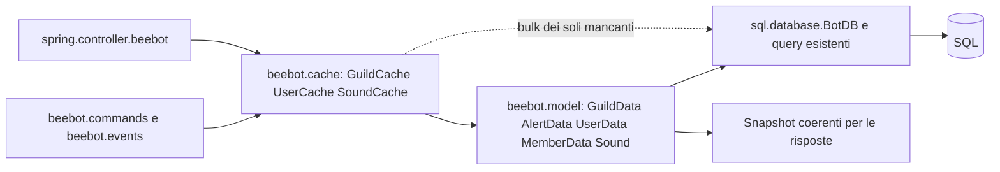

# Beebot: piano concordato di riordino e unificazione

Revisione del 15 novembre 2026, baseline applicativa `48c43d58`. Questo è il piano completo concordato in chat, aggiornato fino alla scelta di collocare l'autenticazione in `spring.auth`. Sostituisce le strutture e le destinazioni proposte nei passaggi precedenti. Le decisioni sono documentate; nessuno spostamento o cambiamento del codice operativo è stato applicato in questa fase.

Le citazioni dei sorgenti e l'inventario descrivono la baseline prima degli spostamenti. La sezione «Struttura finale concordata dei package» è il riferimento per le destinazioni e distingue file spostati dal proprietario, file nuovi dell'assistente e file da assorbire soltanto dopo. Ogni ulteriore decisione concordata va aggiornata qui e richiamata dalla skill, mantenendo una sola versione del piano.

## Perimetro attivo

L'obiettivo principale è che bot e API usino le stesse cache, gli stessi oggetti e le stesse operazioni persistenti. `GuildData`, `AlertData` e `Sound` mantengono il modello esistente: una modifica tramite l'oggetto salva sul DB e aggiorna la memoria dopo il successo.

| Decisione | Applicazione al piano |
|---|---|
| MongoDB resta com'è | Nessuna scomposizione del repository, ottimizzazione delle query o migrazione dei tipi `QueryRecord`/BSON |
| Struttura SQL conservata | Nessun refactoring generale di `AbstractDB`/`BotDB`; solo allineamento delle query nuove e assorbimento delle operazioni che oggi creano percorsi paralleli guild/sound |
| App e nomi storici conservati | Nessuna ridenominazione di `App.java`, `distruzione_demoniaca` o altre parti per motivi estetici |
| BotStatus e metriche rimandati | Nessuno spostamento dei relativi modelli o servizi |
| Comandi e component handler conservati | Cambio di package secondo l'albero finale, senza nuove gerarchie o riscritture; solo adeguamenti delle chiamate indispensabili al percorso comune |
| Chronos secondario | Il file segue il package finale conservando nome e comportamento; rimozione o sostituzione rimandata. Una future rappresenta un risultato e non sostituisce la pianificazione periodica |
| Priorità | Cache/oggetti e coerenza bot/API; errori e Spring/auth; trasporto HTTP e parsing comune con LoL |

Le esclusioni non impediscono di leggere un chiamante per capire un contratto. Impediscono di trasformare ogni dipendenza osservata in un ulteriore refactoring.

## Problemi confermati, con peso pratico

### 1. Le modifiche guild e sound hanno ancora percorsi paralleli

**Guild:** `GuildData.setPrefix`, `setExpSystem`, `setLeagueShard` e `setVoice` sono già sincronizzati e aggiornano la memoria dopo il risultato SQL. `AlertData.setMessage`, `setPrivateMessage`, `setAlertChannel` e `setEnabled` fanno già query prima di aggiornare il campo. La dashboard usa invece `GuildService` → `GuildSettingsDB`, poi invalida `GuildCache`. Un riferimento già ottenuto dal bot non viene aggiornato dall'invalidazione.

**Suoni:** `Sound.setName`, `setPublic`, `setTags`, `like` e `dislike` sono già operazioni persistenti, diverse delle quali sincronizzate. La dashboard usa anche mutazioni in `SoundCache.patch/vote/settings` e `SoundDB`. `BotDB.updateSoundMetadata` chiama a sua volta `SoundDB` e invalida `SoundCache`: la catena esiste già, non è soltanto un rischio futuro.

**User:** `UserData.setGreet/unsetGreet` salva e modifica il proprio stato, mentre l'API aggiorna il greet da `SoundCache.settings` e invalida `UserCache`.

**Proposta prioritaria:** le operazioni tornano agli oggetti esistenti e i due ingressi li ottengono dalla stessa cache. La cache carica e coordina l'identità; non interpreta il JSON HTTP. Eliminare i percorsi paralleli senza introdurre `GuildRepository`, `GuildMutationService`, `UserRepository` o `SoundService` sostitutivi.

Fonti: [GuildData](../../src/main/java/com/safjnest/model/guild/GuildData.java):136, [AlertData](../../src/main/java/com/safjnest/model/guild/alert/AlertData.java):120, [Sound](../../src/main/java/com/safjnest/model/sound/Sound.java):158, [UserData](../../src/main/java/com/safjnest/model/UserData.java):160, [SoundCache](../../src/main/java/com/safjnest/core/cache/managers/SoundCache.java):413 e :497, [BotDB](../../src/main/java/com/safjnest/sql/database/BotDB.java):215.

### 2. Il lock sul singolo oggetto non garantisce da solo coerenza

`GuildCache.getGuild` e `UserCache.getUser` separano controllo, caricamento e pubblicazione: due richieste possono costruire istanze diverse. Scadenza e rimozione possono creare lo stesso problema se un chiamante conserva un riferimento precedente. Anche una `ConcurrentHashMap` protegge le operazioni sulla mappa, non l'intera sequenza né lo stato dei valori.

Gli alert espongono altri punti concreti: `GuildData.getAlerts` assegna la mappa prima di completarne il caricamento e la restituisce modificabile; `deleteAlert` rimuove prima dell'esito SQL. `AlertData.setRoles` elimina e ricrea ruoli con chiamate separate. Il lock della guild e un eventuale `synchronized` sul figlio sono due lock diversi: lettori e scrittori devono partecipare allo stesso coordinamento.

**Decisione proposta:** mutazioni negli oggetti, ciclo di vita nella cache. Usare un'operazione delimitata della cache per ottenere e mantenere l'istanza corrente durante il lavoro; sincronizzare nello stesso proprietario le modifiche, le letture coerenti e i relativi snapshot. Il dettaglio del contratto è descritto sotto. Non dichiarare la garanzia finché tutti gli scrittori, inclusi gli handler esistenti, non usano il percorso concordato.

Fonti: [GuildCache](../../src/main/java/com/safjnest/core/cache/managers/GuildCache.java):40, [UserCache](../../src/main/java/com/safjnest/core/cache/managers/UserCache.java):27, [GuildData](../../src/main/java/com/safjnest/model/guild/GuildData.java):309 e :419, [AlertData](../../src/main/java/com/safjnest/model/guild/alert/AlertData.java):176.

### 3. La base delle cache è condivisa, ma Sound la aggira

`AbstractCache` contiene un backing statico e bookkeeping separato in mappe non concorrenti. `CacheAdapter` costruisce il namespace dal tipo della chiave. `SoundCache` eredita queste classi ma sostituisce gran parte delle operazioni con una Caffeine tipizzata propria.

**Proposta:** assorbire la base utile in un solo `CacheAdapter<K,V>`, con istanze distinte per tipo di oggetto, caricamento singolo/bulk e coordinamento comune. Eliminare `AbstractCache` quando tutti i consumatori sono migrati. Non costruire una sola mappa globale indicizzata soltanto per ID, né trasferire automaticamente a questa base le politiche di sicurezza delle sessioni.

### 4. Gli errori applicativi sono accoppiati a Spring

`AuthException` deriva da `ResponseStatusException` ed è usata anche da guild, sound e query sound. Le risposte vengono assemblate dal filtro e da più advice. `LolApiExceptionHandler` è globale anche se il nome suggerisce un perimetro LoL; `AuthRequestExceptionHandler` elenca controller specifici. Nel filtro il mapping attuale perde l'eventuale `retryAfter` che l'advice sa rappresentare.

**Proposta:** una sola eccezione applicativa riusabile, senza import Spring, e un mapping HTTP comune anche al filtro. Non occorre una classe `SoundNotFoundException`, una `GuildNotFoundException` e così via.

### 5. Trasporto e parsing hanno opportunità precise di riuso

**HTTP:** `PatchUtils.fetchPatches` e `LeagueHandler.loadRunes` usano già `HttpUtils.readUrl`. Il punto separato è `DiscordApi`: client, request builder, invio e form OAuth propri. Conviene estendere il proprietario esistente `HttpUtils` e far convergere Discord su di esso.

**Parsing:** `lol.utils.NumberUtils` è priva di dipendenze LoL. `BuildUtils.parseAnyInt` ripete sostanzialmente il suo parsing tollerante di un `Object`. Altre conversioni apparentemente simili hanno regole diverse: `ArenaGameParser.integer` verifica integrità/range, `ChampionStatsProvider.number` accetta soltanto `Number`, `LolApiParameters.page` segnala un parametro HTTP errato. Sostituirle indiscriminatamente con un fallback a zero cambierebbe il comportamento.

Fonti: [HttpUtils](../../src/main/java/com/safjnest/utils/HttpUtils.java), [DiscordApi](../../src/main/java/com/safjnest/auth/DiscordApi.java):35 e :67, [PatchUtils](../../src/main/java/com/safjnest/lol/utils/PatchUtils.java):85, [LeagueHandler](../../src/main/java/com/safjnest/lol/LeagueHandler.java):177, [NumberUtils](../../src/main/java/com/safjnest/lol/utils/NumberUtils.java), [BuildUtils](../../src/main/java/com/safjnest/lol/utils/BuildUtils.java):43, [ArenaGameParser](../../src/main/java/com/safjnest/lol/arena/ArenaGameParser.java):155.

## Percorso unico proposto



L'arco bulk indica soltanto il caricamento: le scritture restano nelle operazioni dei medesimi oggetti. Il controller adatta input/output HTTP e verifica il contesto autorizzato; non crea un'altra copia operativa né scrive prima nel DB per invalidare dopo.

### Responsabilità degli oggetti

| Proprietario | Cosa mantiene o assorbe |
|---|---|
| `GuildData` | Impostazioni della guild, proprietà dei figli e operazioni di modifica dei blocchi; crea/rimuove alert e canali senza esporre mappe come ingresso di scrittura |
| `AlertData`, `RewardData`, `TwitchData`, `ChannelData`, `BlacklistData` | Setter persistenti e aggiornamenti composti coerenti con la guild; nessuna conoscenza di `JsonNode`, servlet o status HTTP |
| `UserData` | Alias e greet globali/per guild, con aggiornamento dell'istanza corrente dopo il commit; associazioni LoL sul percorso esistente |
| `MemberData` | XP, livello e contatori del membro identificato da guild+user; operazioni composte come acquisizione XP, non soltanto setter isolati |
| `Sound` | Nome, pubblicazione, tag, voti e contatori attraverso il percorso persistente esistente, unificato con la dashboard |
| Cache tipizzate | Identità, caricamenti, bulk e durata delle operazioni; nessuna seconda implementazione delle mutazioni |

`MemberData` non è `UserData`: spostare XP globale dentro la cache user confonderebbe utenti uguali in guild diverse. Anche il controllo del cooldown, la lettura dell'XP, il calcolo del livello e il salvataggio devono essere una singola operazione coordinata sul membro; sincronizzare solo `setExpData` non protegge il calcolo precedente.

### Trasferimento delle operazioni, non soltanto dei file

I nomi nella colonna di destra sono interfacce proposte, da adattare allo stile dei metodi esistenti durante l'implementazione.

| Operazione attuale | Proprietario proposto |
|---|---|
| `GuildService.getGuild` | `GuildCache` ottiene l'istanza; `GuildData.snapshot` copia i setting; `GuildController` completa informazioni, canali e ruoli Discord |
| `GuildService.parseBlock/parseAlert` | Il controller decodifica JSON e presenza/tipo dei campi; `GuildData`/`AlertData` validano e applicano le regole dell'oggetto. Nessun `JsonNode` negli oggetti |
| `GuildService.updateBlock/updateAlert` | Metodi composti di `GuildData` e figli; query necessarie assorbite in `BotDB` con una connessione/transazione per blocco |
| Creazione/inserimento/rimozione alert via mappe | Metodi di `GuildData` che coordinano il figlio e pubblicano il cambiamento dopo il salvataggio |
| `GuildSettingsDB.saveAlert`, sostituzione ruoli | Operazione SQL comune in `BotDB`, riusata sia dai setter singoli sia da aggiornamenti composti; preservare la possibilità di salvare alert ancora non validi |
| `SoundCache.patch/vote/delete` | `Sound` possiede modifica e risultato; cache coordina l'istanza e invalida soltanto le selezioni derivate. Controlli di proprietà/visibilità sotto lock SQL conservati |
| `SoundCache.settings` | `UserData` applica i greet con le stesse operazioni del bot e restituisce risultati per elemento; nessuna invalidazione dell'oggetto corrente dopo una modifica propria |
| `SoundCache.greets` e `/me` | `UserCache` ottiene l'utente; `UserData` carica i greet necessari; i Sound sono risolti in bulk da `SoundCache` |
| `MemberData.canReceiveExperience` più calcolo e `setExpData` in chiamanti separati | Un'operazione composta del membro riusa `ExperienceSystem` e aggiorna cooldown, contatori, XP/livello nello stesso coordinamento |

Il caricamento dei greet richiede un indicatore esplicito di completezza: oggi `UserData.getGreets()` può rappresentare soltanto gli scope caricati finora. Non usarla come se contenesse tutta la tabella per la risposta `/me`. I caricamenti singoli e completi devono arricchire la stessa istanza, conservando fallback globale e override di guild.

### Contratto minimo di concorrenza

La proposta usa l'infrastruttura della cache già esistente, senza un nuovo lock service o repository:

1. **Caricamento unico per chiave.** Una richiesta singola e una bulk per lo stesso ID condividono lo stesso caricamento e la stessa istanza. Il risultato in corso può essere rappresentato internamente da una `CompletableFuture` nell'entry della cache.
2. **Operazione delimitata.** Un metodo della cache, per esempio `GuildCache.withGuild(id, operation)`, acquisisce l'entry e ne impedisce la sostituzione finché l'operazione termina. Lo stesso meccanismo serve a user e sound. Gli oggetti modificabili non devono essere conservati per una scrittura successiva fuori da questo intervallo; all'esterno si conservano ID o snapshot.
3. **Lock del proprietario.** Le operazioni di `GuildData` e dei figli di configurazione condividono il coordinamento della guild. `MemberData` può avere coordinamento per guild+user per evitare di serializzare tutto l'XP della guild; user e sound hanno le proprie identità. Nessun lock globale tenuto durante SQL, Discord o download.
4. **Letture consistenti.** Le risposte copiano lo stato sotto lo stesso coordinamento e serializzano lo snapshot dopo. Non si itera una mappa modificabile mentre un altro ingresso la cambia.
5. **Transazione prima della pubblicazione.** Un aggiornamento di più campi o una sostituzione ruoli usa una transazione SQL per il blocco, poi pubblica in memoria. I setter singoli conservano il loro salvataggio immediato. `synchronized` non trasforma una serie di query con commit separati in una transazione.
6. **Fallimenti e scadenza.** Un caricamento fallito non diventa un oggetto vuoto o un'assenza; le entry in corso vengono completate con errore e possono essere ritentate. Una entry occupata non viene eliminata e ricreata con un'altra istanza. Nessun lock/future/generation viene rimosso mentre protegge ancora un'operazione.
7. **Niente accessi laterali.** Bot e API devono entrambi passare qui, incluse le scritture dei figli. Gli handler mantengono struttura e presentazione, ma le chiamate dirette come `guild.getAlerts().put(...)` devono diventare operazioni del proprietario se si vuole la garanzia completa.

Le entry e gli eventuali contatori di utilizzo possono essere tipi privati annidati in `CacheAdapter`. Questa è una proposta di contratto da implementare e provare: l'attuale codice non lo garantisce. È coordinamento locale al processo; non dimostra coerenza tra due bot o scrittori esterni sullo stesso DB.

### Bulk: 10 presenti, 20 richiesti

Interfacce indicative: `GuildCache.getGuilds(ids)`, `UserCache.getUsers(ids)`, `SoundCache.getSounds(ids)`. Devono usare lo stesso nucleo dei caricamenti singoli, non implementare un secondo ciclo di vita.

`SoundCache.load` già riusa gli oggetti presenti e carica insieme i mancanti: è una base concreta da conservare. Il lavoro è rendere questo comportamento coerente e concorrente anche per guild e user, senza ricrearlo indipendentemente per ogni API.

1. Normalizzare e deduplicare gli ID, mantenendo l'ordine concordato della risposta.
2. Riutilizzare le 10 entry già presenti; per quelle in corso attendere il caricamento esistente.
3. Prenotare i soli 10 ID mancanti che questa richiesta deve caricare. Un'altra richiesta non avvia un secondo fetch sugli stessi ID.
4. Caricare questi ID con le query bulk necessarie, suddivise in gruppi se richiesto dai limiti. Nessun fetch dei 10 hit.
5. Idratare gli oggetti con i dati già ottenuti, pubblicarli nelle entry prenotate e comporre il risultato con i riferimenti mantenuti dall'operazione.

Il risultato completo HTTP attende soltanto i dati mancanti; gli hit sono già disponibili internamente. Non cambia il contratto dell'endpoint per introdurre risposte parziali non richieste.

**Attenzione ai costruttori:** `GuildData(QueryRecord)` carica canali e azioni per ogni guild; `UserData(String)` carica gli alias; `GuildData.getMemberData` può creare un membro assente. Servono factory/overload di idratazione da righe aggregate e percorsi di sola lettura distinti dalla creazione. Una query `IN` sulle guild seguita da N caricamenti dei figli non è il bulk richiesto. Per i profili LoL resta il caricamento lazy esistente: non si modificano query Mongo per estendere questo intervento.

Le viste autorizzate e i campi personali di Sound non vanno memorizzati sugli oggetti globali condivisi. I dati dell'utente che guarda la risposta restano su copie di risposta, come previsto dal contratto attuale.

## Errori: una classe applicativa e un adattatore HTTP

Nome concordato nel piano: `com.safjnest.exception.BeebotException`, invece di chiamarla semplicemente `Exception`, che confonderebbe il tipo Java standard.

Contenuto minimo: categoria, codice stabile, messaggio passato dal chiamante, causa originale ed eventuale `retryAfter`. La categoria può essere un enum annidato nello stesso file. Nessun `HttpStatus`, `ResponseEntity`, dipendenza da Spring o sottoclasse per ogni dominio.

| Esempio richiesto | Categoria condivisa | Dato specifico conservato |
|---|---|---|
| Elemento non trovato | `NOT_FOUND` | `sound_not_found`, `guild_not_found` o altro codice esistente; messaggio del chiamante |
| Chiave errata | `UNAUTHENTICATED` | `invalid_api_key`; distinto da un utente autenticato ma senza permessi |
| Body errato | `INVALID_REQUEST` | `invalid_request`, campo/messaggio sanitizzato dove previsto |
| Permesso insufficiente | `FORBIDDEN` | `guild_forbidden`, `sound_forbidden` |
| Dipendenza indisponibile | `UNAVAILABLE` | `auth_unavailable`, `discord_unavailable`, `sound_storage_unavailable` |
| Risposta upstream malformata | `INVALID_UPSTREAM_RESPONSE` | Mantiene la distinzione attuale fra 502 e 503 |
| Rate limit esterno | `RATE_LIMITED` | Codice, durata e mapping specifico già promesso al client |

Il codice specifico resta importante: il frontend deve distinguere chiave errata, sessione scaduta e Discord indisponibile anche se la classe Java è unica. I messaggi delle eccezioni impreviste non vengono copiati automaticamente al client.

In Spring, `ApiErrors` compone body/header/status e può scrivere anche la risposta del filtro; `ApiExceptionHandler` intercetta gli errori applicativi e di binding/framework. I record di risposta possono essere annidati in `ApiErrors`, mantenendo le forme Beebot e LoL esistenti, inclusi `metadata` e `Retry-After`. `LolApiResponses` continua a mappare `ApiResult` secondo ADR-0007: dati pronti, parziali o in preparazione non diventano eccezioni.

## HTTP e parsing: unificazione circoscritta

### HTTP

`utils.HttpUtils` resta il punto comune e assorbe costruzione della request, invio, encoding dei form dove utile e trattamento dell'interruzione. `DiscordApi` conserva URL, payload, autenticazione Discord e significato di 401/403/429 o risposta malformata; passa la richiesta al trasporto comune. La seam `Transport` già usata nei test può essere annidata nel proprietario HTTP comune.

Conservare i valori attuali: HttpUtils ha connessione 5 s/richiesta 10 s; Discord usa 15 s. Una factory comune può mantenere client configurati diversamente senza duplicare il codice del builder. Non serve imporre un solo timeout o lo stesso parser JSON. Il trasporto deve restituire anche status/header/body per la politica Discord; non trasformare ogni risposta non 2xx in un errore indistinto prima che venga interpretata.

### Parsing

Spostamento proposto: `lol.utils.NumberUtils` → `utils.ParseUtils`, perché contiene già sia numeri sia enum e non dipende da LoL. Esporre soltanto le varianti realmente necessarie, distinguendo rigoroso/fallback/null. Mantenere in `FilterCodec` il significato LoL di `*` e la codifica delle chiavi.

| Punto attuale | Intervento proposto | Compatibilità da verificare |
|---|---|---|
| `BuildUtils.parseAnyInt` | Delegare alla conversione comune e rimuovere il duplicato dopo gli aggiornamenti dei chiamanti | `Number`, stringhe con trim, null/errore → 0 |
| `NumberUtils` e chiamanti `Filter`, `BuildSignature`, `RuneSignature`, `Match`, `FilterCodec` | Aggiornare import e riusare il proprietario comune | Fallback, tipo di ritorno e significato delle chiavi immutati |
| `PatchUtils.patchPart` | Riusare la parte numerica solo preservando la politica sui segmenti | Oggi non fa trim: non cambiare silenziosamente gli input accettati |
| `LolApiParameters.page/profileSeason/parseEnum` | Riusare la conversione di base, mantenere vincoli e messaggi HTTP qui | Input invalido resta errore, non zero/null interpretati come dato valido |
| `ChampionStatsProvider.number`, `ProfileRecordAnalyzer.number` | Valutare una variante comune per soli `Number`, non la conversione che accetta anche stringhe | Stesso insieme di valori accettati |
| `ArenaGameParser.integer/time` | Conservare i controlli integrità/range/non negatività; estrarre solo se ci sono altri consumatori effettivi | Nessuna conversione frazionaria o fuori range tramite semplice `intValue` |
| `QueryRecord.getAsInt/getAsLong/getAsDouble` | Restano dove sono; i consumatori di righe riusano questi metodi | Nessun refactoring del framework SQL/BSON |

La ricerca non ha individuato un tipo canonico `QueryResult`: il pattern esistente è `List<QueryRecord>`. Per auth, `findClient` e `findSession` possono riusare il parser delle righe e factory dei modelli, mantenendo prepared statement, controllo delle righe modificate e transazioni. Non devono passare da fallback che nascondono un DB indisponibile come credenziale semplicemente assente.

## Struttura finale concordata dei package

Questa sezione riporta la struttura scelta in chat, con l'ultima correzione del proprietario: **autenticazione API in `com.safjnest.spring.auth`**. Sostituisce le precedenti proposte con `auth` alla radice, `beebot.auth` o `spring.security`; queste non sono più destinazioni del piano.

La radice resta `com.safjnest`. Il progetto distingue:

- `beebot`: comandi ed eventi Discord, audio/chat, oggetti operativi guild/user/sound e relative cache;
- `lol`: dominio, modelli, servizi, analisi, tracker, code e presentazione LoL esistenti; i comandi Discord LoL vanno invece in `beebot.commands.lol`;
- `spring`: ingressi HTTP, configurazione, autenticazione delle API e mapping degli errori;
- `cache`, `discord`, `exception`, `utils`: meccanismi comuni effettivamente riusati;
- `sql`, `nosql`, `redis`, `status` e i modelli esclusi: posizione conservata secondo il perimetro concordato.

La base generica `cache.CacheAdapter` è distinta dalle cache operative `beebot.cache.GuildCache/UserCache/SoundCache`. I controller Spring usano queste stesse cache operative; la collocazione in package separati non crea un altro percorso applicativo.

`[nuovo]` indica un file che creerà l'assistente. `...` indica i file e sottopackage esistenti conservati, oppure trasferiti insieme alla cartella quando indicato nella tabella. I percorsi dell'albero sono relativi a `src/main/java/`.

```text
com/safjnest/
├── App.java
├── beebot/
│   ├── core/
│   │   ├── Bot.java
│   │   └── Chronos.java
│   ├── commands/
│   │   └── ... tutti i comandi Discord, inclusi quelli LoL
│   ├── events/
│   │   └── ... handler, interfaces e types esistenti
│   ├── audio/
│   │   └── ... classi e sottopackage audio esistenti
│   ├── chat/
│   │   └── ... classi chat esistenti
│   ├── cache/
│   │   ├── GuildCache.java
│   │   ├── UserCache.java
│   │   └── SoundCache.java
│   ├── model/
│   │   ├── UserData.java
│   │   ├── guild/
│   │   │   ├── GuildData.java
│   │   │   ├── MemberData.java
│   │   │   ├── ChannelData.java
│   │   │   ├── BlacklistData.java
│   │   │   ├── AutomatedAction.java
│   │   │   └── alert/
│   │   │       ├── AlertData.java
│   │   │       ├── AlertKey.java
│   │   │       ├── AlertProblem.java
│   │   │       ├── AlertSendType.java
│   │   │       ├── AlertType.java
│   │   │       ├── RewardData.java
│   │   │       └── TwitchData.java
│   │   └── sound/
│   │       ├── Sound.java
│   │       └── Tag.java
│   └── sound/
│       ├── SoundAnalytics.java
│       └── SoundPeriod.java
├── lol/
│   ├── model/
│   ├── service/
│   ├── champion/
│   ├── arena/
│   ├── tracker/
│   ├── queue/
│   ├── message/
│   ├── utils/
│   └── LeagueHandler.java
├── spring/
│   ├── SpringServer.java
│   ├── auth/
│   │   ├── ApiKey.java
│   │   ├── AuthFilter.java
│   │   ├── DiscordAuthService.java
│   │   └── DiscordGuildCache.java
│   ├── config/
│   │   └── ApiConfig.java
│   ├── error/
│   │   ├── ApiErrors.java                    [nuovo]
│   │   └── ApiExceptionHandler.java          [nuovo]
│   └── controller/
│       ├── StatusController.java
│       ├── beebot/
│       │   ├── AuthController.java
│       │   ├── MeController.java             [nuovo]
│       │   ├── GuildController.java
│       │   └── SoundController.java
│       └── lol/
│           ├── AiTrainingController.java
│           ├── ChampionController.java
│           ├── LeaderboardController.java
│           ├── LolController.java
│           ├── ProfileIndexableController.java
│           ├── RecordsController.java
│           ├── SummonerSearchController.java
│           ├── LolApiParameters.java
│           └── LolApiResponses.java
├── cache/
│   ├── CacheAdapter.java
│   └── GenericCache.java
├── discord/
│   └── DiscordApi.java
├── exception/
│   └── BeebotException.java                  [nuovo]
├── utils/
│   ├── HttpUtils.java
│   ├── ParseUtils.java
│   ├── JsonCodec.java
│   ├── CryptoUtils.java
│   └── ... utility esistenti non ancora riclassificate
├── sql/
│   ├── AbstractDB.java
│   ├── DatabaseHandler.java
│   ├── QueryRecord.java
│   ├── QueryRecordParser.java
│   └── database/
│       ├── AuthDB.java
│       ├── BotDB.java
│       ├── SpotifyDB.java
│       └── WebsiteDB.java
├── nosql/
│   └── ... invariato
├── redis/
│   └── ... invariato
├── status/
│   └── ... invariato
└── model/
    └── ... configurazioni e altri modelli esclusi da questo riordino
```

`ExperienceSystem` e `AlertMessage` sono stati riconosciuti come utility specifiche del bot. In chat non è stata ancora fissata la loro sottocartella finale: restano nella posizione attuale finché non viene dettagliata quella riclassificazione, senza inventare qui una destinazione ulteriore. `core.audio.SoundAnalytics` e `sound.SoundAnalytics` sono classi differenti: la prima segue il trasferimento di `core/audio/`, la seconda quello del package sound; non vengono unite sulla sola base del nome.

### Spostamenti dei file esistenti a cura del proprietario

Il proprietario ha scelto di eseguire gli spostamenti e le rinomine dei file già presenti. L'assistente creerà il nuovo codice direttamente nelle destinazioni concordate e proseguirà con gli assorbimenti e le modifiche funzionali richieste. Nessuno spostamento è dichiarato eseguito da questo documento.

Le due colonne sono relative a `src/main/java/com/safjnest/`. Nei trasferimenti di cartelle si conserva la struttura interna, salvo le eccezioni esplicite.

| Sorgente attuale | Destinazione finale |
|---|---|
| `core/Bot.java` | `beebot/core/Bot.java` |
| `core/Chronos.java` | `beebot/core/Chronos.java` — solo package, nessuna sostituzione del timer |
| `commands/**` | `beebot/commands/**` — comprese le categorie LoL e owner |
| `core/events/**` | `beebot/events/**` — stessa organizzazione degli handler |
| `core/audio/**` | `beebot/audio/**` — stessi sottopackage |
| `core/chat/**` | `beebot/chat/**` |
| `model/UserData.java` | `beebot/model/UserData.java` |
| `model/guild/**`, escluso `GuildSettings.java` | `beebot/model/guild/**` — incluso il sottopackage `alert` |
| `model/sound/**` | `beebot/model/sound/**` |
| `core/cache/CacheAdapter.java` | `cache/CacheAdapter.java` |
| `core/cache/managers/GenericCache.java` | `cache/GenericCache.java` |
| `core/cache/managers/GuildCache.java` | `beebot/cache/GuildCache.java` |
| `core/cache/managers/UserCache.java` | `beebot/cache/UserCache.java` |
| `core/cache/managers/SoundCache.java` | `beebot/cache/SoundCache.java` |
| `sound/SoundAnalytics.java` | `beebot/sound/SoundAnalytics.java` |
| `sound/SoundPeriod.java` | `beebot/sound/SoundPeriod.java` |
| `auth/ApiKey.java` | `spring/auth/ApiKey.java` |
| `auth/DiscordAuthService.java` | `spring/auth/DiscordAuthService.java` |
| `guild/DiscordGuildCache.java` | `spring/auth/DiscordGuildCache.java` |
| `spring/config/AuthFilter.java` | `spring/auth/AuthFilter.java` |
| `auth/DiscordApi.java` | `discord/DiscordApi.java` |
| `lol/utils/NumberUtils.java` | `utils/ParseUtils.java` — rinomina anche della classe |
| `spring/config/LolApiConfig.java` | `spring/config/ApiConfig.java` — rinomina anche della classe |
| `spring/controller/beebot/DiscordAuthController.java` | `spring/controller/beebot/AuthController.java` — rinomina anche della classe |

`App.java`, i restanti file LoL, i controller non elencati, SQL, MongoDB, Redis, status e gli altri modelli restano nelle loro posizioni. I metodi storici, compreso `distruzione_demoniaca`, conservano il nome. Il cambio del package degli handler e dei comandi non autorizza una nuova gerarchia, un restyle o una riscrittura del loro comportamento.

Eseguire i movimenti con il refactoring dell'IDE per aggiornare dichiarazioni `package`, nomi di classe e riferimenti, inclusi quelli dei test. Le registrazioni testuali e la scansione Spring devono essere riesaminate durante l'integrazione; un cambio di package non è dimostrato corretto dai soli import compilabili. Non è richiesto un riordino autonomo della struttura dei test in questa fase.

### File nuovi a cura dell'assistente

| File da creare | Responsabilità |
|---|---|
| `exception/BeebotException.java` | Eccezione applicativa comune senza Spring, con categoria annidata, codice, messaggio, causa ed eventuale retry |
| `spring/error/ApiErrors.java` | Mapping e record HTTP annidati, riusati dal filtro, dall'advice e da `LolApiResponses` |
| `spring/error/ApiExceptionHandler.java` | Gestione unificata degli errori applicativi, di binding e del framework |
| `spring/controller/beebot/MeController.java` | Profilo e impostazioni utente; delega al percorso comune degli oggetti |

L'albero non richiede una nuova classe per ogni errore o un nuovo service/repository per ogni cache. I tipi di sola rappresentazione restano nei proprietari appropriati, annidati quando semplice e utile.

### File da mantenere temporaneamente e assorbire dopo

Questi file non vanno cancellati durante i soli spostamenti. L'assistente li rimuoverà soltanto dopo aver trasferito le funzionalità necessarie e aggiornato chiamanti, registrazioni, contratti e test.

| File attuale da mantenere temporaneamente | Assorbimento previsto |
|---|---|
| `auth/AuthException.java` | Sostituito dall'errore comune `exception.BeebotException`, con mapping HTTP in `spring.error` |
| `guild/DiscordGuildService.java` | Operazioni di lista autorizzata, decrittazione e controllo amministrativo in `spring.auth.DiscordAuthService`, con la stessa cache autorizzativa |
| `guild/GuildService.java` | Mutazioni e regole in `beebot.model.guild.GuildData`/figli; adattamento input/output nel controller. Nessun trasferimento indiscriminato di tutta la classe in un unico altro file |
| `sql/database/GuildSettingsDB.java` | Query necessarie in `BotDB`, mantenendo transazioni per blocco, ruoli vuoti, campi omessi, null e creazione di alert ancora non validi |
| `model/guild/GuildSettings.java` | Record di vista/risultato annidati nel proprietario `beebot.model.guild.GuildData`, con forma HTTP e validità attuali |
| `core/cache/AbstractCache.java` | Base utile in `cache.CacheAdapter`; rimozione del backing statico e del bookkeeping superfluo, mantenendo le capacità effettivamente usate |
| `sound/SoundAccess.java` | Lookup/proiezione Discord in `discord.DiscordApi`, con politiche distinte per membership ordinaria e amministrazione |
| `sql/database/SoundDB.java` | Query nuove necessarie in `BotDB`, preservando statement preparati, lock SQL, streaming/batch e sessione di lettura; eliminazione della catena `BotDB → SoundDB` |
| `sound/SoundQueryCache.java` | Dettaglio di selezione Redis di soli ID dentro `beebot.cache.SoundCache` |
| `sound/SoundValues.java` | Errori all'eccezione comune, validazione al confine/proprietario e rappresentazioni nei tipi appropriati; nessun nuovo generico `MapUtils` |
| `spring/exception/AuthExceptionHandler.java` | Gestione applicativa in `spring.error.ApiExceptionHandler`; record di errore in `ApiErrors` |
| `spring/exception/AuthRequestExceptionHandler.java` | Binding e body errati nel medesimo handler HTTP |
| `spring/exception/LolApiExceptionHandler.java` | Gestione HTTP LoL/framework nel medesimo handler, mantenendo il contratto esistente |
| `spring/dto/LolApiError.java` | Record annidato in `spring.error.ApiErrors`, conservando `status`, `code`, `message` e `metadata` |

### Modifiche ai file conservati

| Proprietario nella struttura finale | Modifica prevista |
|---|---|
| `beebot.model.guild.GuildData` e figli | Setter persistenti preservati; operazioni composte, proprietà delle mappe e snapshot coerenti |
| `beebot.model.UserData` | Greet/alias sullo stesso percorso di bot e API; completezza esplicita dei caricamenti e supporto all'idratazione bulk |
| `beebot.model.guild.MemberData` | Operazione XP coordinata per guild+user, comprendente cooldown, calcolo e salvataggio |
| `beebot.model.sound.Sound` | Assorbire mutazioni API oggi in `SoundCache`, mantenendo controlli atomici di visibilità/proprietà e setter dei comandi |
| `beebot.cache.GuildCache/UserCache/SoundCache` | Loader e policy tipizzate sulla base comune; richieste singole/bulk coordinate, senza nuovi service/repository intermedi |
| `cache.CacheAdapter` | Backing per istanza, identità, durata delle operazioni e caricamenti coordinati; `GenericCache` riusa la medesima base |
| `utils.HttpUtils` | Builder/invio comuni anche a Discord, trasporto testabile e timeout compatibili |
| `discord.DiscordApi` | URL, payload e politica Discord; trasporto sul helper HTTP comune. L'URL OAuth è un dato semplice che il servizio auth avvolge nel proprio risultato |
| `spring.auth.DiscordAuthService` | Un unico flusso credenziali/sessioni; assorbire la lista amministrativa senza confonderla con la membership sound |
| `spring.auth.DiscordGuildCache` | Preservare identità utente/applicazione/sessione, revoca, Redis/fallback, lease e fencing |
| `spring.auth.AuthFilter` | Controllo credenziali/contesto e uso del mapper errori comune; nessun package `spring.security` separato |
| `spring.config.ApiConfig` | Configurazione HTTP comune e personalizzazioni LoL; la scansione continua a includere controller/auth/error HTTP |
| `spring.controller.beebot.AuthController` | Solo authorize, session e logout |
| `spring.controller.beebot.MeController` | `/me` e `/me/settings`, usando gli oggetti ottenuti dalla cache comune |
| `spring.controller.beebot.GuildController` | Aggiungere `/guilds` e l'alias `/servers`, oggi nel controller auth; impostazioni sui medesimi oggetti del bot |
| `spring.controller.beebot.SoundController` | Endpoint sound sul percorso comune; `/me/settings` passa al controller Me |
| `spring.controller.lol.LolApiParameters/LolApiResponses` | Riuso dei meccanismi comuni senza perdere vincoli HTTP, stati `ApiResult`, metadati o regole LoL |
| `sql.database.AuthDB` | Allineare le letture nuove al parser/record esistente, mantenendo query parametrizzate, revoca autorevole e transazioni |

Dopo gli assorbimenti spariranno i vecchi package `guild`, `auth` alla radice, `sound` alla radice, `core.cache.managers`, `spring.dto` e `spring.exception`, quando effettivamente vuoti. Le impostazioni operative saranno in `beebot.model.guild`, le cache operative in `beebot.cache` e l'autenticazione delle API in `spring.auth`.

### Confine Spring e sincronizzazione delle regole

Il proprietario ha scelto esplicitamente `spring.auth`. Questa scelta pianifica un ampliamento del vincolo attuale che limita Spring a controller, configurazione ed errori HTTP: Spring possiederà anche l'autenticazione delle API. Durante il riordino vanno sincronizzati `AGENTS.md`, handbook e documentazione architetturale pertinente, rendendo esplicito questo perimetro. Questo documento non modifica silenziosamente un ADR accettato e non sposta modelli di successo LoL in Spring.

L'autenticazione non viene duplicata per i controller LoL o per le credenziali personali: vengono preservati i flussi e gli ambiti esistenti. `DiscordApi` resta fuori da Spring perché serve anche ai suoni; `BeebotException` resta fuori perché è applicativa; `AuthDB` resta nella struttura SQL.

### Suoni e futuro R2

I metadati e le modifiche restano in `beebot.model.sound.Sound` e la cache locale ne coordina l'istanza. In futuro `beebot.audio.SoundFiles` sarà l'unico proprietario del recupero R2 e della copia temporanea sulla VPS, riusato da player, download e greet. Non una catena `SoundRepository → CachedSoundRepository → R2Repository`.

Download concorrenti, file incompleti, durata della copia locale e cleanup durante la riproduzione andranno verificati quando si implementa R2. La conservazione per alcune ore e la pulizia periodica rimangono requisiti del futuro lavoro; non sono implementate da questo piano. `SoundFiles` non va creato durante i soli spostamenti dei file attuali.


## Sequenza di implementazione proposta

Prima degli interventi funzionali, il proprietario esegue i movimenti dei file esistenti elencati nel piano. L'assistente riprende dal working tree risultante, conserva quel lavoro e crea i file nuovi nei package finali. Dopo i movimenti vanno ricontrollati stato Git e CodeGraph, sincronizzando un indice stale e rileggendo i simboli e l'impatto prima delle modifiche pertinenti. Gli assorbimenti non si anticipano cancellando i file ancora usati.

| Passaggio | Risultato concreto | Verifiche necessarie |
|---|---|---|
| 1 — Cache e identità | Una base locale; singolo/bulk concorrenti; snapshot e operazioni delimitate | 10 hit+10 miss; richiesta singola sovrapposta; scadenza durante mutazione; errore loader; stessa istanza durante l'operazione |
| 2 — Guild e alert | API sugli oggetti della cache; eliminazione `GuildService`/`GuildSettingsDB` dopo la migrazione delle funzionalità | Bot→API e API→bot immediati; ruoli vuoti; rollback per blocco; letture durante modifiche; Twitch dopo il commit e fuori dal lock |
| 3 — User e sound | Greet e mutazioni sullo stesso percorso dei comandi; eliminazione dei passaggi paralleli | XP concorrente per guild+user; metadata/voti e privacy sound; cache query invalidata dopo commit senza sostituire oggetti ancora in uso |
| 4 — Errori e Spring/auth | Eccezione comune, mapper unico e raggruppamento dei controller | Contratti Beebot/LoL, filtro e advice, token scaduti, retry, body errato e rotta non trovata |
| 5 — HTTP e parsing | Helper già esistenti estesi e riusati; niente cambi a Mongo o al framework SQL | Timeout/status/header Discord e Data Dragon; input numerici limite e fallback; filtri e chiavi invariati |
| 6 — Allineamento query auth/API | Record/parser per le letture nuove e rimozione dei doppioni residui | Query parametrizzate, righe modificate, consumo OAuth una sola volta, revoca autorevole anche con cache piena |

È utile realizzare presto la piccola parte condivisa degli errori se serve ai passaggi precedenti; la sequenza non impone di far transitare tutto il riordino da una grande riscrittura preventiva.

Le eliminazioni avvengono soltanto quando chiamanti, registrazioni e test sono migrati. Il progetto deve compilare tra gruppi coerenti; in fase di implementazione si rileggerà l'impatto CodeGraph e la documentazione API per ogni gruppo. Le API guild hanno transazioni indipendenti per blocco/elemento, non una nuova transazione unica dell'intero body.

## Stato delle verifiche

L'indice era aggiornato a 587 file prima di questa revisione; l'inventario iniziale dei sorgenti applicativi resta 448 Java `com.safjnest`, più 10 Java incorporati e 101 file di test. [Il registro](review/inventory.tsv) distingue lettura completa, parziale e soli metadati. Non è un audit esaustivo di ogni metodo.

Sono stati riletti e approfonditi i percorsi citati, inclusi setter, costruttori, cache user, XP membro, query auth, request Discord e parser LoL. Le esclusioni sono applicate al piano corrente: i rilievi precedenti su scomposizione Mongo, ricollocazione dei record SQL, BotStatus, nomi storici e grandi refactoring degli handler non sono attività pendenti.

Questa fase cambia soltanto documentazione e istruzioni della skill. Nessuna migrazione, build/test applicativo, prova di concorrenza, benchmark o integrazione live è stata eseguita; la proposta richiede quelle verifiche durante l'implementazione. Le API, la presentazione e le decisioni architetturali accettate non sono state modificate.
